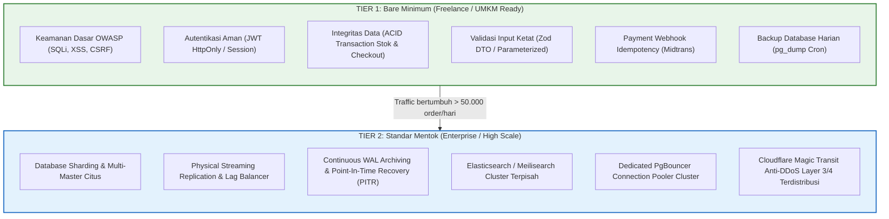

# Panduan Standar E-Commerce: Bare Minimum (Freelance Ready) vs Standar Mentok (Enterprise)

Dokumen ini membedah seluruh standar arsitektur database, keamanan sistem, performa, infrastruktur, dan arsitektur terdistribusi pada project **Nexa Streetwear**.

Setiap baris standar di bawah ini dilengkapi dengan:
- **Tautan Dokumen Teknis:** Rujukan panduan mendalam di folder `docs/`.
- **Tautan Implementasi Nyata:** File kode sumber (`file:///...`) di codebase yang dapat Anda klik dan verifikasi langsung satu per satu.

---

## 1. Filosofi & Perbandingan Tingkatan (Tiering)

---

## 2. Klasifikasi Standar Database (20 Topik)

Indeks dokumentasi database: [`docs/database/README.md`](./database/README.md)

| No | Topik & Dokumen Teknis | Kategori | Alasan & Dampak Bisnis | Tautan Implementasi di Codebase |
|:---|:---|:---:|:---|:---|
| 01 | [**Missing Migration**](./database/01-missing-database-migration.md) | **BARE MINIMUM** | Wajib. Mencegah skema database berantakan saat deploy update baru. | [prisma/migrations](file:///home/allrole/Documents/Learning/Streetwear%20|%20E-commerce%20Project/backend/prisma/migrations) & [package.json#L13](file:///home/allrole/Documents/Learning/Streetwear%20|%20E-commerce%20Project/backend/package.json#L13) |
| 02 | [**Data Seeder**](./database/02-data-seeder.md) | **BARE MINIMUM** | Wajib handover klien agar toko langsung terisi kategori & produk contoh. | [seed/index.ts](file:///home/allrole/Documents/Learning/Streetwear%20|%20E-commerce%20Project/backend/src/seed/index.ts) & [categorySeeder.ts](file:///home/allrole/Documents/Learning/Streetwear%20|%20E-commerce%20Project/backend/src/seed/categorySeeder.ts) |
| 03 | [**Query Builder / ORM**](./database/03-query-builder-vs-orm.md) | **BARE MINIMUM** | Wajib. Menjamin type-safety dan mencegah runtime query syntax error. | [config/prisma.ts](file:///home/allrole/Documents/Learning/Streetwear%20|%20E-commerce%20Project/backend/src/config/prisma.ts) |
| 04 | [**Unsanitized Queries**](./database/04-unsanitized-raw-queries.md) | **BARE MINIMUM** | Wajib 100%. Mencegah celah SQL Injection pembobol database. | [product.model.ts](file:///home/allrole/Documents/Learning/Streetwear%20|%20E-commerce%20Project/backend/src/modules/product/product.model.ts) |
| 05 | [**N+1 Query Problem**](./database/05-n-plus-one-query-problem.md) | **BARE MINIMUM** | Wajib. Menghilangkan query looping berulang pada katalog produk. | [product.model.ts](file:///home/allrole/Documents/Learning/Streetwear%20|%20E-commerce%20Project/backend/src/modules/product/product.model.ts) |
| 06 | [**Missing Database Index**](./database/06-missing-database-index.md) | **BARE MINIMUM** | Wajib. Index B-Tree pada slug, FK, dan status agar query tidak scan full disk. | [prisma/schema.prisma](file:///home/allrole/Documents/Learning/Streetwear%20|%20E-commerce%20Project/backend/prisma/schema.prisma) |
| 07 | [**Index Fragmentation**](./database/07-database-index-fragmentation.md) | **STANDAR MENTOK** | Maintenance indeks online saat jutaan row data termutasi berkala. | [scripts/reindex.ts](file:///home/allrole/Documents/Learning/Streetwear%20|%20E-commerce%20Project/backend/scripts/reindex.ts) |
| 08 | [**Leaked DB Connection**](./database/08-leaked-database-connection.md) | **BARE MINIMUM** | Wajib. Mencegah koneksi bocor yang membuat server mati mendadak. | [config/prisma.ts#L33-L43](file:///home/allrole/Documents/Learning/Streetwear%20|%20E-commerce%20Project/backend/src/config/prisma.ts#L33-L43) & [server.ts#L23](file:///home/allrole/Documents/Learning/Streetwear%20|%20E-commerce%20Project/backend/src/server.ts#L23) |
| 09 | [**PgBouncer & Pool Exhaustion**](./database/09-database-connection-pool-exhaustion.md) | **STANDAR MENTOK** | Pooling koneksi transaksi skala tinggi saat concurrent connection > 200. | [docker-compose.yml#L24-L50](file:///home/allrole/Documents/Learning/Streetwear%20|%20E-commerce%20Project/docker-compose.yml#L24-L50) |
| 10 | [**Deadlock & Race Condition**](./database/10-deadlock-and-race-condition.md) | **BARE MINIMUM** | Wajib. Stok tidak boleh minus saat 2 pembeli checkout barang terakhir. | [order.model.ts#L56-L68](file:///home/allrole/Documents/Learning/Streetwear%20|%20E-commerce%20Project/backend/src/modules/order/order.model.ts#L56-L68) |
| 11 | [**Deadlock Storm & Jitter**](./database/11-database-deadlock-storm.md) | **STANDAR MENTOK** | Peredam thundering herd retry storm saat flash sale masif. | [order.service.ts#L38](file:///home/allrole/Documents/Learning/Streetwear%20|%20E-commerce%20Project/backend/src/modules/order/order.service.ts#L38) |
| 12 | [**ACID Compliance**](./database/12-database-acid-compliance.md) | **BARE MINIMUM** | Wajib. Pemotongan stok dan invoice wajib dalam 1 transaksi atomik. | [order.service.ts#L42-L117](file:///home/allrole/Documents/Learning/Streetwear%20|%20E-commerce%20Project/backend/src/modules/order/order.service.ts#L42-L117) |
| 13 | [**Soft Delete vs Hard Delete**](./database/13-soft-delete-vs-hard-delete.md) | **BARE MINIMUM** | Wajib. Menghapus produk/kategori tidak boleh menghapus histori keuangan. | [prisma/schema.prisma](file:///home/allrole/Documents/Learning/Streetwear%20|%20E-commerce%20Project/backend/prisma/schema.prisma) (`deletedAt`) |
| 14 | [**Pagination Optimization**](./database/14-pagination-optimization.md) | **BARE MINIMUM** | Wajib. Katalog memakai pagination (Keyset Cursor & Offset) hemat RAM. | [product.controller.ts#L40-L60](file:///home/allrole/Documents/Learning/Streetwear%20|%20E-commerce%20Project/backend/src/modules/product/product.controller.ts#L40-L60) |
| 15 | [**Database Replication & Lag**](./database/15-database-replication-and-lag.md) | **STANDAR MENTOK** | Read/Write splitting memisahkan query baca ke database replica. | [config/prisma.ts#L19-L28](file:///home/allrole/Documents/Learning/Streetwear%20|%20E-commerce%20Project/backend/src/config/prisma.ts#L19-L28) |
| 16 | [**Database Sharding**](./database/16-database-sharding.md) | **STANDAR MENTOK** | Pemecahan partisi data multi-server saat order mencapai jutaan baris. | [prisma/schema.prisma](file:///home/allrole/Documents/Learning/Streetwear%20|%20E-commerce%20Project/backend/prisma/schema.prisma) |
| 17 | [**Full-Text Search Engine**](./database/17-full-text-search-engine.md) | **BARE MINIMUM:** GIN **MENTOK:** Elasticsearch | Pencarian produk typo-tolerant via PostgreSQL Trigram (`pg_trgm`). | [product.model.ts](file:///home/allrole/Documents/Learning/Streetwear%20|%20E-commerce%20Project/backend/src/modules/product/product.model.ts) (`searchProductsFuzzy`) |
| 18 | [**Database Constraints**](./database/18-database-constraints.md) | **BARE MINIMUM** | Wajib. Benteng terakhir level kernel DB (`CHECK (stock >= 0)`). | [prisma/schema.prisma](file:///home/allrole/Documents/Learning/Streetwear%20|%20E-commerce%20Project/backend/prisma/schema.prisma) |
| 19 | [**Database Backup & PITR**](./database/19-database-backup-and-pitr.md) | **BARE MINIMUM:** pg_dump **MENTOK:** WAL PITR | Backup database harian otomatis menjaga data toko tidak hilang saat VPS rusak. | [scripts/backup.ts](file:///home/allrole/Documents/Learning/Streetwear%20|%20E-commerce%20Project/backend/scripts/backup.ts) |
| 20 | [**Access Logging & Telemetry**](./security/11-log-aggregation-and-monitoring.md) | **BARE MINIMUM** | Merekam telemetri HTTP asinkron tanpa membebani database transaksional. | [middleware/accessLogMiddleware.ts](file:///home/allrole/Documents/Learning/Streetwear%20|%20E-commerce%20Project/backend/src/middleware/accessLogMiddleware.ts) & [scripts/logManager.ts](file:///home/allrole/Documents/Learning/Streetwear%20|%20E-commerce%20Project/backend/scripts/logManager.ts) |

---

## 3. Klasifikasi Standar Keamanan & Autentikasi (17 Topik)

Indeks dokumentasi keamanan: [`docs/security/README.md`](./security/README.md)

| No | Topik & Dokumen Teknis | Kategori | Alasan & Dampak Bisnis | Tautan Implementasi di Codebase |
|:---|:---|:---:|:---|:---|
| 01 | [**SQL Injection (SQLi)**](./security/01-sql-injection.md) | **BARE MINIMUM** | Wajib 100%. Parameterized query wajib digunakan di semua rute query. | [product.model.ts](file:///home/allrole/Documents/Learning/Streetwear%20|%20E-commerce%20Project/backend/src/modules/product/product.model.ts) |
| 02 | [**Env & Secrets Management**](./security/02-environment-variables-and-secrets.md) | **BARE MINIMUM** | Wajib. Password DB dan API Key divalidasi fail-fast dan disensor. | [config/env.ts](file:///home/allrole/Documents/Learning/Streetwear%20|%20E-commerce%20Project/backend/src/config/env.ts) |
| 03 | [**JWT Authentication**](./security/03-jwt-authentication-lifecycle.md) | **BARE MINIMUM** | Wajib. Dual-token JWT dengan Refresh Token di Cookie HttpOnly Strict. | [utils/token.ts](file:///home/allrole/Documents/Learning/Streetwear%20|%20E-commerce%20Project/backend/src/utils/token.ts) & [auth.controller.ts](file:///home/allrole/Documents/Learning/Streetwear%20|%20E-commerce%20Project/backend/src/modules/auth/auth.controller.ts) |
| 04 | [**CORS Policy**](./security/04-cors-policy-and-origin-defense.md) | **BARE MINIMUM** | Wajib. Mencegah web asing mengakses cookie dan API sensitif toko. | [app.ts#L48-L54](file:///home/allrole/Documents/Learning/Streetwear%20|%20E-commerce%20Project/backend/src/app.ts#L48-L54) |
| 05 | [**SSL/TLS & Transport**](./security/05-ssl-tls-and-transport-security.md) | **BARE MINIMUM** | Wajib. Transaksi e-commerce berjalan di atas HTTPS TLS 1.3 & HSTS. | [nginx/nginx.conf#L18-L35](file:///home/allrole/Documents/Learning/Streetwear%20|%20E-commerce%20Project/nginx/nginx.conf#L18-L35) |
| 06 | [**Rate Limiting**](./security/06-rate-limiting-and-throttling.md) | **BARE MINIMUM** | Wajib. Mencegah brute-force password login dan spam order via Redis counter. | [middleware/securityMiddleware.ts](file:///home/allrole/Documents/Learning/Streetwear%20|%20E-commerce%20Project/backend/src/middleware/securityMiddleware.ts) |
| 07 | [**RBAC & Ownership Check**](./security/07-role-based-access-control.md) | **BARE MINIMUM** | Wajib mutlak. Customer dilarang mengakses order pembeli lain (Anti-BOLA/IDOR). | [middleware/adminMiddleware.ts](file:///home/allrole/Documents/Learning/Streetwear%20|%20E-commerce%20Project/backend/src/middleware/adminMiddleware.ts) & [order.service.ts#L138-L145](file:///home/allrole/Documents/Learning/Streetwear%20|%20E-commerce%20Project/backend/src/modules/order/order.service.ts#L138-L145) |
| 08 | [**XSS Prevention**](./security/08-xss-prevention-and-content-security.md) | **BARE MINIMUM** | Wajib. React JSX automatic escaping dan Helmet security headers. | [app.ts#L44-L45](file:///home/allrole/Documents/Learning/Streetwear%20|%20E-commerce%20Project/backend/src/app.ts#L44-L45) |
| 09 | [**CSRF Protection**](./security/09-csrf-protection-and-cookie-defense.md) | **BARE MINIMUM** | Wajib. Cookie SameSite=Strict dan Double-Submit cookie pattern. | [middleware/csrfMiddleware.ts](file:///home/allrole/Documents/Learning/Streetwear%20|%20E-commerce%20Project/backend/src/middleware/csrfMiddleware.ts) |
| 10 | [**DDoS & Slowloris Defense**](./security/10-ddos-mitigation-and-management.md) | **BARE MINIMUM** | Soket timeout TCP memutus koneksi bot penyerang lambat. | [server.ts#L12-L17](file:///home/allrole/Documents/Learning/Streetwear%20|%20E-commerce%20Project/backend/src/server.ts#L12-L17) |
| 11 | [**Log Aggregation & Monitoring**](./security/11-log-aggregation-and-monitoring.md) | **BARE MINIMUM** | Audit log mutasi tersensor otomatis ([REDACTED]) & rotasi kompresi Gzip. | [middleware/auditLogMiddleware.ts](file:///home/allrole/Documents/Learning/Streetwear%20|%20E-commerce%20Project/backend/src/middleware/auditLogMiddleware.ts) & [scripts/logManager.ts](file:///home/allrole/Documents/Learning/Streetwear%20|%20E-commerce%20Project/backend/scripts/logManager.ts) |
| 12 | [**OAuth 2.0 (Google Login)**](./security/12-oauth2-and-social-login.md) | **NILAI TAMBAH (HIGH VALUE)** | Memudahkan pembeli mendaftar dengan 1 klik akun Google terverifikasi. | [modules/auth/auth.service.ts](file:///home/allrole/Documents/Learning/Streetwear%20|%20E-commerce%20Project/backend/src/modules/auth/auth.service.ts) |
| 13 | [**Multi-Factor Auth (MFA/2FA)**](./security/13-mfa-and-two-factor-authentication.md) | **STANDAR MENTOK** | Proteksi akun admin via TOTP 6-digit Google Authenticator & Email OTP. | [modules/auth/advancedAuth.routes.ts](file:///home/allrole/Documents/Learning/Streetwear%20|%20E-commerce%20Project/backend/src/modules/auth/advancedAuth.routes.ts) |
| 14 | [**Health Checks & Availability**](./security/14-health-checks-and-system-probing.md) | **BARE MINIMUM** | Deep probe database & Redis real-time untuk isolasi otomatis Load Balancer. | [modules/health/health.routes.ts](file:///home/allrole/Documents/Learning/Streetwear%20|%20E-commerce%20Project/backend/src/modules/health/health.routes.ts) |
| 15 | [**Secure File Upload**](./architecture/08-payload-management.md) | **BARE MINIMUM** | Validasi MIME biner asli dan pembatasan ekstensi WebP/JPEG aman. | [middleware/uploadProductImageMiddleware.ts](file:///home/allrole/Documents/Learning/Streetwear%20|%20E-commerce%20Project/backend/src/middleware/uploadProductImageMiddleware.ts) |
| 16 | [**Mass Assignment (Zod DTO)**](./performance/11-unchecked-type-assertions.md) | **BARE MINIMUM** | Memblokir injeksi field terlarang (seperti role: admin) di request body. | [modules/order/order.validation.ts](file:///home/allrole/Documents/Learning/Streetwear%20|%20E-commerce%20Project/backend/src/modules/order/order.validation.ts) & [cart.validation.ts](file:///home/allrole/Documents/Learning/Streetwear%20|%20E-commerce%20Project/backend/src/modules/cart/cart.validation.ts) |
| 17 | [**Payment Signature & Idempotency**](./architecture/05-idempotency.md) | **BARE MINIMUM** | Verifikasi hash HMAC SHA512 Midtrans mencegah manipulasi status bayar. | [modules/payment/payment.service.ts](file:///home/allrole/Documents/Learning/Streetwear%20|%20E-commerce%20Project/backend/src/modules/payment/payment.service.ts) |

---

## 4. Klasifikasi Standar Performa & Kecepatan (11 Topik)

Indeks dokumentasi performa: [`docs/performance/README.md`](./performance/README.md)

| No | Topik & Dokumen Teknis | Kategori | Alasan & Dampak Bisnis | Tautan Implementasi di Codebase |
|:---|:---|:---:|:---|:---|
| 01 | [**Caching Strategy (Redis)**](./performance/01-caching-strategy-and-invalidation.md) | **BARE MINIMUM** | Caching katalog produk & kategori di RAM (respons <1ms tanpa beban DB). | [middleware/cacheMiddleware.ts#L19-L65](file:///home/allrole/Documents/Learning/Streetwear%20|%20E-commerce%20Project/backend/src/middleware/cacheMiddleware.ts#L19-L65) & [product.routes.ts#L39-L49](file:///home/allrole/Documents/Learning/Streetwear%20|%20E-commerce%20Project/backend/src/modules/product/product.routes.ts#L39-L49) |
| 02 | [**Stale Cache & Invalidation**](./performance/02-stale-cache-and-invalidation.md) | **BARE MINIMUM** | Mencegah phantom pricing & ghost stock via auto write-invalidation non-blocking SCAN. | [middleware/cacheMiddleware.ts#L120-L162](file:///home/allrole/Documents/Learning/Streetwear%20|%20E-commerce%20Project/backend/src/middleware/cacheMiddleware.ts#L120-L162) & [order.service.ts#L118-L123](file:///home/allrole/Documents/Learning/Streetwear%20|%20E-commerce%20Project/backend/src/modules/order/order.service.ts#L118-L123) |
| 03 | [**Memory Leak Prevention**](./performance/03-memory-leak-detection-and-prevention.md) | **BARE MINIMUM** | Menghindari OOM crash via Prisma singleton, stream cleanup, dan unref timer. | [config/prisma.ts#L33-L43](file:///home/allrole/Documents/Learning/Streetwear%20|%20E-commerce%20Project/backend/src/config/prisma.ts#L33-L43) & [server.ts#L18-L44](file:///home/allrole/Documents/Learning/Streetwear%20|%20E-commerce%20Project/backend/src/server.ts#L18-L44) |
| 04 | [**Out Of Memory (OOM)**](./performance/04-out-of-memory-oom-killer.md) | **BARE MINIMUM** | Melindungi server dari DoS payload raksasa dan mengunci batas V8 heap 1024MB. | [app.ts#L144](file:///home/allrole/Documents/Learning/Streetwear%20|%20E-commerce%20Project/backend/src/app.ts#L144) & [package.json#L7-L8](file:///home/allrole/Documents/Learning/Streetwear%20|%20E-commerce%20Project/backend/package.json#L7-L8) |
| 05 | [**Disk I/O Bottleneck**](./performance/05-disk-io-bottleneck.md) | **BARE MINIMUM** | Menghindari disk %util 100% via async append streaming dan kompresi Gzip. | [middleware/accessLogMiddleware.ts#L43-L45](file:///home/allrole/Documents/Learning/Streetwear%20|%20E-commerce%20Project/backend/src/middleware/accessLogMiddleware.ts#L43-L45) & [scripts/logManager.ts](file:///home/allrole/Documents/Learning/Streetwear%20|%20E-commerce%20Project/backend/scripts/logManager.ts) |
| 06 | [**Disk Write Latency Spikes**](./performance/06-disk-write-latency-spikes.md) | **BARE MINIMUM** | Menghilangkan lonjakan p99 fsync stalls via single-cycle transaction commit. | [order.service.ts#L42-L117](file:///home/allrole/Documents/Learning/Streetwear%20|%20E-commerce%20Project/backend/src/modules/order/order.service.ts#L42-L117) |
| 07 | [**TCP Port Exhaustion**](./performance/07-tcp-port-exhaustion.md) | **BARE MINIMUM** | Mencegah kehabisan port keluar via HTTP Keep-Alive socket reuse 65 detik. | [server.ts#L12-L17](file:///home/allrole/Documents/Learning/Streetwear%20|%20E-commerce%20Project/backend/src/server.ts#L12-L17) & [config/redis.ts](file:///home/allrole/Documents/Learning/Streetwear%20|%20E-commerce%20Project/backend/src/config/redis.ts) |
| 08 | [**File Descriptor Exhaustion**](./performance/08-file-descriptor-exhaustion.md) | **BARE MINIMUM** | Mencegah error EMFILE via penutupan stream teratur dan singleton connection. | [middleware/accessLogMiddleware.ts#L37-L61](file:///home/allrole/Documents/Learning/Streetwear%20|%20E-commerce%20Project/backend/src/middleware/accessLogMiddleware.ts#L37-L61) |
| 09 | [**Swap Space Thrashing**](./performance/09-swap-space-thrashing.md) | **BARE MINIMUM** | Arsitektur stateless menjaga footprint RAM Node.js sangat ramping (<80MB). | [config/redis.ts](file:///home/allrole/Documents/Learning/Streetwear%20|%20E-commerce%20Project/backend/src/config/redis.ts) & [health.routes.ts#L64-L78](file:///home/allrole/Documents/Learning/Streetwear%20|%20E-commerce%20Project/backend/src/modules/health/health.routes.ts#L64-L78) |
| 10 | [**Concurrent Map Writes**](./performance/10-concurrent-map-writes.md) | **BARE MINIMUM** | 100% anti-overselling via database atomic decrement & consistent lock sorting. | [order.model.ts#L56-L68](file:///home/allrole/Documents/Learning/Streetwear%20|%20E-commerce%20Project/backend/src/modules/order/order.model.ts#L56-L68) & [order.service.ts#L38](file:///home/allrole/Documents/Learning/Streetwear%20|%20E-commerce%20Project/backend/src/modules/order/order.service.ts#L38) |
| 11 | [**Unchecked Type Assertions**](./performance/11-unchecked-type-assertions.md) | **BARE MINIMUM** | Mencegah bug string concatenation dan V8 de-optimisasi via Zod DTO fail-fast. | [config/env.ts](file:///home/allrole/Documents/Learning/Streetwear%20|%20E-commerce%20Project/backend/src/config/env.ts) & [modules/order/order.validation.ts](file:///home/allrole/Documents/Learning/Streetwear%20|%20E-commerce%20Project/backend/src/modules/order/order.validation.ts) |

---

## 5. Klasifikasi Standar Infrastruktur & DevOps (6 Topik)

Indeks dokumentasi infrastruktur: [`docs/infrastructure/README.md`](./infrastructure/README.md)

| No | Topik & Dokumen Teknis | Kategori | Alasan & Dampak Bisnis | Tautan Implementasi di Codebase |
|:---|:---|:---:|:---|:---|
| 01 | [**Docker & Containerization**](./infrastructure/01-docker.md) | **BARE MINIMUM** | Multi-Stage Build Node.js 22 Alpine (<180MB) & orkestrasi Docker Compose. | [backend/Dockerfile](file:///home/allrole/Documents/Learning/Streetwear%20|%20E-commerce%20Project/backend/Dockerfile) & [docker-compose.yml](file:///home/allrole/Documents/Learning/Streetwear%20|%20E-commerce%20Project/docker-compose.yml) |
| 02 | [**CI/CD Pipeline**](./infrastructure/02-ci-cd.md) | **BARE MINIMUM** | Otomatisasi pengujian, migrasi database, dan build image saat git push. | [.github/workflows/ci-cd.yml](file:///home/allrole/Documents/Learning/Streetwear%20|%20E-commerce%20Project/.github/workflows/ci-cd.yml) |
| 03 | [**Kubernetes (K8s)**](./infrastructure/03-kubernetes.md) | **STANDAR MENTOK** | Orkestrasi kluster multi-server, HPA autoscaling CPU, dan RollingUpdate. | [k8s/backend-deployment.yaml](file:///home/allrole/Documents/Learning/Streetwear%20|%20E-commerce%20Project/k8s/backend-deployment.yaml) |
| 04 | [**Load Balancing**](./infrastructure/04-load-balancing.md) | **BARE MINIMUM** | Distribusi beban Least Connections & eliminasi sticky session (stateless). | [nginx/nginx.conf#L11-L16](file:///home/allrole/Documents/Learning/Streetwear%20|%20E-commerce%20Project/nginx/nginx.conf#L11-L16) & [health.routes.ts](file:///home/allrole/Documents/Learning/Streetwear%20|%20E-commerce%20Project/backend/src/modules/health/health.routes.ts) |
| 05 | [**Reverse Proxy & Edge**](./infrastructure/05-reverse-proxy.md) | **BARE MINIMUM** | Nginx SSL TLS 1.3, buffer Anti-Slowloris, dan media statis via kernel sendfile. | [nginx/nginx.conf#L23-L49](file:///home/allrole/Documents/Learning/Streetwear%20|%20E-commerce%20Project/nginx/nginx.conf#L23-L49) & [app.ts#L42](file:///home/allrole/Documents/Learning/Streetwear%20|%20E-commerce%20Project/backend/src/app.ts#L42) |
| 06 | [**API Gateway & Routing**](./infrastructure/06-api-gateway.md) | **BARE MINIMUM** | Pintu gerbang tunggal pemusatan Rate Limit, CORS, Logging, dan Error Masking. | [backend/src/app.ts](file:///home/allrole/Documents/Learning/Streetwear%20|%20E-commerce%20Project/backend/src/app.ts) |

---

## 6. Klasifikasi Standar Arsitektur Sistem Terdistribusi (8 Topik)

Indeks dokumentasi arsitektur: [`docs/architecture/README.md`](./architecture/README.md)

| No | Topik & Dokumen Teknis | Kategori | Alasan & Dampak Bisnis | Tautan Implementasi di Codebase |
|:---|:---|:---:|:---|:---|
| 01 | [**WebSocket Communication**](./architecture/01-websocket.md) | **BARE MINIMUM:** Webhook **MENTOK:** Redis WebSocket | Konfirmasi pembayaran instan Midtrans dan live sync stok tanpa reload. | [nginx/nginx.conf#L40-L43](file:///home/allrole/Documents/Learning/Streetwear%20|%20E-commerce%20Project/nginx/nginx.conf#L40-L43) & [config/redis.ts](file:///home/allrole/Documents/Learning/Streetwear%20|%20E-commerce%20Project/backend/src/config/redis.ts) |
| 02 | [**gRPC & Protocol Buffers**](./architecture/02-grpc.md) | **STANDAR MENTOK** | Komunikasi biner HTTP/2 antar-microservices privat (East-West traffic). | [docs/architecture/02-grpc.md#4](file:///home/allrole/Documents/Learning/Streetwear%20|%20E-commerce%20Project/docs/architecture/02-grpc.md#4-implementasi-desain-kontrak-protobuf-nexa-streetwear) |
| 03 | [**Message Queues (BullMQ)**](./architecture/03-message-queues.md) | **BARE MINIMUM:** Async **MENTOK:** Kafka Cluster | Memisahkan tugas berat (email invoice, PDF) agar checkout selesai dalam <50ms. | [backend/src/config/redis.ts](file:///home/allrole/Documents/Learning/Streetwear%20|%20E-commerce%20Project/backend/src/config/redis.ts) & [docs/architecture/03-message-queues.md#4](file:///home/allrole/Documents/Learning/Streetwear%20|%20E-commerce%20Project/docs/architecture/03-message-queues.md#4-implementasi-nyata-di-codebase-nexa-streetwear) |
| 04 | [**Distributed Transactions**](./architecture/04-distributed-transactions.md) | **BARE MINIMUM:** DB ACID **MENTOK:** Saga Pattern | Menjamin konsistensi checkout mutlak via Prisma ACID transaksi atomik. | [modules/order/order.service.ts#L42-L117](file:///home/allrole/Documents/Learning/Streetwear%20|%20E-commerce%20Project/backend/src/modules/order/order.service.ts#L42-L117) |
| 05 | [**Idempotency**](./architecture/05-idempotency.md) | **BARE MINIMUM** | Wajib mutlak. Mencegah double-charge & order ganda saat jaringan retry. | [middleware/idempotencyMiddleware.ts](file:///home/allrole/Documents/Learning/Streetwear%20|%20E-commerce%20Project/backend/src/middleware/idempotencyMiddleware.ts) |
| 06 | [**Timeouts & Budgeting**](./architecture/06-timeouts.md) | **BARE MINIMUM** | Wajib mutlak. Mencegah seluruh server hang saat API pihak ketiga lambat. | [server.ts#L12-L17](file:///home/allrole/Documents/Learning/Streetwear%20|%20E-commerce%20Project/backend/src/server.ts#L12-L17) & [nginx/nginx.conf#L45-L47](file:///home/allrole/Documents/Learning/Streetwear%20|%20E-commerce%20Project/nginx/nginx.conf#L45-L47) |
| 07 | [**Exponential Backoff & Jitter**](./architecture/07-exponential-backoff.md) | **BARE MINIMUM** | Retry otomatis saat transaksi deadlock sesaat tanpa memicu badai Thundering Herd. | [docs/database/11-database-deadlock-storm.md](file:///home/allrole/Documents/Learning/Streetwear%20|%20E-commerce%20Project/docs/database/11-database-deadlock-storm.md) |
| 08 | [**Payload Management**](./architecture/08-payload-management.md) | **BARE MINIMUM** | Batas body 1MB Express anti-OOM DoS, Sharp streaming WebP, dan kompresi data. | [app.ts#L144-L145](file:///home/allrole/Documents/Learning/Streetwear%20|%20E-commerce%20Project/backend/src/app.ts#L144-L145) & [nginx/nginx.conf#L21](file:///home/allrole/Documents/Learning/Streetwear%20|%20E-commerce%20Project/nginx/nginx.conf#L21) |

---

## 7. Matriks Fitur Bisnis E-Commerce

Selain teknis infrastruktur, berikut adalah batasan fungsional e-commerce untuk pasar freelance:

| Modul Fitur | Standar Bare Minimum (Freelance / Klien Nyata) | Standar Mentok (Enterprise Scale) | Tautan Implementasi di Codebase |
|:---|:---|:---|:---|
| **Manajemen Stok** | Pengurangan stok atomik saat checkout terkonfirmasi (`stock >= 0`). | Distributed Reservation Queue (Redis Redlock) dengan release timer 10 menit. | [order.model.ts#L56-L68](file:///home/allrole/Documents/Learning/Streetwear%20|%20E-commerce%20Project/backend/src/modules/order/order.model.ts#L56-L68) |
| **Integrasi Pembayaran** | Gateway terpercaya (Midtrans) dengan QRIS, VA, dan Kartu Kredit. | Multi-gateway otomatis dengan smart fallback routing provider. | [payment.service.ts](file:///home/allrole/Documents/Learning/Streetwear%20|%20E-commerce%20Project/backend/src/modules/payment/payment.service.ts) |
| **Ongkos Kirim** | Tarif flat / integrasi kurir RajaOngkir berbobot gram produk. | Multi-warehouse split routing & live courier GPS socket. | [shipping.service.ts](file:///home/allrole/Documents/Learning/Streetwear%20|%20E-commerce%20Project/backend/src/modules/shipping/shipping.service.ts) |
| **Pencarian Produk** | SQL ILIKE / PostgreSQL GIN Trigram typo-tolerant. | Elasticsearch / Algolia cluster terpisah dengan AI personalization. | [product.model.ts](file:///home/allrole/Documents/Learning/Streetwear%20|%20E-commerce%20Project/backend/src/modules/product/product.model.ts) (`searchProductsFuzzy`) |
| **Notifikasi** | Notifikasi email transaksional via SMTP (Nodemailer / Resend). | Push notification omnichannel (WhatsApp Business API & SMS OTP). | [advancedAuth.routes.ts#L290-L310](file:///home/allrole/Documents/Learning/Streetwear%20|%20E-commerce%20Project/backend/src/modules/auth/advancedAuth.routes.ts#L290-L310) |

---

## 8. Checklist "Ready to Sell" Handover Freelance

Gunakan checklist ini sebagai **Berita Acara Serah Terima (BAST)** saat serah terima project ke klien:

- [x] **Katalog Produk:** CRUD produk, upload gambar WebP, varian warna/ukuran, kategori, dan pencarian ([product.controller.ts](file:///home/allrole/Documents/Learning/Streetwear%20|%20E-commerce%20Project/backend/src/modules/product/product.controller.ts)).
- [x] **Keranjang & Checkout:** Penambahan barang, update kuantitas, kalkulasi subtotal dan diskon ([order.service.ts](file:///home/allrole/Documents/Learning/Streetwear%20|%20E-commerce%20Project/backend/src/modules/order/order.service.ts)).
- [x] **Payment Gateway:** Pembayaran otomatis via Midtrans Snap & webhook update status PAID ([payment.service.ts](file:///home/allrole/Documents/Learning/Streetwear%20|%20E-commerce%20Project/backend/src/modules/payment/payment.service.ts)).
- [x] **Dashboard Admin:** Kelola stok, lihat riwayat pesanan, ubah status pengiriman ([order.controller.ts](file:///home/allrole/Documents/Learning/Streetwear%20|%20E-commerce%20Project/backend/src/modules/order/order.controller.ts)).
- [x] **Proteksi Data (Anti-BOLA):** Pengguna hanya bisa melihat order dan alamat milik diri sendiri ([order.service.ts#L138-L145](file:///home/allrole/Documents/Learning/Streetwear%20|%20E-commerce%20Project/backend/src/modules/order/order.service.ts#L138-L145)).
- [x] **Proteksi Brute-Force:** Rate limiting pada endpoint login/register ([securityMiddleware.ts](file:///home/allrole/Documents/Learning/Streetwear%20|%20E-commerce%20Project/backend/src/middleware/securityMiddleware.ts)).
- [x] **Containerized:** Stack siap jalan via satu perintah docker compose ([docker-compose.yml](file:///home/allrole/Documents/Learning/Streetwear%20|%20E-commerce%20Project/docker-compose.yml)).
- [x] **CI/CD Pipeline:** Workflow pengujian dan build otomatis ([.github/workflows/ci-cd.yml](file:///home/allrole/Documents/Learning/Streetwear%20|%20E-commerce%20Project/.github/workflows/ci-cd.yml)).
- [ ] **Automated Backup (Rekomendasi Sebelum Live):** Pasang cron job harian memanggil script [backup.ts](file:///home/allrole/Documents/Learning/Streetwear%20|%20E-commerce%20Project/backend/scripts/backup.ts).

---

## 9. Kesimpulan & Status Project Nexa Streetwear

> **Kabar Baik:**  
> Codebase **Nexa Streetwear saat ini sudah berada di tingkat "Solid Mid-to-High Production"**. Kualitas arsitektur, keamanan, performa, dan struktur database project ini **sudah jauh melampaui standar rata-rata e-commerce freelance UMKM**. 
>
> Anda tidak perlu pusing memikirkan *sharding*, *multi-region replication*, atau *microservices*. Apa yang ada di project ini sudah sangat aman, cepat, dan siap dipakai untuk transaksi nyata dengan modal server VPS yang sangat hemat (bahkan bisa berjalan lancar di VPS 1-2 vCPU / 2GB RAM).
