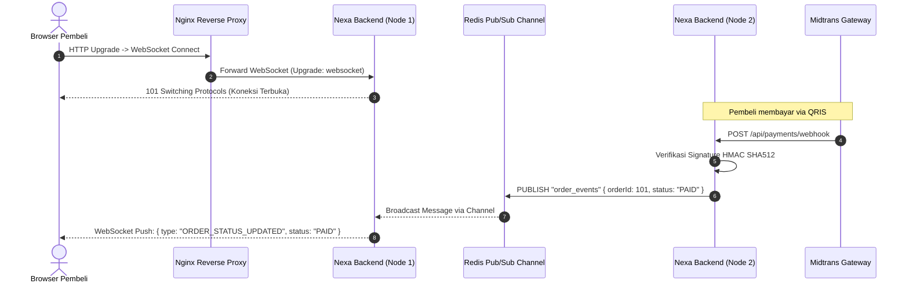

# 01. WebSocket: Full-Duplex Real-Time Communication

Dokumen ini membedah arsitektur **WebSocket (RFC 6455)**, perbandingannya dengan *HTTP Polling*, pola integrasi *Real-Time Events* di e-commerce, skalabilitas multi-node via *Redis Pub/Sub*, serta implementasinya di project **Nexa Streetwear**.

---

## 1. Mengapa E-Commerce Membutuhkan WebSocket?

Model komunikasi standar web adalah **HTTP Request-Response (Half-Duplex)**: klien harus selalu berinisiatif mengirim request agar server bisa mengirimkan data balasan.

```
+---------------------------------------------------------------------------------+
| PERBANDINGAN HTTP POLLING VS WEBSOCKET                                          |
|                                                                                 |
| 1. HTTP POLLING TRADISIONAL (BOROS SUMBER DAYA):                                |
|    Browser  ---[GET /order-status? (Header 1KB)]--->  Server (Belum Bayar)      |
|    Browser  ---[GET /order-status? (Header 1KB)]--->  Server (Belum Bayar)      |
|    Browser  ---[GET /order-status? (Header 1KB)]--->  Server (SUDAH BAYAR!)     |
|    *Dampak: Ribuan request kosong membebani CPU, soket jaringan, dan kuota.*    |
|                                                                                 |
| 2. WEBSOCKET PERSISTENT CONNECTION (EFISIEN & INSTAN):                          |
|    Browser  ===[ 1x HTTP Upgrade Handshake (TCP Persisten) ]===> Server         |
|    Browser  <=================[ Channel Terbuka ]=================> Server         |
|    Browser  <---[ Server Push: "ORDER_PAID" (Frame 2 Byte!) ]--- Server         |
|    *Dampak: Latensi sub-milidetik, tanpa overhead header HTTP berulang.*        |
+---------------------------------------------------------------------------------+
```

### 3 Kasus Penggunaan Kritis WebSocket di Nexa Streetwear:
1. **Konfirmasi Pembayaran Instan (Instant Payment Handshake):**  
   Saat pembeli melakukan pembayaran QRIS di smartphone, Webhook Midtrans masuk ke backend Express. Melalui WebSocket, server dapat langsung mengirim sinyal ke halaman checkout di laptop pembeli untuk otomatis beralih ke halaman *"Pembayaran Sukses"* tanpa perlu reload browser.
2. **Visualisasi Stok Flash Sale Real-Time:**  
   Ketika 1.000 pembeli melihat item limited edition, perubahan stok yang dibeli oleh user lain langsung diperbarui di layar seluruh pembeli secara live (*Live Inventory Sync*).
3. **Live Courier Tracking:**  
   Menampilkan pergerakan posisi kurir pengiriman di atas peta secara real-time.

---

## 2. Alur Arsitektur WebSocket & Redis Pub/Sub Adapter

Pada sistem produksi dengan lebih dari 1 server backend (kluster multi-instance), koneksi WebSocket yang tersambung di Server 1 tidak dapat menerima pesan yang dipicu di Server 2 tanpa perantara *Message Broker*.

Nexa Streetwear mengadopsi arsitektur **Redis Pub/Sub** sebagai jembatan distribusi event:



---

## 3. Best Practices Rekayasa WebSocket

1. **Heartbeat & Dead Connection Pruning (Ping/Pong):**  
   Koneksi internet mobile sering putus tanpa mengirim sinyal `FIN` TCP (*Half-Open Sockets*). Kirim frame `ping` setiap 30 detik. Jika klien tidak merespons dengan `pong`, putus soket secara sepihak untuk membebaskan RAM dan File Descriptor.
2. **Autentikasi di Level Handshake:**  
   Validasi token JWT saat handshake upgrade pertama kali (`Sec-WebSocket-Protocol` atau query token). Jangan biarkan soket anonim tanpa otorisasi mengonsumsi koneksi server.
3. **Reverse Proxy Upgrade Headers:**  
   Nginx wajib dikonfigurasi dengan `proxy_set_header Upgrade $http_upgrade;` dan `proxy_set_header Connection "upgrade";` agar tidak memutus komunikasi dua arah.

---

## 4. Implementasi Nyata di Codebase Nexa Streetwear

### A. Konfigurasi Dukungan WebSocket pada Reverse Proxy: [`nginx/nginx.conf`](file:///home/allrole/Documents/Learning/Streetwear%20|%20E-commerce%20Project/nginx/nginx.conf#L40-L43)
```nginx
location / {
    proxy_pass http://nexa_backend_cluster;
    
    # Meneruskan Handshake Protokol WebSocket RFC 6455
    proxy_http_version 1.1;
    proxy_set_header Upgrade $http_upgrade;
    proxy_set_header Connection "upgrade";
    
    proxy_read_timeout 3600s; # Cegah pemutusan koneksi idle dini
}
```

### B. Pola Desain WebSocket Server dengan Redis Adapter
```typescript
import { createServer } from "http";
import { Server } from "socket.io";
import { createAdapter } from "@socket.io/redis-adapter";
import redis from "./config/redis.js";
import app from "./app.js";

const httpServer = createServer(app);
const io = new Server(httpServer, {
  cors: { origin: process.env.CLIENT_URL, credentials: true },
});

// Duplikasi client redis untuk dedicated pub/sub subscriber
const pubClient = redis;
const subClient = redis.duplicate();
io.adapter(createAdapter(pubClient, subClient));

// Validasi Token JWT saat Handshake
io.use((socket, next) => {
  const token = socket.handshake.auth.token;
  if (!token) return next(new Error("Authentication error"));
  // Verifikasi JWT...
  next();
});

io.on("connection", (socket) => {
  const userId = socket.data.userId;
  socket.join(`user:${userId}`); // Gabungkan ke private room
});
```

---

## 5. Cheatsheet CLI & Pengujian WebSocket

```bash
# 1. Menguji koneksi WebSocket via terminal menggunakan wscat
wscat -c ws://localhost:5000/ws -H "Authorization: Bearer <TOKEN_JWT>"

# 2. Memantau frame WebSocket secara visual di browser
# Buka Chrome DevTools -> Tab 'Network' -> Filter 'WS' -> Klik koneksi -> Tab 'Messages'

# 3. Simulasi broadcast event dari Redis CLI
redis-cli PUBLISH order_events '{"orderId":101,"status":"PAID"}'
```

---

## 6. Kesimpulan

Dengan mengimplementasikan **WebSocket RFC 6455** yang didukung oleh **Redis Pub/Sub Message Bus**:
- Halaman checkout Nexa Streetwear dapat menerima konfirmasi pembayaran secara instan tanpa perlu polling HTTP yang boros CPU.
- Server kebal terhadap bottleneck komunikasi karena ratusan klien dapat berbagi satu koneksi persistent yang sangat hemat bandwidth.
