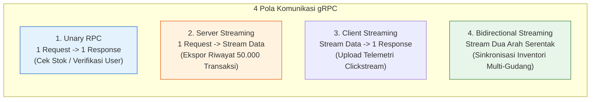

# 02. gRPC: High-Performance Internal RPC & Protocol Buffers

Dokumen ini membedah arsitektur **gRPC (Google Remote Procedure Call)**, efisiensi serialisasi biner **Protocol Buffers (Protobuf)** dibandingkan REST JSON, pola komunikasi antar-microservices, serta implementasinya di project **Nexa Streetwear**.

---

## 1. Mengapa gRPC Diperlukan dalam Arsitektur Terdistribusi?

Dalam arsitektur monolitik modular (seperti Nexa saat ini), fungsi antar-modul dipanggil langsung di dalam memori Node.js (*in-memory function call*). Namun ketika sistem dipecah menjadi beberapa **Microservices** independen (misalnya: *Order Service*, *Inventory Service*, dan *Payment Service* yang berjalan di server terpisah), layanan harus berkomunikasi melalui jaringan (*Network I/O*).

```
+---------------------------------------------------------------------------------+
| PERBANDINGAN REST JSON VS gRPC PROTOBUF                                         |
|                                                                                 |
| 1. REST OVER HTTP/1.1 (JSON):                                                   |
|    - Format Teks ASCII Verbose (Kunci JSON "product_variant_id" dikirim berulang)|
|    - Serialisasi/Deserialisasi memakan waktu CPU (JSON.parse & JSON.stringify)  |
|    - HTTP/1.1 Head-of-Line Blocking (1 request per koneksi TCP)                 |
|    - Ukuran Payload Rata-rata: 1.200 Byte | Latensi: ~15-25 ms                  |
|                                                                                 |
| 2. gRPC OVER HTTP/2 (PROTOCOL BUFFERS):                                         |
|    - Serialisasi Biner Terkompresi (Field dipetakan ke nomor tag biner 1-byte)  |
|    - Parsing Biner C++ Berkecepatan Tinggi (Nihil parsing teks string)          |
|    - HTTP/2 Multiplexing Penuh (Ratusan RPC berjalan paralel di 1 TCP socket)   |
|    - Ukuran Payload Rata-rata: 210 Byte (Hemat 80%!) | Latensi: ~1-3 ms        |
+---------------------------------------------------------------------------------+
```

### Kapan Menggunakan REST vs gRPC?
* **REST API:** Untuk komunikasi publik ke klien (Web Browser, Mobile App, dan Third-Party Webhook seperti Midtrans) karena universal dan mudah diakses.
* **gRPC:** Untuk komunikasi privat antar-layanan internal (*East-West Traffic*) di dalam kluster Kubernetes untuk mencapai throughput maksimal dan latensi terendah.

---

## 2. 4 Pola Aliran RPC pada gRPC



---

## 3. Best Practices Rekayasa gRPC

1. **Strict Protobuf Schema Versioning:**  
   Jangan pernah mengubah nomor tag biner field yang sudah ada di file `.proto` (`int32 quantity = 3;`). Mengubah nomor tag akan merusak kompatibilitas mundur (*backward compatibility*) dengan service versi lama yang masih berjalan.
2. **Channel Multiplexing & Connection Reuse:**  
   Manfaatkan satu koneksi gRPC Channel tunggal untuk ribuan RPC call. Jangan membuka koneksi baru di setiap fungsi request.
3. **Deadlines & Circuit Breakers:**  
   Selalu pasang `deadline` (batas waktu eksekusi) pada pemanggilan gRPC client untuk mencegah thread menunggu tanpa batas jika service tujuan sedang mengalami gangguan (*cascading outage*).

---

## 4. Implementasi Desain Kontrak Protobuf Nexa Streetwear

Berikut adalah rancangan kontrak interface pemotongan stok berkecepatan tinggi antara *Order Service* dan *Inventory Service* (`proto/inventory.proto`):

```protobuf
syntax = "proto3";

package nexa.inventory;

// Definisi Service RPC
service InventoryService {
  // Unary RPC: Pemotongan stok atomik saat checkout
  rpc DeductStock (DeductStockRequest) returns (DeductStockResponse);
  
  // Server Streaming RPC: Cek stok multi-varian produk
  rpc StreamVariantStocks (VariantStockQuery) returns (stream VariantStockItem);
}

// Skema Data Request
message OrderItem {
  int32 variant_id = 1;
  int32 quantity = 2;
}

message DeductStockRequest {
  string order_number = 1;
  int32 user_id = 2;
  repeated OrderItem items = 3; // Array item belanjaan
}

// Skema Data Response
message DeductStockResponse {
  bool success = 1;
  string message = 2;
  int64 timestamp = 3;
}

message VariantStockQuery {
  repeated int32 variant_ids = 1;
}

message VariantStockItem {
  int32 variant_id = 1;
  int32 current_stock = 2;
  bool is_available = 3;
}
```

### Implementasi Server di Node.js (`@grpc/grpc-js`)
```typescript
import * as grpc from "@grpc/grpc-js";
import * as protoLoader from "@grpc/proto-loader";
import prisma from "./config/prisma.js";

const packageDef = protoLoader.loadSync("proto/inventory.proto");
const proto = grpc.loadPackageDefinition(packageDef) as any;

const server = new grpc.Server();

server.addService(proto.nexa.inventory.InventoryService.service, {
  deductStock: async (call: any, callback: any) => {
    const { items, order_number } = call.request;
    
    try {
      // Eksekusi pemotongan stok di level database
      await prisma.$transaction(async (tx) => {
        for (const item of items) {
          const res = await tx.product_variants.updateMany({
            where: { id: item.variant_id, stock: { gte: item.quantity } },
            data: { stock: { decrement: item.quantity } },
          });
          if (res.count === 0) throw new Error("Stok tidak mencukupi");
        }
      });

      callback(null, { success: true, message: "Stok berhasil dipotong", timestamp: Date.now() });
    } catch (err: any) {
      callback({
        code: grpc.status.FAILED_PRECONDITION,
        message: err.message,
      });
    }
  },
});

server.bindAsync("0.0.0.0:50051", grpc.ServerCredentials.createInsecure(), () => {
  console.log("gRPC Inventory Service running on port 50051");
});
```

---

## 5. Cheatsheet CLI & Debugging gRPC via `grpcurl`

```bash
# 1. Menampilkan daftar service RPC yang diekspos server
grpcurl -plaintext localhost:50051 list

# 2. Melihat detail method dan parameter skema proto
grpcurl -plaintext localhost:50051 describe nexa.inventory.InventoryService

# 3. Menembak pemanggilan RPC langsung dari terminal (seperti cURL untuk gRPC)
grpcurl -plaintext -d '{"order_number": "ORD-123", "items": [{"variant_id": 1, "quantity": 2}]}' \
  localhost:50051 nexa.inventory.InventoryService/DeductStock
```

---

## 6. Kesimpulan

gRPC adalah **Standar Mentok (Enterprise Microservices)** untuk komunikasi antar-layanan internal berlatensi ultra-rendah. Dengan serialisasi biner **Protocol Buffers** dan **Multiplexing HTTP/2**, overhead jaringan antar-modul dapat dipangkas hingga **>80%**, menjamin sistem e-commerce tetap responsif dalam hitungan milidetik.
