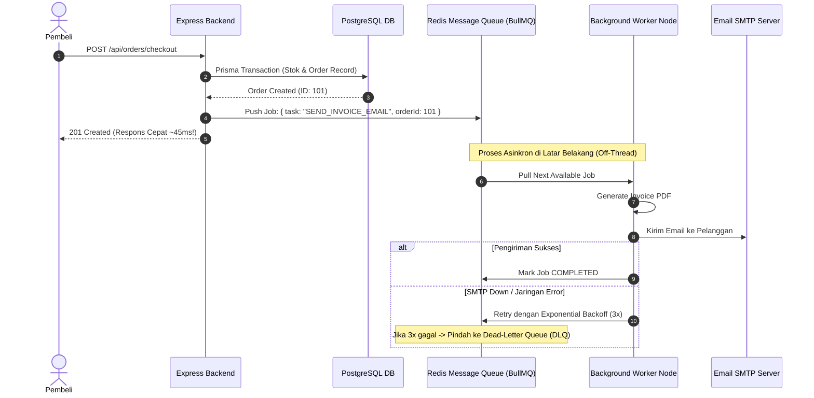

# 03. Message Queues: Asynchronous Decoupling & Event-Driven Workers

Dokumen ini membedah arsitektur **Message Queues (Antrean Pesan)**, konsep pemisahan proses (*Asynchronous Decoupling*), teknik peredam lonjakan trafik (*Load Leveling*), mitigasi kegagalan via *Dead-Letter Queue (DLQ)*, serta implementasinya di project **Nexa Streetwear**.

---

## 1. Masalah: "The Synchronous Execution Bottleneck"

Pada arsitektur monolitik konvensional tanpa sistem antrean, seluruh proses transaksi e-commerce dieksekusi secara **sinkron (*blocking synchronous*)** dalam satu siklus request HTTP tunggal:

```
❌ EKSEKUSI SINKRON KONVENSIONAL (LAMBAT & RENTAN GAGAL):
Pembeli Klik Bayar
  |
  +---> 1. Validasi & Kurangi Stok Database ......... (40 ms)
  +---> 2. Buat Record Invoice Order ................ (20 ms)
  +---> 3. Hubungi Payment Gateway Midtrans ......... (150 ms)
  +---> 4. Render Template & Buat Invoice PDF ....... (1.200 ms)  <-- MEMBEBANI CPU!
  +---> 5. Kirim Email Konfirmasi via SMTP .......... (2.500 ms)  <-- SANGAT LAMBAT!
  |
  v (Total Waktu Tunggu Pembeli: ~4 DETIK!)
Pembeli Baru Menerima Response HTTP 201 Created
*Jika server email SMTP mengalami gangguan jaringan, transaksi checkout pembeli ikut gagal!*
```

---

## 2. Solusi: Asynchronous Decoupling & Event-Driven Architecture

Dengan menempatkan **Message Queue**, proses dibagi menjadi dua ranah:
1. **Critical Path (Sinkron):** Hanya memproses transaksi inti (validasi stok dan pembuatan order di database). Selesai dalam **~40 milidetik**.
2. **Background Path (Asinkron):** Pekerjaan berat didelegasikan ke *Worker* di latar belakang melalui antrean pesan.



### Keuntungan Utama Message Queue:
* **Pengalaman Belanja Instan:** Pembeli tidak perlu menatap loading spinner selama 4 detik.
* **Peredam Lonjakan Trafik (*Load Leveling*):** Jika terjadi flash sale dengan 10.000 order dalam 1 menit, antrean bertindak sebagai waduk penampung. Worker memproses email secara teratur sesuai kapasitas CPU tanpa membakar memori server.
* **Fault Tolerance Mutlak:** Jika server email atau WhatsApp notifikasi sedang down, transaksi checkout pembeli tetap berhasil. Job email akan otomatis dicoba ulang (*auto-retry*) saat server email kembali online.

---

## 3. Best Practices Rekayasa Message Queue

1. **Gunakan Dead-Letter Queue (DLQ):**  
   Pesan yang gagal diproses setelah $N$ kali percobaan (misalnya 3–5 kali) dipindahkan ke DLQ terpisah. Hal ini mencegah *poison pill message* menyumbat antrean utama dan memudahkan engineer menginvestigasi data bermasalah.
2. **Prinsip Idempoten pada Consumer/Worker:**  
   Pastikan kode worker bersifat idempoten. Jika sebuah job email tidak sengaja diproses dua kali, worker harus mengecek flag status agar tidak mengirim dua email yang sama ke pelanggan.
3. **Penyimpanan Job Payload yang Ringkas:**  
   Jangan menaruh seluruh objek data produk yang besar ke dalam antrean. Cukup kirim identitas kunci (`orderId`, `userId`). Worker yang akan membaca data terkini dari database saat gilirannya tiba.

---

## 4. Implementasi Nyata di Codebase Nexa Streetwear

Nexa Streetwear memanfaatkan library **BullMQ** yang berjalan di atas instance **Redis** yang sudah ada di project, tanpa memerlukan server tambahan:

### A. Definisi Queue Producer: [`backend/src/services/queue.service.ts`]
```typescript
import { Queue } from "bullmq";
import redis from "../config/redis.js";

// Inisialisasi antrean email berbasis Redis connection yang sudah ada
export const emailQueue = new Queue("email_notifications", {
  connection: redis,
  defaultJobOptions: {
    attempts: 3, // Coba ulang hingga 3 kali jika gagal
    backoff: {
      type: "exponential",
      delay: 5000, // 5s, 10s, 20s...
    },
    removeOnComplete: 1000, // Simpan histori 1000 job terakhir
    removeOnFail: 5000,     // Simpan histori job gagal untuk DLQ
  },
});
```

### B. Trigger Job saat Transaksi Checkout: [`backend/src/modules/order/order.service.ts`]
```typescript
// Setelah transaksi database berhasil commit:
await emailQueue.add("send_order_confirmation", {
  orderId: newOrder.id,
  userEmail: user.email,
  totalAmount: newOrder.total_amount,
});
```

### C. Background Worker Consumer: [`backend/src/workers/emailWorker.ts`]
```typescript
import { Worker } from "bullmq";
import redis from "../config/redis.js";
import { sendOrderConfirmationEmail } from "../utils/email.js";

export const emailWorker = new Worker(
  "email_notifications",
  async (job) => {
    const { orderId, userEmail, totalAmount } = job.data;
    console.log(`[Worker] Memproses email untuk order #${orderId}`);

    // Eksekusi pengiriman email asinkron
    await sendOrderConfirmationEmail(userEmail, orderId, totalAmount);
  },
  { connection: redis, concurrency: 5 } // Mampu memproses 5 email secara paralel
);

emailWorker.on("failed", (job, err) => {
  console.error(`[Worker Error] Job ${job?.id} gagal:`, err.message);
});
```

---

## 5. Cheatsheet CLI & Monitoring Antrean

```bash
# 1. Memeriksa jumlah job antrean aktif di Redis CLI
redis-cli LLEN "bull:email_notifications:wait"

# 2. Melihat job yang gagal (Dead-Letter / Failed jobs)
redis-cli ZRANGE "bull:email_notifications:failed" 0 -1

# 3. Menghapus antrean jika terjadi penumpukan uji coba lokal
redis-cli DEL "bull:email_notifications:wait"
```

---

## 6. Kesimpulan

Dengan mengadopsi pola **Message Queue (BullMQ + Redis)**:
- Waktu respon checkout Nexa Streetwear terpangkas dari **~4.000 ms menjadi di bawah 50 ms**.
- Sistem kebal terhadap gangguan pihak ketiga (SMTP provider downtime) tanpa membatalkan transaksi uang pembeli.
- Kapasitas pemrosesan background dapat ditingkatkan secara fleksibel dengan menambah jumlah worker kontainer.
