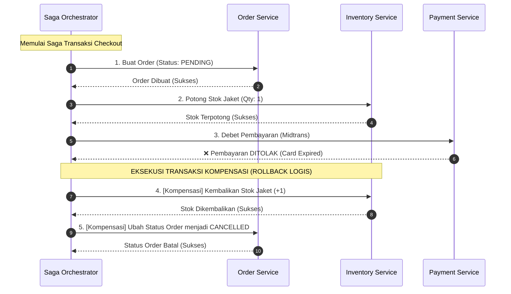

# 04. Distributed Transactions: Saga Pattern & Distributed Consistency

Dokumen ini membedah tantangan **Distributed Transactions** (transaksi lintas database terpisah), kegagalan parsial (*Partial Failures*), pola **Saga Pattern & Transaksi Kompensasi**, serta perbandingannya dengan transaksi ACID di project **Nexa Streetwear**.

---

## 1. Masalah: "The Dual-Write & Partial Failure Trap"

Pada arsitektur database tunggal (seperti Nexa saat ini), konsistensi data dijamin 100% oleh pilar **ACID (Atomicity)** PostgreSQL menggunakan transaksi lokal:
```sql
BEGIN;
  UPDATE product_variants SET stock = stock - 1;
  INSERT INTO orders (id, total) VALUES (101, 250000);
COMMIT; -- Jika ada satu baris yang gagal, seluruhnya otomatis di-ROLLBACK!
```

Namun ketika sistem bertumbuh menjadi **Microservices Terdistribusi**, setiap layanan memiliki database terpisah (*Database-per-Service Pattern*):

```
+---------------------------------------------------------------------------------+
| MASALAH KEGAGALAN PARSIAL (PARTIAL FAILURE DI MICROSERVICES)                    |
|                                                                                 |
| 1. Order Service        ---> Berhasil simpan order di Database Order (SUKSES)   |
| 2. Inventory Service    ---> Berhasil potong stok di Database Inventory (SUKSES)|
| 3. Payment Gateway API  ---> Kartu Kredit Ditolak / Saldo Kurang (GAGAL!)       |
|                                                                                 |
| *PERTANYAAN KRITIS:*                                                            |
| Bagaimana membatalkan pemotongan stok di Database Inventory yang berada di      |
| server terpisah? Transaksi SQL biasa TIDAK BISA melakukan rollback lintas       |
| jaringan fisik!                                                                 |
+---------------------------------------------------------------------------------+
```

---

## 2. Mengapa 2PC (Two-Phase Commit) Ditinggalkan?

Protokol kuno seperti **2PC (Two-Phase Commit)** mencoba mengunci seluruh database secara bersamaan sebelum melakukan commit.
* **Kelemahan 2PC:** Sangat lambat (*blocking locks*), latensi melonjak drastis, dan jika koordinator mati di tengah proses *prepare*, seluruh database di kluster akan terkunci (*system lockup*).
* **Standar Industri Saat Ini:** Mengadopsi prinsip **Eventual Consistency** melalui **Saga Pattern**.

---

## 3. Solusi Arsitektur: Saga Pattern & Compensating Transactions

Sebuah **Saga** memecah transaksi global menjadi serangkaian **transaksi lokal berurutan**. Setiap transaksi lokal memperbarui database miliknya sendiri dan memicu event berikutnya.

Jika salah satu langkah di tengah jalan mengalami kegagalan, Saga akan mengeksekusi rangkaian **Transaksi Kompensasi (*Compensating Transactions*)** untuk membalikkan (*undo*) perubahan yang sempat terjadi.



### Matriks Transaksi Maju vs Transaksi Kompensasi

| Langkah Layanan | Transaksi Maju (*Forward Action*) | Transaksi Kompensasi (*Compensating Action*) |
| :--- | :--- | :--- |
| **1. Order Service** | Buat record pesanan berstatus `PENDING`. | Ubah status pesanan menjadi `CANCELLED`. |
| **2. Inventory Service** | Kurangi stok varian (`stock - qty`). | Tambahkan kembali stok varian (`stock + qty`). |
| **3. Payment Service** | Tagih saldo kartu kredit / e-wallet. | Lakukan refund dana (jika sempat terpotong). |

---

## 4. Pola Pelengkap: Transactional Outbox Pattern

Salah satu risiko terbesar dalam sistem terdistribusi adalah: data berhasil disimpan di database, namun proses *publish* event ke message broker (Kafka/RabbitMQ) gagal karena koneksi jaringan putus.

Untuk mengatasinya, gunakan **Outbox Pattern**:
1. Simpan data bisnis (misal record `orders`) dan event pesan (`outbox_events`) di dalam **1 transaksi database lokal yang sama**.
2. Sebuah proses terpisah (*Relay Worker*) membaca tabel `outbox_events` dan meneruskannya ke broker secara andal (*Guaranteed Delivery*).

---

## 5. Implementasi Nyata di Codebase Nexa Streetwear

### Status Arsitektur Nexa Streetwear Saat Ini:
Nexa Streetwear mengadopsi pola **Modular Monolith dengan Single PostgreSQL Database**. 

Dengan arsitektur ini, Anda **tidak memerlukan kompleksitas Saga Pattern** karena seluruh pemotongan stok, pembuatan invoice, dan status pembayaran dapat diselesaikan dengan aman dalam satu transaksi atomik lokal via Prisma:

```typescript
// backend/src/modules/order/order.service.ts
// Seluruh konsistensi data terjamin ACID 100% tanpa risiko partial failure:
await prisma.$transaction(async (tx) => {
  // 1. Validasi & potong stok
  await OrderModel.deductVariantStock(tx, item.variantId, item.quantity);
  // 2. Buat order record
  const newOrder = await OrderModel.createOrder(tx, orderPayload);
  // 3. Buat shipping record
  await ShippingModel.createShipping(tx, shippingPayload);
});
```

Dokumentasi Saga Pattern ini disiapkan sebagai **cetak biru arsitektur (*architectural blueprint*)** apabila suatu hari tim Anda memutuskan memecah modul Nexa menjadi microservices independen.

---

## 6. Kesimpulan

- Pada sistem berskala UMKM hingga puluhan ribu transaksi per hari, **ACID Transactions pada database tunggal adalah pilihan paling pragmatis, hemat biaya, dan minim bug**.
- Jika sistem beralih ke microservices dengan database terpisah, **Saga Pattern dengan Transaksi Kompensasi** adalah standar industri mutlak untuk mencegah data stok hilang atau transaksi menggantung akibat kegagalan parsial.
