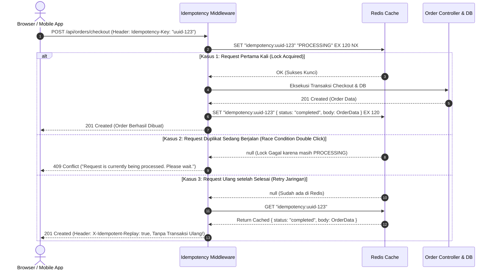

# 05. Idempotency: Safe Retries & Exactly-Once Semantics

Dokumen ini membedah arsitektur **Idempotency (Idempotensi)**, pencegahan eksekusi ganda (*Double Charging & Duplicate Orders*) saat terjadi *retry* jaringan atau klik ganda pembeli, serta implementasi nyatanya di project **Nexa Streetwear**.

---

## 1. Apa itu Idempotency? (The Double-Charge Problem)

Secara matematis, sebuah operasi $f(x)$ dikatakan **idempoten** jika menjalankannya satu kali atau seratus kali menghasilkan hasil akhir yang sama persis:
$$f(f(x)) = f(x)$$

Dalam protokol HTTP:
* **Metode Idempoten Bawaan:** `GET`, `PUT`, `DELETE`, `HEAD`, `OPTIONS`. (Memanggil `DELETE /products/1` sebanyak 5 kali tetap menghasilkan status akhir: produk 1 terhapus).
* **Metode TIDAK Idempoten:** `POST` dan `PATCH`. Setiap kali `POST /api/orders/checkout` dipanggil, server secara default akan membuat order baru dan memotong stok kembali!

```
+---------------------------------------------------------------------------------+
| KASUS: KONEKSI INTERNET PEMBELI TIMEOUT SAAT CHECKOUT                           |
|                                                                                 |
| 1. Pembeli mengklik tombol "Bayar Sekarang"                                    |
| 2. Server berhasil mendebet kartu kredit Rp 350.000                             |
| 3. Namun koneksi internet 4G pembeli putus sebelum menerima response HTTP 201    |
| 4. Browser/Pembeli mengira gagal, lalu mengklik "Bayar Sekarang" LAGI!         |
|                                                                                 |
| *TANPA IDEMPOTENCY:*                                                            |
| Kartu kredit pembeli terdebet 2 KALI (Rp 700.000) dan terbuat 2 pesanan ganda!   |
|                                                                                 |
| *DENGAN IDEMPOTENCY KEY:*                                                       |
| Server mengenali Idempotency-Key yang sama, memblokir eksekusi ganda, dan       |
| langsung mengembalikan bukti pembayaran pertama (X-Idempotent-Replay: true).    |
+---------------------------------------------------------------------------------+
```

---

## 2. Alur Arsitektur Idempotency Key Pattern di Nexa

Sistem menggunakan header standar industri **`Idempotency-Key`** yang divalidasi menggunakan perintah atomik Redis **`SET NX` (SET if Not eXists)**:



---

## 3. Best Practices Rekayasa Idempotency

1. **Gunakan Kunci Atomik `SET NX` dengan TTL:**  
   Jangan melakukan `GET` lalu `SET` terpisah di Redis karena rentan *race condition*. Gunakan parameter atomik `redis.set(key, val, "EX", ttl, "NX")`.
2. **Hapus Kunci jika Server Error (4xx / 5xx):**  
   Jika transaksi database gagal akibat validasi atau server down, kunci di Redis harus segera dihapus (`redis.del(key)`) agar pembeli dapat mencoba checkout kembali dengan key yang sama setelah memperbaiki data.
3. **Idempotensi Webhook Payment Gateway (Midtrans):**  
   Midtrans otomatis mengirim ulang webhook jika server lambat merespons. Handler webhook wajib memeriksa status transaksi di database sebelum melakukan mutasi saldo: jika pesanan sudah berstatus `PAID`, abaikan webhook ulangan tersebut seketika.

---

## 4. Implementasi Nyata di Codebase Nexa Streetwear

Sistem Idempotensi di Nexa Streetwear telah diimplementasikan penuh di: [`backend/src/middleware/idempotencyMiddleware.ts`](file:///home/allrole/Documents/Learning/Streetwear%20|%20E-commerce%20Project/backend/src/middleware/idempotencyMiddleware.ts).

### Cuplikan Kode Middleware:
```typescript
export const idempotency = (ttlSeconds: number = 120) => {
  return async (req: Request, res: Response, next: NextFunction) => {
    if (["GET", "HEAD", "OPTIONS"].includes(req.method)) return next();

    const idempotencyKey = (req.headers["idempotency-key"] || req.headers["x-idempotency-key"]) as string | undefined;
    if (!idempotencyKey) return next();

    const redisKey = `idempotency:${idempotencyKey}`;

    // 1. Kunci atomik via SETNX di Redis
    const acquired = await redis.set(redisKey, JSON.stringify({ status: "processing" }), "EX", ttlSeconds, "NX");

    if (!acquired) {
      const existing = await redis.get(redisKey);
      if (existing) {
        const parsed = JSON.parse(existing);
        if (parsed.status === "completed") {
          // 2. Kembalikan response asli yang tersimpan tanpa query DB ulang
          res.setHeader("X-Idempotent-Replay", "true");
          return res.status(parsed.statusCode || 200).send(parsed.body);
        } else {
          // 3. Tangani jika request paralel sebelumnya masih bekerja
          return next(new AppError("A request with this idempotency key is currently being processed.", 409));
        }
      }
    }

    // 4. Intersep response untuk menyimpan status 'completed' ke Redis
    const originalSend = res.send.bind(res);
    res.send = (body: any) => {
      if (res.statusCode >= 200 && res.statusCode < 300) {
        redis.set(redisKey, JSON.stringify({ status: "completed", statusCode: res.statusCode, body }), "EX", ttlSeconds);
      } else {
        redis.del(redisKey); // Buka kunci jika transaksi gagal
      }
      return originalSend(body);
    };

    next();
  };
};
```

---

## 5. Cheatsheet CLI & Pengujian Idempotency

Kirim dua request POST yang sama menggunakan `Idempotency-Key` via cURL:

```bash
# REQUEST 1: Request Pertama (Membuat Order Nyata di Database)
curl -i -X POST http://localhost:5000/api/orders/checkout \
  -H "Authorization: Bearer <TOKEN>" \
  -H "Content-Type: application/json" \
  -H "Idempotency-Key: 7b3d1f04-a951-4b11-9a99-b1d7d0fa0001" \
  -d '{"items": [{"variantId": 1, "quantity": 1}]}'
# Respons: HTTP 201 Created (Record order dibuat di PostgreSQL)

# REQUEST 2: Request Kedua dengan Kunci yang Sama Persis (Simulasi Retry Jaringan)
curl -i -X POST http://localhost:5000/api/orders/checkout \
  -H "Authorization: Bearer <TOKEN>" \
  -H "Content-Type: application/json" \
  -H "Idempotency-Key: 7b3d1f04-a951-4b11-9a99-b1d7d0fa0001" \
  -d '{"items": [{"variantId": 1, "quantity": 1}]}'
# Respons: HTTP 201 Created
# Perhatikan Header: X-Idempotent-Replay: true
# (Database tidak disentuh, stok tidak dipotong dua kali, hasil diambil dari Redis!)
```

---

## 6. Kesimpulan

Dengan menerapkan **Idempotency Key Pattern** berbasis Redis atomik:
- Toko Nexa Streetwear 100% aman dari ancaman transaksi ganda (*double charge* dan *duplicate checkout*).
- Sistem ramah terhadap jaringan seluler pembeli yang tidak stabil, karena retry otomatis aman dieksekusi tanpa efek samping.
