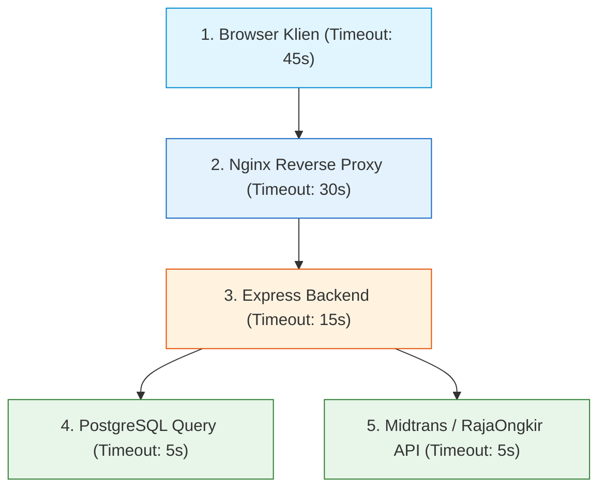

# 06. Timeouts: Socket, Gateway, & Cascading Failure Prevention

Dokumen ini membedah arsitektur **Timeouts (Batas Waktu Jaringan)**, pencegahan kegagalan berantai (*Cascading Failures*), hierarki alokasi waktu (*Timeout Budgeting*), serta implementasi nyatanya di project **Nexa Streetwear**.

---

## 1. Masalah: "The Cascading Hang / Thread Starvation Trap"

Dalam arsitektur e-commerce terdistribusi, server backend Anda bergantung pada berbagai layanan eksternal: Payment Gateway (Midtrans), API Kurir Ongkos Kirim (RajaOngkir), Database PostgreSQL, dan SMTP Email.

Jika salah satu layanan eksternal tersebut mengalami kemacetan (*unresponsive*) dan backend **tidak memiliki batas waktu (timeout) yang tegas**:

```
+---------------------------------------------------------------------------------+
| BENCANA KETIADAAN TIMEOUT (CASCADING FAILURE):                                  |
|                                                                                 |
| 1. API RajaOngkir mengalami gangguan jaringan dan berhenti merespons.           |
| 2. Pembeli A checkout -> Request tertahan menunggu respons RajaOngkir.          |
| 3. Pembeli B, C, D... datang -> 100 soket Express tertahan menunggu.           |
| 4. Seluruh soket TCP dan thread pool Node.js habis terisi antrean macet.       |
| 5. Akibat: Endpoint katalog (/api/products) dan login yang sebenarnya sehat     |
|    IKUT MACET TOTAL! Toko online lumpuh hanya karena pihak ketiga lambat!       |
+---------------------------------------------------------------------------------+
```

Dengan memasang **Timeout**, jika RajaOngkir tidak merespons dalam 5 detik, koneksi langsung diputus secara sepihak (*fail-fast*), melepaskan soket TCP, dan mengembalikan respons fallback tanpa melumpuhkan seluruh server.

---

## 2. Hierarki Alokasi Batas Waktu (Timeout Budgeting)

Aturan baku dalam rekayasa jaringan adalah: **Batas waktu lapisan luar (*Outer Layer*) harus selalu LEBIH PANJANG daripada lapisan dalam (*Inner Layer*)**:



### Mengapa Aturan Hierarki Ini Sangat Penting?
Jika Nginx memiliki timeout 5 detik sementara database backend memiliki timeout 15 detik:
* Nginx akan memutus koneksi dan mengembalikan `504 Gateway Timeout` ke pembeli di detik ke-5.
* Namun backend masih terus memproses pemotongan stok hingga detik ke-15 (*Orphan Processing*).
* Pembeli mengira transaksi gagal padahal stok telah terpotong di database (*Data Inconsistency*).

---

## 3. 5 Lapisan Timeout di Nexa Streetwear

| Lapisan Timeout | Nilai Rekomendasi | Peran & Proteksi |
| :--- | :---: | :--- |
| **TCP Keep-Alive Timeout** | **65 Detik** | Mempertahankan soket TCP tetap terbuka dengan Nginx/ALB agar tidak boros handshake. |
| **Headers Timeout (Slowloris)** | **66 Detik** | Memutus koneksi bot penyerang yang sengaja mengirim data header HTTP byte-per-byte. |
| **HTTP Request Timeout** | **30 Detik** | Batas maksimal total waktu pembacaan seluruh payload HTTP dari klien. |
| **Reverse Proxy Read Timeout** | **30 Detik** | Nginx menunggu respons dari Node.js maksimal 30 detik sebelum melempar 504. |
| **Database & External API** | **5 – 8 Detik** | Kueri SQL dan panggilan ke Midtrans/RajaOngkir wajib selesai dalam <8 detik. |

---

## 4. Implementasi Nyata di Codebase Nexa Streetwear

### A. Hardening Timeout di Level Socket Server: [`backend/src/server.ts`](file:///home/allrole/Documents/Learning/Streetwear%20|%20E-commerce%20Project/backend/src/server.ts#L12-L17)

```typescript
// Proteksi Anti-Slowloris & Connection Starvation (TCP/HTTP Socket Level)
// Nilai keepAliveTimeout diset 65s (lebih besar dari timeout standar 60s pada Nginx / AWS ALB)
server.keepAliveTimeout = 65000;
server.headersTimeout = 66000; // Memutus koneksi jika pengiriman header sengaja diperlambat
server.requestTimeout = 30000; // Batas mutlak pembacaan request di level TCP socket
```

### B. Timeout Reverse Proxy Nginx: [`nginx/nginx.conf`](file:///home/allrole/Documents/Learning/Streetwear%20|%20E-commerce%20Project/nginx/nginx.conf#L45-L47)
```nginx
location / {
    proxy_pass http://nexa_backend_cluster;
    
    proxy_connect_timeout 5s;   # Waktu maksimal koneksi ke backend
    proxy_read_timeout 30s;     # Waktu maksimal menunggu respon backend
    proxy_send_timeout 30s;
}
```

### C. Panggilan Pihak Ketiga dengan AbortController / Timeout
Saat menghubungi API eksternal (misal kurir pengiriman), selalu pasang sinyal timeout:
```typescript
const controller = new AbortController();
const timeoutId = setTimeout(() => controller.abort(), 5000); // Batas 5 detik

try {
  const response = await fetch("https://api.rajaongkir.com/starter/cost", {
    signal: controller.signal,
    // ...
  });
} catch (error: any) {
  if (error.name === "AbortError") {
    throw new AppError("Layanan pengecekan ongkos kirim sedang lambat. Silakan coba sesaat lagi.", 504);
  }
} finally {
  clearTimeout(timeoutId);
}
```

---

## 5. Cheatsheet CLI & Pengujian Timeout

```bash
# 1. Menguji apakah server memutus koneksi Slowloris (Simulasi slow header)
curl -v -H "User-Agent: test" --limit-rate 10B http://localhost:5000/api/health

# 2. Menguji timeout proxy pada endpoint buatan
# Jika server backend tidur selama 35 detik, Nginx harus melempar 504 Gateway Timeout tepat di detik ke-30
```

---

## 6. Kesimpulan

Dengan menerapkan **Hierarki Timeout Budgeting** yang disiplin:
- Sistem Nexa Streetwear kebal terhadap *Cascading Failures* saat provider payment gateway atau kurir mengalami kendala.
- Sumber daya server (TCP socket dan RAM) segera dibebaskan kembali untuk melayani pembeli lain.
- Toko online mempertahankan standar ketersediaan tinggi tanpa pernah mengalami macet total (*freeze*).
