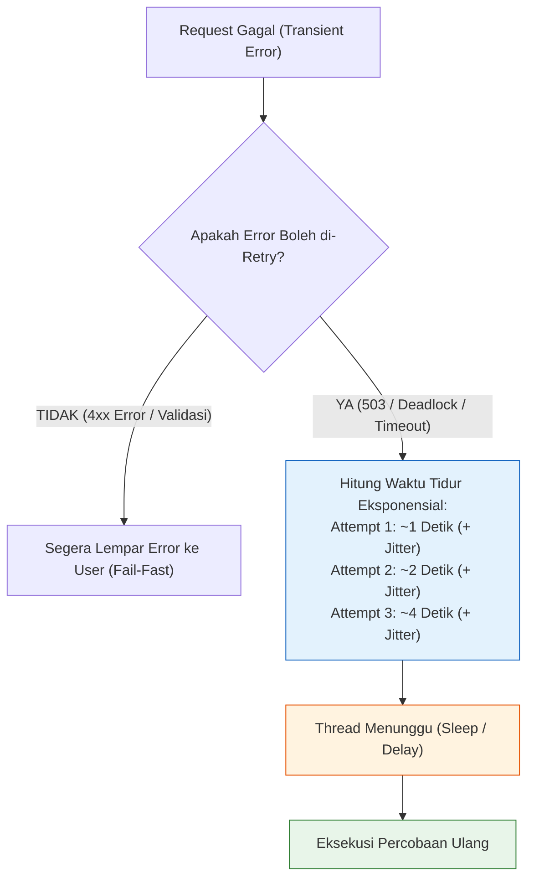

# 07. Exponential Backoff: Retry with Jitter & Thundering Herd Mitigation

Dokumen ini membedah arsitektur **Exponential Backoff**, bahaya badai percobaan ulang (*Retry Storms & Thundering Herd*), teknik penyebaran jeda acak (*Full Jitter*), serta implementasi nyatanya di project **Nexa Streetwear**.

---

## 1. Masalah: "The Retry Storm & Self-Inflicted DDoS"

Ketika database PostgreSQL atau API payment gateway mengalami lonjakan beban sesaat, beberapa transaksi checkout dapat mengalami kegagalan sementara (*transient errors* seperti *deadlock* atau *connection timeout*).

Jika aplikasi menerapkan **Retry Instan Tanpa Jeda** (*Naive Immediate Retry*):

```
+---------------------------------------------------------------------------------+
| BENCANA NAIVE RETRY (RETRY STORM / THUNDERING HERD):                            |
|                                                                                 |
| Detik 0: Database overload -> 500 transaksi gagal.                             |
| Detik 1: 500 request tersebut MENCOBA ULANG SERENTAK di milidetik yang sama!    |
|          Database yang baru saja mulai bernapas langsung dihantam 500 request  |
|          tambahan -> Crash semakin parah!                                       |
| Detik 2: 500 request MENCOBA ULANG LAGI BERSAMAAN -> Server mati permanen!      |
|                                                                                 |
| *Aplikasi Anda baru saja melakukan DDoS terhadap infrastrukturnya sendiri!*    |
+---------------------------------------------------------------------------------+
```

---

## 2. Solusi: Formula Exponential Backoff with Jitter

Untuk meredam tabrakan serentak, rekayasa keandalan modern menggunakan formula **Exponential Backoff dengan Variasi Acak (Full Jitter)**:

$$T_{\text{sleep}} = \text{random}(0, \; \min(\text{cap}, \; \text{base} \times 2^{\text{attempt}}))$$



### Mengapa Harus Menggunakan "Jitter"?
Jika 500 request hanya menggunakan eksponensial murni ($2^1 = 2$ detik), ke-500 request tetap akan menyerbu database secara bersamaan tepat di detik ke-2. **Jitter (angka acak acak)** memecah ke-500 request tersebut agar tersebar merata di antara detik 1.2 hingga 2.5, memungkinkan database menyerap antrean secara teratur.

---

## 3. Kapan Boleh di-Retry vs Kapan Dilarang Keras?

| Kategori Error | Status | Tindakan |
| :--- | :---: | :--- |
| **Database Deadlock (PostgreSQL 40P01 / Prisma P2034)** | **Transient** | **Wajib Retry** dengan backoff (transaksi biasanya sukses di percobaan kedua). |
| **HTTP 503 Service Unavailable / 429 Too Many Requests** | **Transient** | **Wajib Retry** dengan menghormati header `Retry-After`. |
| **Network Socket Hangup (`ECONNRESET`)** | **Transient** | **Wajib Retry** (gangguan jaringan sementara). |
| **HTTP 400 Bad Request / 422 Unprocessable Entity** | **Permanent** | **DILARANG RETRY** (data input dari user salah/tidak lengkap). |
| **HTTP 401 Unauthorized / 403 Forbidden** | **Permanent** | **DILARANG RETRY** (kredensial atau role user tidak sah). |
| **HTTP 404 Not Found** | **Permanent** | **DILARANG RETRY** (resource memang tidak ada). |

---

## 4. Implementasi Nyata di Codebase Nexa Streetwear

### A. Utility Helper `retryWithBackoff`: [`backend/src/utils/retryHelper.ts`]

```typescript
export interface RetryOptions {
  maxRetries?: number;
  baseDelayMs?: number;
  maxDelayMs?: number;
  shouldRetry?: (error: any) => boolean;
}

/**
 * Mengeksekusi fungsi asinkron dengan strategi Exponential Backoff + Full Jitter
 */
export async function retryWithBackoff<T>(
  fn: () => Promise<T>,
  options: RetryOptions = {}
): Promise<T> {
  const {
    maxRetries = 3,
    baseDelayMs = 500,
    maxDelayMs = 5000,
    shouldRetry = (err) => isTransientError(err),
  } = options;

  let attempt = 0;

  while (true) {
    try {
      return await fn();
    } catch (error: any) {
      attempt++;

      if (attempt > maxRetries || !shouldRetry(error)) {
        throw error; // Lempar error jika batas percobaan habis atau error permanen
      }

      // Hitung jeda eksponensial: base * 2^attempt
      const exponentialDelay = Math.min(maxDelayMs, baseDelayMs * Math.pow(2, attempt));
      
      // Tambahkan Full Jitter (acak antara 0 hingga exponentialDelay)
      const jitterDelay = Math.random() * exponentialDelay;

      console.warn(`[Retry Helper] Percobaan ke-${attempt} gagal (${error.message}). Menunggu ${Math.round(jitterDelay)}ms...`);
      await new Promise((resolve) => setTimeout(resolve, jitterDelay));
    }
  }
}

function isTransientError(err: any): boolean {
  // Prisma Deadlock / Timeout codes
  const isPrismaDeadlock = err.code === "P2034" || err.message?.includes("deadlock");
  // Network connection drops
  const isNetworkDrop = ["ECONNRESET", "ETIMEDOUT"].includes(err.code);
  return isPrismaDeadlock || isNetworkDrop;
}
```

### B. Otomatisasi Retry pada Message Queue BullMQ: [`backend/src/services/queue.service.ts`]
Pada antrean tugas pengiriman email dan webhook, backoff eksponensial diaktifkan langsung di level konfigurasi Redis Queue:
```typescript
defaultJobOptions: {
  attempts: 3,
  backoff: {
    type: "exponential",
    delay: 3000, // Percobaan 1: 3s, Percobaan 2: 6s, Percobaan 3: 12s
  },
}
```

---

## 5. Cheatsheet Simulasi Pengujian Retry Helper

```typescript
// test-retry.ts: Simulasi fungsi yang gagal 2 kali sebelum sukses di percobaan ke-3
let callCount = 0;
async function unreliableDbCall() {
  callCount++;
  if (callCount < 3) {
    const error: any = new Error("Transaction deadlock detected");
    error.code = "P2034";
    throw error;
  }
  return "Data Berhasil Disimpan!";
}

const result = await retryWithBackoff(() => unreliableDbCall(), { maxRetries: 3 });
console.log("Hasil Akhir:", result); // Sukses tanpa melempar crash ke pengguna!
```

---

## 6. Kesimpulan

Dengan menerapkan **Exponential Backoff with Full Jitter**:
- Sistem Nexa Streetwear memiliki ketahanan mandiri (*Self-Healing*) terhadap fluktuasi jaringan dan konflik transaksi database sesaat.
- Server terlindungi dari *Retry Storms* yang dapat memperparah kondisi pemadaman (*cascading blackout*).
- Pembeli tidak merasakan kegagalan transaksi karena sistem otomatis menyelesaikan konflik di latar belakang.
