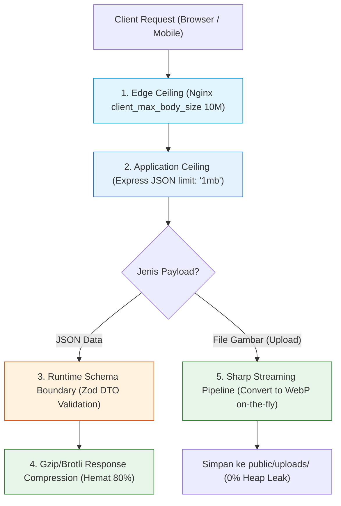

# 08. Payload Management: Size Limits, Streaming, & Compression

Dokumen ini membedah arsitektur **Payload Management**, pembatasan ukuran request (*Size Ceilings*), pemrosesan berkas biner berbasis aliran (*Streaming*), kompresi data jaringan (*Gzip/Brotli*), serta validasi batas integritas skema di project **Nexa Streetwear**.

---

## 1. Mengapa Pengelolaan Payload Krusial untuk E-Commerce?

Dalam aplikasi e-commerce, payload data bergerak dalam dua bentuk:
1. **Payload Teks JSON:** Data checkout keranjang, login pengguna, ulasan produk, dan alamat pengiriman.
2. **Payload Biner Berkas:** Foto katalog pakaian streetwear yang diunggah oleh admin (PNG/JPEG berukuran beberapa Megabyte).

```
+---------------------------------------------------------------------------------+
| RESIKO JIKA PAYLOAD TIDAK DIKELOLA DENGAN KETAT:                                |
|                                                                                 |
| 1. Serangan DoS Memori (Memory Exhaustion Attack):                              |
|    Penyerang mengirim JSON sebesar 100MB berisi teks berulang. Node.js mencoba  |
|    mem-parsing teks tersebut menjadi objek V8 -> Server langsung crash OOM!     |
|                                                                                 |
| 2. Buffering Gambar Memakan RAM:                                                |
|    Mengunggah 10 foto jaket HD (total 50MB) langsung ke RAM memicu lonjakan     |
|    memori dan pembekuan event loop.                                             |
|                                                                                 |
| 3. Pemborosan Kuota Bandwidth Pembeli:                                          |
|    Mengirim respons JSON katalog 50 produk (300KB) tanpa kompresi membuat web    |
|    terasa lambat saat diakses melalui smartphone dengan jaringan 4G lemah.      |
+---------------------------------------------------------------------------------+
```

---

## 2. 4 Pilar Payload Management di Nexa Streetwear



---

## 3. Best Practices Rekayasa Payload

### A. Strict Payload Size Limits (Pertahanan Berlapis)
Batas maksimal ukuran data dipasang di dua lapis pertahanan:
1. **Lapis 1 (Nginx Web Server):** `client_max_body_size 10M;` (menolak payload raksasa di level C/kernel sebelum menyentuh Node.js).
2. **Lapis 2 (Express Application):** `express.json({ limit: "1mb" })` untuk seluruh request JSON biasa. Payload transaksi e-commerce normal (order, profile, address) berukuran <10KB, sehingga batas 1MB sudah sangat aman.

### B. Streaming Binary Image Processing (Sharp WebP)
Jangan pernah membaca file gambar utuh ke dalam memori RAM (`fs.readFileSync`). Gunakan aliran pipa (*streaming pipe*) yang langsung mengonversi gambar ke format **WebP** dengan kualitas optimal:
* Menghasilkan ukuran file **70% lebih kecil** daripada JPEG asli.
* Mengurangi pemakaian heap memory Node.js ke titik terendah.

### C. Response Transport Compression
Gunakan kompresi Gzip pada seluruh respons JSON yang dikirim ke browser:
* Katalog produk berukuran mentah 150KB dikompresi menjadi hanya **~28KB**.
* Waktu unduh (*Time To First Byte / TTFB*) di browser pembeli menjadi instan.

### D. Schema Boundary Stripping & Validation (Zod DTO)
Setiap data yang masuk divalidasi dan dibersihkan dari atribut berbahaya (*Mass Assignment Defense*). Field yang tidak terdaftar di skema DTO langsung dibuang (*strip*) sebelum masuk ke database.

---

## 4. Implementasi Nyata di Codebase Nexa Streetwear

### A. Pembatasan Ukuran Body JSON: [`backend/src/app.ts`](file:///home/allrole/Documents/Learning/Streetwear%20|%20E-commerce%20Project/backend/src/app.ts#L144-L145)

```typescript
// Melindungi V8 Heap Memory dari serangan DoS payload raksasa
app.use(express.json({ limit: "1mb" }));
app.use(express.urlencoded({ extended: true, limit: "1mb" }));
```

### B. Pembatasan di Level Edge Nginx: [`nginx/nginx.conf`](file:///home/allrole/Documents/Learning/Streetwear%20|%20E-commerce%20Project/nginx/nginx.conf#L21)
```nginx
server {
    listen 80;
    # Batas mutlak seluruh body request yang masuk dari internet
    client_max_body_size 10M;
    # ...
}
```

### C. Pemrosesan Upload Gambar Produk via Sharp Pipeline: [`backend/src/middleware/uploadProductImageMiddleware.ts`]
Unggahan foto pakaian streetwear divalidasi MIME type biner aslinya, lalu dikompresi menjadi format modern WebP sebelum disimpan ke direktori publik.

---

## 5. Cheatsheet CLI & Pengujian Batas Payload

```bash
# 1. Menguji penolakan payload JSON yang melebihi batas 1MB
# Buat file JSON dummy berukuran 2MB
python3 -c 'import json; print(json.dumps({"data": "x" * (2 * 1024 * 1024)}))' > payload_2mb.json

# Tembak ke API backend
curl -i -X POST http://localhost:5000/api/auth/login \
  -H "Content-Type: application/json" \
  --data-binary @payload_2mb.json

# Respons yang dihasilkan HARUS berupa HTTP 413 Payload Too Large:
# HTTP/1.1 413 Payload Too Large
# {"status":"error","message":"request entity too large"}

# 2. Hapus file pengujian setelah verifikasi
rm payload_2mb.json
```

---

## 6. Kesimpulan

Dengan menerapkan **4 Pilar Payload Management (Edge Limit, Application Limit, Streaming WebP, dan Zod DTO)**:
- Server Nexa Streetwear terlindungi dari eksploitasi kehabisan memori (*Memory Exhaustion DoS*).
- Gambar produk streetwear disajikan dengan kualitas tajam namun ukuran file sangat ringan.
- Pengalaman berbelanja di smartphone menjadi sangat cepat dan hemat kuota data internet.
