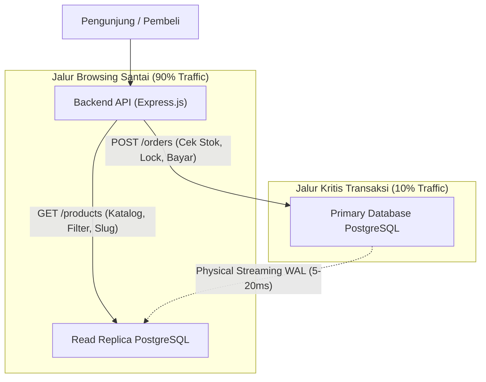

# 15. Database Replication, Read/Write Splitting, & Mitigasi Replication Lag

Dokumen ini membedah arsitektur **Database Replication (Primary vs Read Replica)** pada PostgreSQL di project **Nexa Streetwear E-Commerce**, cara kerja sinkronisasi data fisik via *Write-Ahead Logging (WAL)*, bahaya fatal fenomena **Replication Lag** pada stok barang e-commerce, serta strategi **Data-Sensitivity Splitting** yang diterapkan di codebase backend.

---

## 1. Mengapa Butuh Database Replication?

Pada toko online dengan ribuan pengunjung serentak, profil beban kerja database terbagi menjadi dua:
* **90% - 95% Beban Pembacaan (Read Traffic):** Pengunjung *scrolling* katalog, mencari hoodie, memfilter ukuran, melihat ulasan.
* **5% - 10% Beban Penulisan (Write Traffic):** Menambah alamat, checkout pesanan, memotong stok, memperbarui status bayar.

Jika seluruh query diarahkan ke satu server database tunggal:
1. Query baca yang berat (misal *full-text search* atau agregasi filter) akan merebut CPU dan RAM dari transaksi checkout pembeli.
2. Server utama kehabisan *connection pool* sehingga transaksi pembayaran gagal (*bottleneck*).

**Solusinya:** Memisahkan peran database menjadi:
1. **Primary Database (Write Master):** Khusus melayani penulisan data (`INSERT`, `UPDATE`, `DELETE`) dan transaksi keuangan yang sensitif.
2. **Read Replica (Follower):** Database salinan *read-only* untuk menampung seluruh beban *browsing* jutaan pengunjung.

---

## 2. Cara Kerja Replikasi di PostgreSQL: Physical Streaming Replication

PostgreSQL menyalin data dari Primary ke Replica menggunakan mekanisme **Physical Streaming Replication via WAL (Write-Ahead Log)**:
1. Setiap kali terjadi perubahan data di Primary, PostgreSQL menuliskan catatan biner mentah ke dalam berkas **WAL**.
2. Proses `wal sender` di Primary mengalirkan (*streaming*) data WAL tersebut melalui koneksi socket TCP ke proses `wal receiver` di Read Replica.
3. Read Replica langsung menerapkan (*replay*) perubahan biner tersebut ke dalam disk lokalnya.

### Berapa Cepat Sinkronisasinya?
Dalam arsitektur modern (jaringan cloud yang sama, misalnya AWS VPC atau Google Cloud VPC):
* Kecepatan replikasi streaming ini berada pada kisaran **sub-detik (biasanya hanya 5 sampai 50 milidetik)**.
* Jeda 20 ms mustahil terdeteksi oleh mata manusia saat melihat gambar atau membaca deskripsi jaket di katalog.

---

## 3. Bahaya Fatal: Fenomena "Replication Lag" di E-Commerce

Meskipun rata-rata latensi hanya 5 - 50 ms, ada saat-saat di mana Primary sedang mengalami beban penulisan tinggi atau I/O padat sehingga Replica tertinggal beberapa ratus milidetik. Jeda waktu ini disebut **Replication Lag**.

### Skenario Petaka "Over-Selling" Akibat Membaca Stok di Replica:
1. Produk *Limited Edition Bomber Jacket* tersisa **1 unit**.
2. **Pembeli A** menekan tombol checkout $\to$ Database Primary sukses memotong stok menjadi **0 unit** pada pukul `14:00:00.000`.
3. Tepat **15 milidetik kemudian** (`14:00:00.015`), **Pembeli B** menekan tombol beli:
   - Jika sistem backend mengecek stok ke **Read Replica** (yang sedang memiliki lag 30 milidetik), Replica masih mencatat stok = **1 unit**.
   - Sistem mengizinkan Pembeli B melanjutkan pembayaran.
4. **Hasilnya:** Baju terjual 2 kali (*over-selling*), toko kekurangan barang, dan tim operasional harus meminta maaf serta membatalkan pesanan pembeli.

---

## 4. Dua Mode Replikasi di PostgreSQL: Async vs Sync

PostgreSQL menyediakan konfigurasi mode replikasi melalui parameter `synchronous_commit`:

| Karakteristik | Asynchronous Replication (Default) | Synchronous Replication (`synchronous_commit = on`) |
|:---|:---|:---|
| **Cara Kerja** | Primary mengonfirmasi transaksi sukses ke aplikasi **tanpa menunggu** replica selesai menyalin data. | Primary **menahan konfirmasi transaksi** sampai minimal 1 replica mengonfirmasi data telah diterima di disk. |
| **Replication Lag** | Ada jeda kecil (**~5 - 50 ms**). | **0 ms (Konsistensi Mutlak / Real-time)**. |
| **Kecepatan Write** | **Sangat Cepat & Skalabel:** Penulisan tidak terhambat latensi jaringan antar server. | **Lebih Lambat:** Setiap aksi write harus menunggu round-trip jaringan ke replica. |
| **Risiko Kegagalan** | Jika Primary meledak tepat saat ada lag, beberapa transaksi milidetik terakhir belum tersalin. | Data 100% aman tanpa kehilangan milidetik transaksi (*Zero Data Loss*). |

---

## 5. Solusi Standar Industri: "Data-Sensitivity Splitting"

Alih-alih memperlambat seluruh sistem dengan mode *Synchronous Replication* untuk semua data, industri e-commerce menerapkan **Pemisahan Jalur Berdasarkan Sensitivitas Data**:



### Aturan Distribusi Query:
1. **Lempar ke Read Replica:**
   - Halaman Home & Banner
   - Katalog Produk, Kategori, & Filter
   - Pencarian Produk (FTS)
   - Ulasan / Review Produk
2. **Wajib ke Primary Database:**
   - Tombol "Tambah ke Keranjang" (validasi batas stok maksimal)
   - Seluruh alur Checkout & Pembuatan Pesanan (`POST /orders`)
   - Eksekusi Pengurangan Stok (`UPDATE product_variants SET stock = stock - X`)
   - Webhook Pembayaran Midtrans (`POST /payments/notification`)

---

## 6. Implementasi Nyata di Codebase Project Nexa

### A. Konfigurasi Read Replicas di Prisma Client ([`backend/src/config/prisma.ts`](file:///home/allrole/Documents/Learning/Streetwear%20|%20E-commerce%20Project/backend/src/config/prisma.ts))

Backend menggunakan ekstensi resmi `@prisma/extension-read-replicas`:
```typescript
import { PrismaClient } from "@prisma/client";
import { readReplicas } from "@prisma/extension-read-replicas";

const basePrisma = new PrismaClient({
  datasources: {
    db: { url: process.env.DATABASE_URL }, // Primary Database via PgBouncer
  },
});

const prisma = basePrisma.$extends(
  readReplicas({
    url: process.env.DATABASE_REPLICA_URL || process.env.DATABASE_URL!,
  })
);

export default prisma as unknown as PrismaClient;
```

---

### B. Proteksi Otomatis Jalur Transaksi Kritis di ([`order.service.ts`](file:///home/allrole/Documents/Learning/Streetwear%20|%20E-commerce%20Project/backend/src/modules/order/order.service.ts#L35-L65))

Saat pembeli melakukan checkout, seluruh operasi pemesanan dibungkus dalam `prisma.$transaction`:

```typescript
return await executeWithRetry(async () => {
  return await prisma.$transaction(
    async (tx) => {
      // 1. tx OTOMATIS MENEMBAK PRIMARY DATABASE (Bypass Read Replica)
      // Pembacaan stok di bawah ini dijamin 100% konsisten dan realtime!
      const variantIds = sortedCartItems.map((item) => item.product_variant_id);
      const variants = await tx.product_variants.findMany({
        where: {
          id: { in: variantIds },
          deleted_at: null,
        },
        select: { id: true, product_id: true, size: true, stock: true },
      });

      // 2. Validasi stok aktual tanpa terpengaruh replication lag
      for (const item of sortedCartItems) {
        const variant: any = variantMap.get(item.product_variant_id);
        if (!variant || variant.stock < item.quantity) {
          throw new AppError("Cart is empty or stock is insufficient", 400);
        }
      }

      // 3. Pemotongan stok aman di Primary
      for (const item of sortedCartItems) {
        await OrderModel.decrementStock(tx, item.product_variant_id, item.quantity);
      }
      ...
    },
    { isolationLevel: "ReadCommitted" }
  );
});
```

> **Jaminan Keamanan Prisma:**
> Begitu query berada di dalam `prisma.$transaction(async (tx) => ...)`, Prisma **secara otomatis mengabaikan koneksi Read Replica** dan mengunci seluruh query baca/tulis langsung ke **Primary Database**. Dengan arsitektur ini, risiko membaca stok usang akibat *replication lag* menjadi **0%**.

---

## 7. Cara Memantau Replication Lag di PostgreSQL Server

Administrator database dapat memeriksa status dan jeda replikasi secara *realtime* di server Primary menggunakan query berikut:

```sql
SELECT 
    client_addr AS replica_ip,
    state,
    sync_state,
    replay_lag,
    write_lag,
    flush_lag
FROM pg_stat_replication;
```

* **`replay_lag`:** Selisih waktu antara data yang ditulis di Primary dengan data yang selesai diproses oleh Replica. Pada kondisi sehat, nilainya harus selalu di bawah `00:00:00.05` (50 milidetik).

---

## 8. Rangkuman Best Practice

1. **Gunakan Async Replication untuk Performa:** Menjaga operasi penulisan di server utama tetap ringan dan cepat.
2. **Pisahkan Jalur Berdasarkan Sensitivitas:** Biarkan pembeli yang sekadar melihat katalog membaca dari Read Replica.
3. **Wajibkan Primary DB untuk Checkout:** Jangan pernah mempercayai pembacaan stok dari Read Replica pada alur keranjang belanja dan pembayaran.
4. **Bungkus dalam Transaksi Atomik:** Memastikan pengecekan stok dan pengurangan stok berjalan di koneksi Primary yang sama.

---

## Review Senior Backend: Analisis Gap & Batasan Mentok Implementasi

### Status Saat Ini:
* Arsitektur pemisahan read-replica aktif melalui `@prisma/extension-read-replicas`. Kueri katalog publik dialihkan ke replica, sedangkan operasi checkout dan stok terkunci ketat di Primary.

### Hal yang Belum Diimplementasikan (Menuju Standar Tertinggi / Batasan Mentok):
1. **Dynamic "Read-Your-Own-Writes" Consistency Window:**  
   Saat pengguna mengubah nama profil atau alamat, lalu browser langsung melakukan redirect dan memanggil `GET /api/users/me`, jika pembacaan diarahkan ke replica yang sedang mengalami lag 300ms, pengguna akan melihat data lama (*stale data*) dan mengira update gagal. Batasan mentoknya adalah memasang penanda di cookie atau Redis session: jika user baru saja melakukan mutasi data, arahkan seluruh kueri pembacaan user tersebut ke **Primary selama 2–3 detik**, baru kemudian dilepas kembali ke replica.
2. **Automated Lag Monitoring & Replica Draining:**  
   Belum ada sensor background yang mengawasi fungsi PostgreSQL `pg_last_wal_replay_lsn()`. Batasan mentoknya adalah mengeluarkan replica dari pool traffic pembacaan (*auto-drain*) secara dinamis jika replication lag melebihi **5 detik**.
