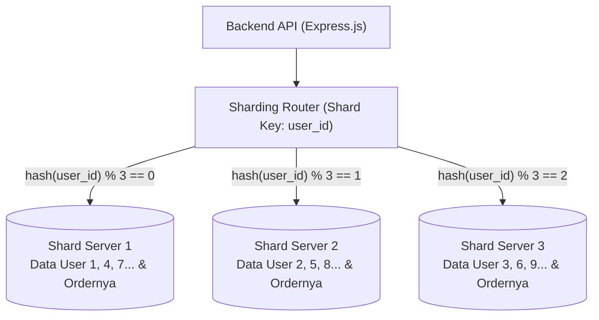

# 16. Database Sharding: Konsep, Alasan Penundaan, & Roadmap Skalabilitas Masa Depan

Dokumen ini membedah konsep **Database Sharding (Horizontal Partitioning antar Server Fisik)**, mengevaluasi arsitektur **Nexa Streetwear E-Commerce**, menjelaskan secara objektif **mengapa sharding belum perlu diterapkan saat ini**, serta merumuskan **roadmap implementasi masa depan** jika bisnis bertumbuh menjadi skala raksasa.

---

## 1. Apa Itu Database Sharding?

**Database Sharding** adalah teknik arsitektur di mana satu database raksasa dipecah secara horizontal menjadi **beberapa server database fisik yang berdiri sendiri (disebut *Shard*)**. Setiap server hanya menyimpan sebagian (*subset*) dari total baris data tabel.



### Pembeda Kunci: Sharding vs Replication vs Partitioning

| Karakteristik | Replication (Read Replicas) | Table Partitioning | Database Sharding |
|:---|:---|:---|:---|
| **Jumlah Server Fisik** | Beberapa server. | **1 server tunggal**. | **Banyak server terpisah**. |
| **Isi Data Tiap Server** | **100% identik** (salinan penuh). | Terbagi per tabel di 1 mesin. | Masing-masing hanya menyimpan sebagian data (misal 33%). |
| **Tujuan Utama** | Membagi beban *Read* (baca) & cadangan failover. | Mempercepat scan query pada data historis (misal per tahun). | Menembus batas maksimal storage, RAM, dan CPU 1 mesin (*Horizontal Write Scaling*). |

---

## 2. Mengapa Project Nexa BELUM PERLU Sharding Sekarang?

Di industri rekayasa perangkat lunak berlaku prinsip emas: **"Don't Shard Until You Must"** (Jangan terburu-buru melakukan sharding sebelum benar-benar kepepet). 

Berikut adalah 4 alasan teknis mengapa sharding belum dibutuhkan di fase ini:

### A. Hirarki Optimasi Database Masih Sangat Panjang
Sharding adalah langkah paling akhir dalam rantai optimasi. Project Nexa telah dan sedang menempuh jalur optimasi yang jauh lebih efisien:
1. **B-Tree Indexing:** Seluruh query pencarian, foreign key, dan filter soft-delete sudah berkecepatan $O(\log N)$.
2. **Connection Pooling (PgBouncer):** Multiplexing ribuan koneksi klien ke puluhan koneksi server PostgreSQL.
3. **In-Memory Caching (Redis):** Menyerap beban query berulang pada data katalog dan sesi auth.
4. **Read/Write Splitting (Read Replicas):** 90% beban pembacaan pengunjung toko dialihkan dari database utama.
5. **Vertical Scaling:** Satu server cloud modern (misal AWS RDS dengan 16–32 vCPU, 128 GB RAM, dan NVMe SSD) sanggup menangani **ratusan gigabyte data dan puluhan ribu transaksi per detik** tanpa perlu di-shard.

### B. Kehilangan Foreign Key Constraint Antar-Shard
Di database PostgreSQL tunggal, integritas data dijaga oleh mesin database:
```sql
ALTER TABLE order_items ADD CONSTRAINT fk_product 
FOREIGN KEY (product_id) REFERENCES products(id);
```
Jika tabel di-shard ke server yang berbeda, **PostgreSQL tidak bisa lagi memvalidasi Foreign Key antar server fisik**. Semua validasi integritas data terpaksa dipindahkan ke logika kode backend, yang membuka risiko inkonsistensi data jika terjadi *bug*.

### C. Kerumitan Transaksi Terdistribusi (*Distributed Transactions / 2PC*)
Saat pembeli melakukan checkout:
- Stok jaket harus dipotong di database produk.
- Saldo/status bayar harus dicatat di database order.
Jika kedua data ini berada di dua server fisik yang berbeda, sistem harus menggunakan protokol *Two-Phase Commit (2PC)* yang lambat, rentan *network timeout*, dan sangat rumit untuk di-debug.

### D. Performa Buruk pada Laporan Agregat (*Cross-Shard Queries*)
Jika admin toko ingin melihat total omzet bulanan:
* Di database tunggal: Cukup `SELECT SUM(total_amount) FROM orders WHERE created_at >= ...` (instan).
* Di database ter-shard: Backend harus menembak 5 server berbeda lewat jaringan, menunggu kelima server merespons, lalu menggabungkan hasilnya di memori Node.js.

---

## 3. Gambaran Arsitektur Masa Depan (Jika Sharding Diterapkan)

Jika bisnis Nexa Streetwear telah bertumbuh pesat hingga memiliki **puluhan juta pelanggan, ratusan juta baris transaksi, dan ukuran database menembus puluhan terabyte**, berikut adalah *blueprint* implementasinya:

### A. Strategi Pemisahan Entitas: "Core Sharding + Reference Tables"

Tidak semua tabel perlu di-shard. Tabel dipisahkan menjadi dua kelompok:

```
[ ARCHITECTURE BLUEPRINT ]

1. Global / Reference Tables (Disimpan di Semua Node / Master Node):
   - products
   - product_variants
   - categories
   (Alasan: Data katalog ukurannya relatif kecil dan sering dibaca bersamaan).

2. Sharded Tables (Dipecah ke banyak Shard Node berdasarkan Shard Key):
   - users
   - addresses
   - orders
   - order_items
   - payments
```

### B. Penentuan Shard Key: `user_id`

Kolom pembeda utama (*Shard Key*) yang paling ideal untuk toko online adalah **`user_id`**:
* Seluruh data yang berkaitan dengan seorang pengguna (Profil, Alamat, Keranjang, Riwayat Pesanan) akan selalu bermukim di **Shard Server yang sama**.
* **Keuntungan:** Query transaksi pembeli seperti `GET /orders` atau `POST /orders` tidak pernah menyentuh server lain (*Single-Shard Query*), sehingga eksekusi tetap secepat kilat.

Formula penentuan server menggunakan teknik **Consistent Hashing**:
$$\text{Shard Node} = \text{ConsistentHash}(\text{user\_id}) \pmod{\text{Total Shards}}$$

### C. Pilihan Teknologi Implementasi Masa Depan

Daripada menulis logika perutean sharding secara manual di Express.js (*Application-Level Routing*), solusi modern yang direkomendasikan adalah menggunakan:

1. **Citus Data (Distributed PostgreSQL):**
   * Ekstensi resmi dari Microsoft untuk mengubah PostgreSQL standar menjadi database terdistribusi.
   * Aplikasi backend Nexa tetap berbicara ke satu endpoint koordinator SQL biasa.
   * Citus secara otomatis mendistribusikan tabel ke puluhan *worker node* di latar belakang:
     ```sql
     -- Mengubah tabel orders menjadi tabel terdistribusi berdasarkan user_id
     SELECT create_distributed_table('orders', 'user_id');
     ```
2. **Dedicated OLAP / Data Warehouse untuk Laporan Admin:**
   * Untuk mengatasi masalah laporan lintas-shard (*cross-shard aggregations*), data transaksi dialirkan secara *asynchronous* via CDC (Debezium/Kafka) ke database analitik berbasis kolom seperti **ClickHouse** atau **Google BigQuery**.
   * Dashboard Admin membaca analitik omzet dan grafik penjualan dari ClickHouse, sementara transaksi jual-beli harian tetap berjalan mulus di Shard PostgreSQL.

---

## 4. Rangkuman & Keputusan Proyek

| Aspek | Status Saat Ini | Rencana Jangka Panjang |
|:---|:---|:---|
| **Kebutuhan Sharding** | **Belum Perlu (Deferred)** | Diterapkan jika data > 1 TB atau volume transaksi > 10.000 TPS. |
| **Arsitektur Aktif** | Single Primary + Read Replicas + PgBouncer + Redis. | Distributed PostgreSQL (Citus) + ClickHouse OLAP. |
| **Fokus Optimasi Saat Ini** | Indeksasi presisi, pencegahan deadlock, soft delete murni, dan pagination hybrid. | Skalabilitas horizontal multi-server. |

---

## Review Senior Backend: Analisis Gap & Batasan Mentok Implementasi

### Status Saat Ini:
* Keputusan arsitektur yang sangat matang (*Engineering Trade-off*): Menghindari kerumitan *Over-Engineering* sharding prematur dan memaksimalkan *Vertical Scaling*, Read Replicas, dan Redis Caching.

### Hal yang Belum Diimplementasikan (Menuju Standar Tertinggi / Batasan Mentok):
1. **Application-Level Shard Routing Prototype (Consistent Hashing):**  
   Jika di masa depan database mencapai 50 juta pesanan dan wajib di-shard, kode aplikasi belum memiliki abstraksi router database berbasis *Consistent Hashing*:
   ```typescript
   const shardId = hashMurmur3(userId) % TOTAL_SHARDS;
   const dbClient = getShardConnection(shardId);
   ```
2. **Distributed PostgreSQL Extension (Citus Data Cloud Cluster):**  
   Batasan mentok jika benar-benar harus melakukan sharding tanpa menulis ulang seluruh kueri join adalah mengadopsi extension **Citus Data**, di mana tabel `orders` didistribusikan secara transparan menggunakan perintah `create_distributed_table('orders', 'user_id')`.
