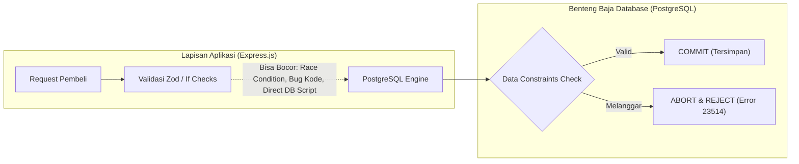

# 18. Database Constraints: Benteng Pertahanan Integritas Data E-Commerce

Dokumen ini membedah arsitektur **Data Constraints (Batasan Integritas Data)** pada database PostgreSQL di project **Nexa Streetwear E-Commerce**, alasan mengapa validasi di backend saja tidak pernah cukup, klasifikasi 6 jenis constraint, serta **implementasi nyata dan proteksi data yang aktif di database dan codebase**.

---

## 1. Mengapa Validasi di Backend Saja Tidak Pernah Cukup?

Banyak developer mengira validasi skema di backend (seperti Zod, Joi, atau pengecekan `if (stock <= 0)`) sudah memadai untuk menjaga keamanan data. **Faktanya tidak!**



### 3 Celah Fatal Jika Tidak Memiliki Database Constraints:
1. **Bahaya *Race Condition* (Flash Sale & Konkurensi):**
   Dua pembeli menekan tombol checkout di milidetik yang sama. Keduanya membaca stok tersisa = 1, dan keduanya lolos dari pengecekan `if (stock >= 1)` di memori Node.js. Jika database tidak memiliki constraint, stok akan terpotong dua kali menjadi **`-1` (*Over-selling*)**.
2. **Celah *Bug* Logika Pengembang:**
   Developer bisa saja lupa menambahkan pengecekan `if (price < 0)` saat membuat fitur kupon promo atau diskon komposit, sehingga harga produk berubah menjadi angka negatif.
3. **Eksekusi Script SQL / Migrasi Manual:**
   Jika ada perbaikan data atau eksekusi script SQL langsung ke database produksi tanpa melewati API Express.js, backend tidak berdaya mencegah data korup masuk.

> **Aturan Emas:** Database Constraint adalah **benteng pertahanan terakhir**. Siapa pun yang mencoba memasukkan data tidak valid (aplikasi, hacker, atau script admin), **mesin PostgreSQL akan menolaknya seketika**.

---

## 2. Enam Jenis Data Constraints Utama di PostgreSQL

| Jenis Constraint | Kode Error PG | Tujuan & Fungsi | Contoh Nyata di Nexa Streetwear |
|:---|:---:|:---|:---|
| **1. NOT NULL** | `23502` | Mencegah kolom bernilai kosong (*null*). | Kolom wajib seperti nama produk, harga, email user, dan nomor telepon. |
| **2. UNIQUE** | `23505` | Mencegah adanya duplikasi data pada kolom tertentu. | Email pengguna (`users.email`), kode barang (`products.sku`), dan nomor resi/order (`orders.order_number`). |
| **3. PRIMARY KEY** | `23505` | Identitas unik mutlak untuk setiap baris data (gabungan `NOT NULL` + `UNIQUE`). | Kolom `id` di setiap tabel sistem. |
| **4. FOREIGN KEY** | `23503` | Menjaga integritas referensial antar tabel agar tidak tercipta data "yatim piatu". | `order_items.product_id` **harus** merujuk ke produk valid di tabel `products`. Dilengkapi aturan `ON DELETE RESTRICT`. |
| **5. CHECK CONSTRAINT** | `23514` | Memastikan nilai kolom memenuhi **ekspresi logika / matematika bisnis**. | • Stok $\ge 0$<br>• Harga produk $\ge 0$<br>• Rating ulasan antara 1 s/d 5<br>• Kuantitas keranjang $> 0$<br>• Total pesanan $\ge 0$ |
| **6. ENUM CONSTRAINT** | `22P02` | Membatasi nilai kolom hanya pada daftar kata tertentu. | Status pesanan (`pending`, `processing`, `shipped`, `delivered`, `cancelled`) dan gender produk (`men`, `women`, `unisex`). |

---

## 3. Implementasi Nyata di Database `db_nexa`

Berikut adalah daftar **CHECK Constraints** yang telah terpasang dan aktif menegakkan aturan bisnis di database PostgreSQL project Nexa:

```sql
-- 1. Perlindungan Stok Anti-Minus (Paling Krusial Saat Flash Sale)
ALTER TABLE product_variants 
ADD CONSTRAINT check_stock_non_negative 
CHECK (stock >= 0);

-- 2. Perlindungan Harga Produk Anti-Negatif
ALTER TABLE products 
ADD CONSTRAINT check_product_price_non_negative 
CHECK (price >= 0);

-- 3. Perlindungan Keranjang Belanja (Kuantitas Minimal 1)
ALTER TABLE cart_items 
ADD CONSTRAINT check_cart_quantity_positive 
CHECK (quantity > 0);

-- 4. Perlindungan Invoice Transaksi (Nilai Uang Tidak Boleh Negatif)
ALTER TABLE orders 
ADD CONSTRAINT check_order_amount_non_negative 
CHECK (total_amount >= 0 AND shipping_cost >= 0);

-- 5. Perlindungan Item Pesanan (Kuantitas Positif & Harga Non-Negatif)
ALTER TABLE order_items 
ADD CONSTRAINT check_order_item_positive 
CHECK (quantity > 0 AND price >= 0);

-- 6. Batasan Rating Ulasan Pembeli (Hanya Bintang 1 s/d 5)
ALTER TABLE product_reviews 
ADD CONSTRAINT product_reviews_rating_check 
CHECK (rating >= 1 AND rating <= 5);
```

---

## 4. Bukti Pengujian Penolakan Mutlak oleh Database

Pengujian langsung dilakukan ke PostgreSQL untuk membuktikan bahwa database menolak pembaruan data yang tidak logis:

```sql
UPDATE product_variants SET stock = -5 WHERE id = 1;
```

**Hasil Respons PostgreSQL:**
```
ERROR:  new row for relation "product_variants" violates check constraint "check_stock_non_negative"
DETAIL: Failing row contains (1, 1, 36, -5).
```

Transaksi seketika digagalkan oleh mesin database (*automatic rollback*), menjamin bahwa data fisik di disk tidak pernah rusak.

---

## 5. Cara Menangani Error Constraint di Backend ([`AppError.ts`](file:///home/allrole/Documents/Learning/Streetwear%20|%20E-commerce%20Project/backend/src/utils/appError.ts))

Ketika transaksi melanggar constraint database, PostgreSQL melempar kode error spesifik. Backend menangkap kode tersebut dan mengembalikannya sebagai pesan ramah pengguna:

```typescript
try {
  await OrderModel.decrementStock(tx, variantId, quantity);
} catch (error: any) {
  // Kode 23514: CHECK Constraint Violation (misal stok habis saat race condition)
  if (error.code === "23514") {
    throw new AppError("Stok produk tidak mencukupi untuk menyelesaikan transaksi", 400);
  }

  // Kode 23505: UNIQUE Constraint Violation (misal email/SKU kembar)
  if (error.code === "23505") {
    throw new AppError("Data duplikat: nilai unik sudah terdaftar di sistem", 409);
  }

  // Kode 23503: FOREIGN KEY Violation (misal barang sudah tidak ada)
  if (error.code === "23503") {
    throw new AppError("Data referensi tidak ditemukan", 400);
  }

  throw error;
}
```

---

## 6. Rangkuman Best Practice

1. **Terapkan Validasi Berlapis (*Defense in Depth*):**
   - *Lapisan Depan (Zod/Joi):* Memberikan pesan kesalahan cepat (*fail-fast*) kepada pengguna di HTTP layer.
   - *Lapisan Belakang (DB Constraints):* Menjadi jaring pengaman mutlak dari *race condition*, kelalaian kode, dan script eksternal.
2. **Jangan Pernah Mengizinkan Nilai Negatif untuk Uang & Kuantitas:**
   Pasang selalu `CHECK (col >= 0)` untuk harga, ongkir, total belanja, dan stok.
3. **Gunakan Nama Constraint yang Deskriptif:**
   Gunakan pola penamaan `check_<nama_tabel>_<nama_kolom>_<kondisi>` (misal: `check_stock_non_negative`) agar saat terjadi error di log sistem, akar masalah langsung teridentifikasi dalam 1 detik.

---

## Review Senior Backend: Analisis Gap & Batasan Mentok Implementasi

### Status Saat Ini:
* Integritas data terlindungi oleh 6 pilar database constraint: Primary Key, Foreign Key with RESTRICT, Unique index, NOT NULL, CHECK constraints non-negatif (`stock >= 0`, `price >= 0`), dan Enum type-safety.

### Hal yang Belum Diimplementasikan (Menuju Standar Tertinggi / Batasan Mentok):
1. **PostgreSQL Custom Domain Types (DRY Constraint Architecture):**  
   Saat ini constraint `CHECK (col >= 0)` didefinisikan satu per satu di tabel produk, varian, dan order. Batasan mentoknya adalah membuat tipe data domain PostgreSQL terpusat:
   ```sql
   CREATE DOMAIN positive_money AS integer CHECK (VALUE >= 0);
   CREATE DOMAIN email_address AS varchar(255) CHECK (VALUE ~* '^[A-Z0-9._%+-]+@[A-Z0-9.-]+\.[A-Z]{2,}$');
   ```
   sehingga setiap kolom harga dan email di seluruh database secara otomatis mewarisi aturan validasi tanpa duplikasi definisi DDL.
2. **Exclusion Constraints for Overlapping Time/Resource Reservations:**  
   Jika di masa depan toko membuka fitur booking jadwal fitting pakaian offline di butik, CHECK constraint biasa tidak mampu mencegah tabrakan jam janji temu (*overlapping schedule*). Batasan mentoknya adalah menerapkan *Exclusion Constraint* via ekstensi `btree_gist`:
   ```sql
   ALTER TABLE fitting_bookings ADD CONSTRAINT no_overlapping_slots EXCLUDE USING gist (room_id WITH =, booking_time WITH &&);
   ```
