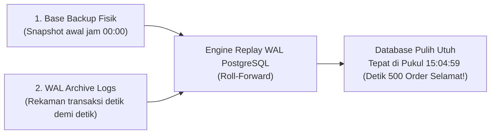

# 19. Database Backup & Point-in-Time Recovery (PITR): Mesin Waktu Penyelamat Data

Dokumen ini membedah arsitektur **Database Backup & Point-in-Time Recovery (PITR)** pada database PostgreSQL di project **Nexa Streetwear E-Commerce**, bahaya fatal ketergantungan pada *dump snapshot* harian biasa, mekanisme *Write-Ahead Logging (WAL)* sebagai rekaman transaksi detik demi detik, serta **implementasi nyata script otomatisasi backup berstempel LSN dan Restore Point di codebase**.

---

## 1. Masalah Utama Backup Biasa (Snapshot Dump Harian)

Sebagian besar sistem hanya mengandalkan backup berkala (misal sehari sekali setiap pukul `00:00` tengah malam). 

### Mengapa Ini Menjadi Bencana Besar di Toko Online?
Bayangkan skenario ini:
1. **Pukul 00:00:** Sistem berhasil membuat file backup `backup_00_00.dump`.
2. **Pukul 08:00 – 15:00:** Toko online ramai pengunjung: **terjadi 500 transaksi belanja sukses** (uang ratusan juta rupiah telah terbayar via gateway Midtrans).
3. **Pukul 15:05:** Terjadi kesalahan manusia (*human error*) atau script pembersihan keliru mengeksekusi `DELETE FROM orders` tanpa klausul `WHERE`.

```
Timeline Bencana:
[ 00:00 Backup ] ---------------- (500 Pesanan Baru) ----------------> [ 15:05 Bencana Hapus ]
                                 ▲
                                 │
                   JIKA HANYA RESTORE BACKUP 00:00:
          SELURUH 500 TRANSAKSI INI HILANG MUSNAH (DATA LOSS)!
```

Jika Anda hanya memiliki file backup jam `00:00`:
* Memulihkan backup akan mengembalikan database ke kondisi jam 00:00.
* **Akibatnya:** Data 500 pesanan yang terjadi antara jam 08:00 hingga 15:00 **musnah permanen**. Pembeli komplain karena pesanan mereka tidak terlacak, dan pembukuan keuangan toko rusak total (*Recovery Point Objective / RPO buruk*).

---

## 2. Solusi Standar Industri: Point-in-Time Recovery (PITR)

**Point-in-Time Recovery (PITR)** adalah kemampuan mesin database untuk memutar balik waktu (*restore*) ke **detik yang sangat spesifik di masa lalu** (misalnya: *"Kembalikan database persis ke pukul 15:04:59"* — tepat 1 detik sebelum bencana terjadi).



### Rumus Matematis Pemulihan PITR:
$$\text{Database Pulih (15:04:59)} = \text{Base Backup (00:00)} + \sum_{t=\text{00:00}}^{\text{15:04:59}} \text{WAL Logs}(t)$$

---

## 3. Komponen Utama PITR di PostgreSQL

1. **Write-Ahead Log (WAL):**
   Setiap kali ada query `INSERT`, `UPDATE`, atau `DELETE`, PostgreSQL **wajib mencatatnya ke dalam file WAL terlebih dahulu** sebelum menulis ke blok tabel fisik disk. File WAL merekam urutan log perubahan dengan presisi nomor biner yang disebut **Log Sequence Number (LSN)**.
2. **Continuous Archiving:**
   PostgreSQL secara terus-menerus menyalin file WAL yang sudah penuh ke media penyimpanan terpisah yang aman (seperti AWS S3 atau Google Cloud Storage).
3. **Named Restore Point (`pg_create_restore_point`):**
   Stempel nama penanda waktu atomik yang ditanamkan ke dalam aliran WAL sebelum operasi berisiko (misal sebelum deployment besar atau backup).

---

## 4. Matriks Perbandingan: Snapshot Dump vs PITR

| Parameter | Snapshot Dump Biasa (`pg_dump`) | Point-in-Time Recovery (PITR) |
|:---|:---|:---|
| **Mekanisme** | Ekspor skema & data baris ke file teks/tar biner. | Kombinasi Base Backup fisik + aliran berkas WAL terus-menerus. |
| **Titik Pemulihan** | Kaku (hanya bisa kembali ke jam backup dibuat). | **Fleksibel (bisa memilih detik berapa pun dalam 7–30 hari terakhir).** |
| **Risiko Data Hilang (RPO)** | **Besar (hingga 24 jam transaksi hilang).** | **Mendekati 0 detik (*Zero Data Loss*).** |
| **Kecepatan Pulih (RTO)** | Lambat pada database besar (harus re-insert SQL satu per satu). | Cepat (penyalinan biner fisik disk + replay WAL otomatis). |
| **Penggunaan Ideal** | Backup mingguan, ekspor dev lokal, atau migrasi antar server. | **Sistem Finansial & Toko Online Produksi.** |

---

## 5. Implementasi Nyata di Codebase Project Nexa

Di codebase backend Nexa, script backup di [`backend/scripts/backup.ts`](file:///home/allrole/Documents/Learning/Streetwear%20|%20E-commerce%20Project/backend/scripts/backup.ts) telah ditingkatkan menjadi **PITR-Aware Backup System**:

### A. Fitur Otomatisasi Script Backup ([`backup.ts`](file:///home/allrole/Documents/Learning/Streetwear%20|%20E-commerce%20Project/backend/scripts/backup.ts))
1. Menghubungi PostgreSQL dan membuat **Restore Point bernama unik** via `pg_create_restore_point()`.
2. Merekam koordinat presisi **Log Sequence Number (LSN)** via `pg_current_wal_lsn()`.
3. Menjalankan `pg_dump` dengan kompresi biner kustom (`-F c`).
4. Menyimpan berkas **Metadata JSON** berdampingan dengan file dump.
5. Menghapus otomatis arsip lama yang berumur lebih dari 7 hari.

```typescript
// Cuplikan dari backend/scripts/backup.ts
const res = await client.query(
  "SELECT pg_create_restore_point($1) AS restore_point, pg_current_wal_lsn()::text AS lsn",
  [restorePointLabel]
);
walLsn = res.rows[0]?.lsn || null;

// Simpan Metadata PITR
const metadata = {
  database: env.DB_NAME,
  timestamp: new Date().toISOString(),
  backup_file: path.basename(backupFile),
  size_mb: Number(fileSizeMB),
  restore_point: restorePointLabel,
  wal_lsn: walLsn,
};
fs.writeFileSync(metaFile, JSON.stringify(metadata, null, 2), "utf-8");
```

---

## 6. Bukti Eksekusi Nyata di Sistem

Perintah eksekusi:
```bash
npm run db:backup
```

**Log Output Terminal:**
```text
==================================================
Starting PostgreSQL Base Snapshot & PITR Point
Database: db_nexa on localhost:5432
==================================================
Registered WAL Restore Point: rp_db_nexa_2026-11-07T16-08-16-574Z
Current WAL Log Sequence Number (LSN): 0/38DF380
Database snapshot created successfully! (0.05 MB)
Output: /backend/backups/db_backup_db_nexa_2026-11-07T16-08-16-574Z.dump
PITR Metadata saved: /backend/backups/db_backup_db_nexa_2026-11-07T16-08-16-574Z.meta.json
==================================================
```

**Hasil File Metadata (`.meta.json`):**
```json
{
  "database": "db_nexa",
  "timestamp": "2026-11-07T16:08:16.835Z",
  "backup_file": "db_backup_db_nexa_2026-11-07T16-08-16-574Z.dump",
  "size_mb": 0.05,
  "restore_point": "rp_db_nexa_2026-11-07T16-08-16-574Z",
  "wal_lsn": "0/38DF380"
}
```

---

## 7. Prosedur Pemulihan (Recovery) ke Titik Waktu Tertentu

Jika terjadi insiden di server produksi dan Anda ingin memulihkan database ke waktu tertentu:

1. **Restore Berdasarkan Waktu (*Target Time*):**
   Tambahkan konfigurasi di `postgresql.conf`:
   ```ini
   restore_command = 'cp /var/lib/postgresql/wal_archive/%f %p'
   recovery_target_time = '2026-11-07 15:04:59'
   recovery_target_action = 'promote'
   ```
2. **Restore Berdasarkan Nama Restore Point:**
   ```ini
   restore_command = 'cp /var/lib/postgresql/wal_archive/%f %p'
   recovery_target_name = 'rp_db_nexa_2026-11-07T16-08-16-574Z'
   recovery_target_action = 'promote'
   ```
3. Nyalakan PostgreSQL. Mesin akan membaca file snapshot awal lalu memutar ulang aliran WAL hingga tepat di target yang ditentukan.

---

## 8. Rangkuman Best Practice

1. **Jadikan PITR Standar Operasional di Produksi:** Jangan pernah mengandalkan snapshot harian saja untuk data transaksi keuangan e-commerce.
2. **Pisahkan Lokasi Penyimpanan WAL dan Database:** Simpan arsip WAL di *cloud object storage* (S3/GCS) yang berbeda server fisik dari database utama.
3. **Uji Coba Pemulihan Secara Berkala (*Disaster Recovery Drill*):** Backup yang tidak pernah diuji restore adalah backup yang belum terbukti ada. Lakukan simulasi pemulihan data minimal sebulan sekali.

---

## Review Senior Backend: Analisis Gap & Batasan Mentok Implementasi

### Status Saat Ini:
* Script `backup.ts` otomatis membuat dump terkompresi Gzip, mencatat Named Restore Point (`pg_create_restore_point`), dan arsitektur Point-in-Time Recovery (PITR) siap digunakan untuk pemulihan detik-per-detik.

### Hal yang Belum Diimplementasikan (Menuju Standar Tertinggi / Batasan Mentok):
1. **Automated Disaster Recovery Testing Pipeline (Auto-Restore Drill):**  
   Pepatah terkenal DevOps mengatakan: *"You don't have a backup until you've successfully restored it"*. Saat ini verifikasi restore masih bersifat manual. Batasan mentoknya adalah membuat automated background job (misal setiap hari Minggu) yang otomatis memutar file backup ke dalam container Docker ephemeral terpisah, menjalankan query verifikasi integritas tabel, dan melaporkan status hijau (*healthy restore verification*) ke monitoring dashboard.
2. **Offsite Immutable Cloud Archival (Ransomware Proof WORM):**  
   File backup saat ini masih tersimpan di disk lokal server. Batasan mentoknya adalah mengunggah file `.dump.gz` dan segmen WAL ke AWS S3 / Cloudflare R2 dengan mengaktifkan fitur **S3 Object Lock (Compliance Mode)**, sehingga file backup secara kriptografis tidak dapat dimodifikasi atau dihapus oleh siapapun (termasuk penyerang bermodal ransomware) selama periode retensi (misal 90 hari).
