# 01. Docker & Multi-Stage Containerization

Dokumen ini membedah arsitektur **Containerization** menggunakan **Docker**, strategi **Multi-Stage Build** untuk efisiensi image produksi, orkestrasi multi-layanan via **Docker Compose**, serta implementasinya di project **Nexa Streetwear**.

---

## 1. Mengapa Containerization Krusial untuk E-Commerce?

Masalah klasik dalam deployment aplikasi adalah *"It works on my machine, but fails on the server"* akibat perbedaan versi runtime Node.js, dependensi C++ sistem, dan konfigurasi database.

```
+---------------------------------------------------------------------------------+
| TRADISIONAL (BARE-METAL / DIRECT VPS)         DOCKER CONTAINERIZATION           |
|                                                                                 |
| [Aplikasi Nexa] [App Lain]                    [ Container Nexa ] [ Container DB] |
|       \             /                                 |                 |       |
|    [ Shared OS & Libraries ]                   [ Isolated Engine & Root FS ]    |
| (Rawan konflik versi & dependensi)             (100% Identik di Dev & Prod)     |
+---------------------------------------------------------------------------------+
```

### Keuntungan Utama Docker di Nexa Streetwear:
1. **Reproducibility (100% Deterministik):** Lingkungan di laptop developer, server pengujian (CI/CD), dan server produksi klien identik hingga ke level bit sistem operasi (Alpine Linux).
2. **Isolasi Layanan (Service Sandboxing):** PostgreSQL, Redis, PgBouncer, dan Node.js berjalan di dalam *isolated namespace* masing-masing tanpa saling mengganggu.
3. **Penyederhanaan Onboarding:** Klien atau developer baru dapat menyalakan seluruh stack aplikasi hanya dengan satu perintah: `docker compose up -d`.

---

## 2. Arsitektur Multi-Stage Build (Lean Production Image)

Ketika membangun aplikasi TypeScript, kita membutuhkan *compiler* `tsc`, tipe data `@types/*`, dan berbagai library dev dependencies yang berukuran besar (>500MB). Namun, di server produksi, kita **hanya membutuhkan file JavaScript hasil kompilasi (`dist/`) dan runtime Node.js**.

Nexa Streetwear mengadopsi pola **Multi-Stage Build**:

```mermaid
flowchart LR
    subgraph Stage1["Stage 1: BUILDER (node:22-alpine)"]
        direction TB
        S1_1["Install SEMUA Dependensi (Dev + Prod)"]
        S1_2["Salin Source Code TypeScript (.ts)"]
        S1_3["Jalankan Kompilasi: npm run build"]
        S1_4["Hasil: Direktori /dist (Biner JS)"]
    end

    subgraph Stage2["Stage 2: RUNNER (node:22-alpine)"]
        direction TB
        S2_1["Install HANYA Production Deps (--omit=dev)"]
        S2_2["Salin /dist dari Stage 1"]
        S2_3["Salin /public aset statis"]
        S2_4["Eksekusi: node dist/server.js"]
    end

    Stage1 -->|"Hanya salin /dist (Sampah dev dibuang)"| Stage2

    style Stage1 fill:#fff3e0,stroke:#e65100
    style Stage2 fill:#e8f5e9,stroke:#2e7d32,stroke-width:2px
```



### Manfaat Pengurangan Ukuran Image:
* **Ukuran Single-Stage Tradisional:** ~850 MB – 1.2 GB (Lambat saat di-pull server, boros disk).
* **Ukuran Multi-Stage Nexa:** **~140 MB – 180 MB** (Super ringan, start-up instan, dan meminimalkan celah kerentanan CVE karena tidak ada compiler atau shell dev di image final).

---

## 3. Best Practices Rekayasa Docker

1. **Gunakan Base Image Minimalis (`alpine`):**  
   Gunakan `node:22-alpine` alih-alih `node:22` (Debian full) untuk memangkas ratusan utilitas OS yang tidak diperlukan.
2. **Layer Caching Optimization:**  
   Salin `package*.json` terlebih dahulu sebelum menyalin source code (`COPY package*.json ./` lalu `RUN npm install`). Hal ini memastikan Docker menggunakan cache layer jika dependensi tidak berubah, mempercepat proses build dari menit menjadi hitungan detik.
3. **Disiplin `.dockerignore`:**  
   Jangan pernah menyertakan folder `node_modules`, `.env`, file `.git`, dan folder log lokal ke dalam build context Docker.
4. **Healthcheck & Strict Dependency Ordering:**  
   Aplikasi backend tidak boleh dijalankan sebelum PostgreSQL dan Redis benar-benar siap menerima koneksi soket (`condition: service_healthy`).

---

## 4. Implementasi Nyata di Codebase Nexa Streetwear

### A. Multi-Stage Dockerfile: [`backend/Dockerfile`](file:///home/allrole/Documents/Learning/Streetwear%20|%20E-commerce%20Project/backend/Dockerfile)

```dockerfile
# STAGE 1: Compiler & Builder
FROM node:22-alpine AS builder

WORKDIR /app
COPY package*.json ./
RUN npm install
COPY . .
RUN npm run build

# STAGE 2: Production Runner
FROM node:22-alpine AS runner
WORKDIR /app
COPY package*.json ./
# Hanya install dependensi esensial produksi (membuang devDependencies)
RUN npm install --omit=dev
COPY --from=builder /app/dist ./dist
COPY --from=builder /app/public ./public

EXPOSE 5000
CMD ["node", "dist/server.js"]
```

### B. Orkestrasi Multi-Layanan: [`docker-compose.yml`](file:///home/allrole/Documents/Learning/Streetwear%20|%20E-commerce%20Project/docker-compose.yml)
File ini mengorkestrasi 4 kontainer utama dengan volume presisten dan healthcheck otomatis:

```yaml
version: '3.8'

services:
  # 1. Database Utama (PostgreSQL 16)
  db:
    image: postgres:16-alpine
    container_name: nexa_postgres
    restart: always
    environment:
      POSTGRES_USER: ${DB_USER:-postgres}
      POSTGRES_PASSWORD: ${DB_PASSWORD:-admin123}
      POSTGRES_DB: ${DB_NAME:-db_nexa}
    ports:
      - "${DB_PORT:-5434}:5432"
    volumes:
      - nexa_pgdata:/var/lib/postgresql/data
    healthcheck:
      test: ["CMD-SHELL", "pg_isready -U ${DB_USER:-postgres} -d ${DB_NAME:-db_nexa}"]
      interval: 5s
      timeout: 5s
      retries: 5

  # 2. Connection Pooler (PgBouncer)
  pgbouncer:
    image: edoburu/pgbouncer:latest
    container_name: nexa_pgbouncer
    restart: always
    depends_on:
      db:
        condition: service_healthy
    environment:
      - DB_HOST=db
      - DB_PORT=5432
      - POOL_MODE=transaction
      - MAX_CLIENT_CONN=500
    ports:
      - "${PGBOUNCER_PORT:-6432}:6432"
    healthcheck:
      test: ["CMD-SHELL", "pg_isready -h 127.0.0.1 -p 6432 -U ${DB_USER:-postgres} -d ${DB_NAME:-db_nexa}"]
      interval: 5s
      timeout: 5s
      retries: 5

  # 3. Cache & Rate Limiting (Redis)
  redis:
    image: redis:alpine
    container_name: nexa_redis
    restart: always
    ports:
      - "6379:6379"
    healthcheck:
      test: ["CMD", "redis-cli", "ping"]
      interval: 5s
      timeout: 5s
      retries: 5

  # 4. Backend Express API
  api:
    build:
      context: ./backend
      dockerfile: Dockerfile
    container_name: nexa_backend
    restart: always
    depends_on:
      db:
        condition: service_healthy
      pgbouncer:
        condition: service_healthy
      redis:
        condition: service_healthy
    environment:
      PORT: 5000
      DATABASE_URL: "postgresql://${DB_USER:-postgres}:${DB_PASSWORD:-admin123}@pgbouncer:6432/${DB_NAME:-db_nexa}?pgbouncer=true&connection_limit=50"
      DIRECT_URL: "postgresql://${DB_USER:-postgres}:${DB_PASSWORD:-admin123}@db:5432/${DB_NAME:-db_nexa}"
      REDIS_HOST: redis
      REDIS_PORT: 6379
    ports:
      - "5000:5000"
    healthcheck:
      test: ["CMD-SHELL", "wget --no-verbose --tries=1 --spider http://localhost:5000/api/health || exit 1"]
      interval: 10s
      timeout: 5s
      retries: 3

volumes:
  nexa_pgdata:
```

---

## 5. Cheatsheet CLI Docker & Operasional

```bash
# 1. Menyalakan seluruh stack kontainer di background
docker compose up -d

# 2. Memeriksa status kesehatan seluruh kontainer (Harus berstatus 'healthy')
docker compose ps

# 3. Melihat log backend secara live (streaming)
docker compose logs -f api

# 4. Membangun ulang image setelah mengubah kode backend
docker compose up -d --build api

# 5. Memeriksa penggunaan CPU & Memori real-time setiap kontainer
docker stats

# 6. Masuk ke terminal kontainer backend untuk investigasi
docker exec -it nexa_backend sh
```

---

## 6. Kesimpulan

Dengan mengadopsi **Multi-Stage Dockerfile** dan **Docker Compose Health-Check Orchestration**:
- Waktu deployment menjadi sangat cepat karena ukuran image yang ringkas (<180MB).
- Seluruh dependensi infrastruktur (PostgreSQL, PgBouncer, Redis) dapat dinyalakan dengan satu perintah tanpa setup manual yang rumit.
- Sistem bebas dari *environment drift* saat diserahkan ke klien freelance atau di-deploy ke server cloud.
