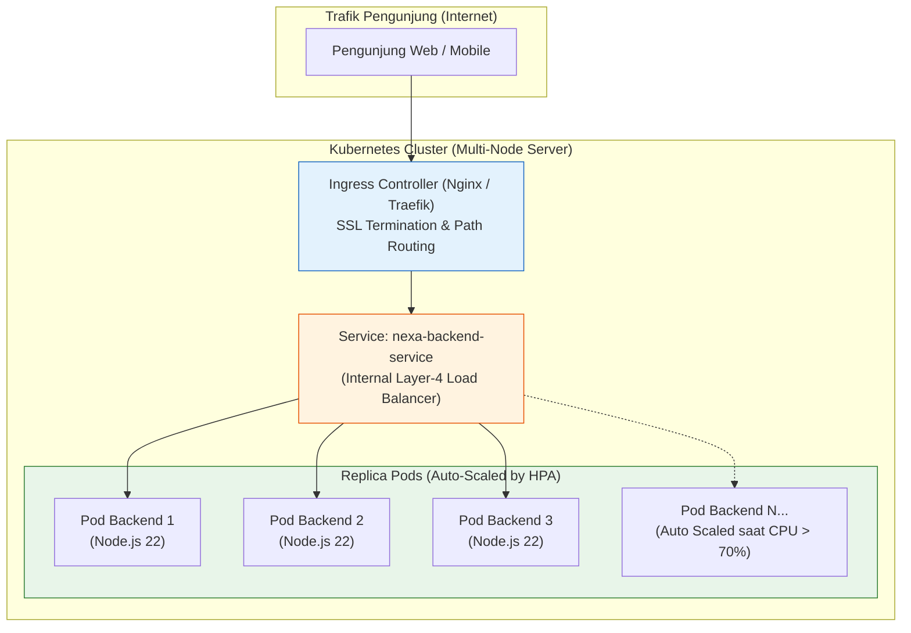

# 03. Kubernetes (K8s) & Container Orchestration

Dokumen ini membedah arsitektur **Kubernetes (K8s)** untuk orkestrasi kluster multi-server, strategi skalabilitas otomatis (*Horizontal Pod Autoscaler*), pemulihan mandiri (*Self-Healing*), serta manifest manifest produksi untuk project **Nexa Streetwear**.

---

## 1. Kapan E-Commerce Membutuhkan Kubernetes?

Pada tahap awal (UMKM / Freelance), **Docker Compose di atas 1 VPS sudah sangat cukup**. Namun ketika platform bertumbuh menjadi skala nasional (*enterprise scale*):
* **Single Point of Failure (SPOF):** Jika 1 server VPS mati, seluruh website toko online padam total.
* **Trafik Fluktuatif Ekstrem (Flash Sale):** Trafik melonjak 100x lipat dalam waktu 5 menit saat promo tanggal kembar (11.11 / 12.12), lalu kembali sepi di tengah malam. Mengelola penambahan server manual memakan waktu terlalu lama.
* **Zero-Downtime Deployment Skala Masif:** Memperbarui kode di puluhan server tanpa memutus satu pun koneksi pembeli yang sedang membayar.



---

## 2. Anatomi Komponen Utama Kubernetes Nexa

1. **Pod:** Satuan komputasi terkecil di K8s. Menjalankan kontainer image backend Nexa (`ghcr.io/nexa/backend`).
2. **Deployment:** Deklarasi status yang diinginkan (*desired state*). Mengontrol berapa banyak replika Pod yang harus aktif dan mengatur proses rilis *Rolling Update*.
3. **Service (ClusterIP):** Abstraksi jaringan internal yang memberikan alamat IP virtual stabil dan mendistribusikan traffic ke Pod-Pod yang sehat.
4. **Ingress:** Pintu gerbang utama cluster yang menerima request dari internet, memvalidasi sertifikat SSL/TLS, dan meneruskannya ke Service yang sesuai.
5. **Horizontal Pod Autoscaler (HPA):** Komponen otomatis yang menambah jumlah Pod (misal dari 3 menjadi 20 Pod) ketika rata-rata penggunaan CPU cluster melampaui 70%.
6. **Probes (Healthchecks):**
   * **Readiness Probe:** Memastikan Pod baru tidak menerima traffic sebelum koneksi database dan Redis-nya terhubung sempurna.
   * **Liveness Probe:** Otomatis membunuh dan merestart Pod jika proses Node.js mengalami *deadlock* atau membeku.

---

## 3. Best Practices Rekayasa Kubernetes

1. **Definisikan Resource Requests & Limits Secara Ketat:**  
   Jangan biarkan Pod berjalan tanpa batas CPU/RAM. Pod tanpa batas bisa memakan seluruh memori node server (*noisy neighbor*) dan memicu Linux OOM Killer pada Pod lain.
2. **Gunakan Pod Disruption Budget (PDB):**  
   Menjamin minimal ada sejumlah Pod tertentu (misal 80%) yang selalu hidup saat cluster melakukan maintenance atau upgrade OS node.
3. **Zero-Downtime Rolling Update Strategy:**  
   Atur `maxSurge: 25%` (membuat Pod baru terlebih dahulu) dan `maxUnavailable: 0` (tidak boleh mematikan Pod lama sebelum Pod baru berstatus *Ready*).
4. **Pisahkan Secret dari Image:**  
   Gunakan Kubernetes `Secret` yang diinjeksikan sebagai Environment Variables, terintegrasi dengan HashiCorp Vault atau AWS Secrets Manager.

---

## 4. Manifest Kubernetes Siap Pakai untuk Nexa Streetwear

Berikut adalah konfigurasi manifest Kubernetes (`k8s/backend-deployment.yaml`) yang telah disesuaikan dengan arsitektur backend Nexa:

```yaml
apiVersion: apps/v1
kind: Deployment
metadata:
  name: nexa-backend
  namespace: production
  labels:
    app: nexa-backend
spec:
  replicas: 3
  strategy:
    type: RollingUpdate
    rollingUpdate:
      maxSurge: 1
      maxUnavailable: 0
  selector:
    matchLabels:
      app: nexa-backend
  template:
    metadata:
      labels:
        app: nexa-backend
    spec:
      containers:
        - name: backend
          image: ghcr.io/nexa/backend:latest
          imagePullPolicy: IfNotPresent
          ports:
            - containerPort: 5000
          resources:
            requests:
              cpu: "250m"      # Minimal 0.25 vCPU
              memory: "256Mi"  # Minimal 256MB RAM
            limits:
              cpu: "1000m"     # Maksimal 1 vCPU
              memory: "1024Mi" # Maksimal 1GB RAM
          envFrom:
            - secretRef:
                name: nexa-backend-secrets
            - configMapRef:
                name: nexa-backend-config
          # Probes Kesehatan
          readinessProbe:
            httpGet:
              path: /api/health
              port: 5000
            initialDelaySeconds: 10
            periodSeconds: 5
            timeoutSeconds: 3
            failureThreshold: 3
          livenessProbe:
            httpGet:
              path: /api/health
              port: 5000
            initialDelaySeconds: 20
            periodSeconds: 10
            timeoutSeconds: 5
            failureThreshold: 3
---
apiVersion: v1
kind: Service
metadata:
  name: nexa-backend-service
  namespace: production
spec:
  type: ClusterIP
  selector:
    app: nexa-backend
  ports:
    - port: 80
      targetPort: 5000
---
apiVersion: autoscaling/v2
kind: HorizontalPodAutoscaler
metadata:
  name: nexa-backend-hpa
  namespace: production
spec:
  scaleTargetRef:
    apiVersion: apps/v1
    kind: Deployment
    name: nexa-backend
  minReplicas: 3
  maxReplicas: 20
  metrics:
    - type: Resource
      resource:
        name: cpu
        target:
          type: Utilization
          averageUtilization: 70
```

---

## 5. Cheatsheet CLI `kubectl` & Operasional Kluster

```bash
# 1. Menerapkan manifest ke kluster
kubectl apply -f k8s/backend-deployment.yaml

# 2. Memantau status Pod secara real-time
kubectl get pods -n production -w

# 3. Melihat proses Rolling Update rilis baru
kubectl rollout status deployment/nexa-backend -n production

# 4. Melakukan Rollback instan jika rilis baru bermasalah
kubectl rollout undo deployment/nexa-backend -n production

# 5. Memeriksa log gabungan seluruh Pod backend
kubectl logs -f -l app=nexa-backend -n production --max-log-requests=10

# 6. Memeriksa status penskalaan otomatis HPA
kubectl get hpa -n production
```

---

## 6. Kesimpulan

Kubernetes adalah **Standar Mentok (Enterprise Grade)** untuk operasional skala masif. Dengan memadukan **Rolling Updates (`maxUnavailable: 0`)**, **Liveness/Readiness Probes**, dan **Horizontal Pod Autoscaling (HPA)**, arsitektur Nexa Streetwear mampu menahan lonjakan trafik jutaan pengunjung saat festival belanja online tanpa campur tangan teknis manual.
