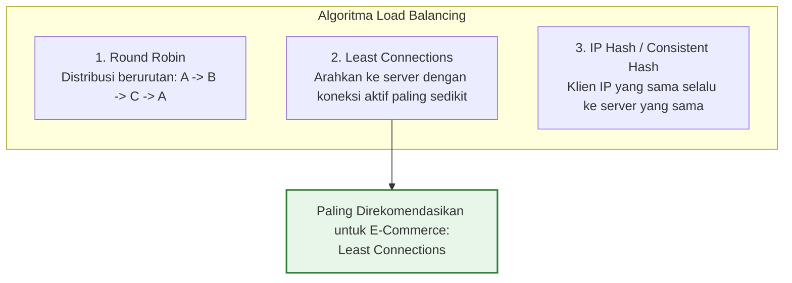

# 04. Load Balancing: Arsitektur, Algoritma, & Health Checks

Dokumen ini membedah arsitektur **Load Balancing**, perbandingan **Layer 4 vs Layer 7 Load Balancer**, algoritma distribusi trafik (*Round Robin, Least Connections, IP Hash*), serta strategi *High Availability* di project **Nexa Streetwear**.

---

## 1. Mengapa E-Commerce Membutuhkan Load Balancer?

Ketika toko online streetwear Anda dikunjungi oleh ribuan pembeli secara bersamaan, satu server fisik/VPS akan kehabisan CPU, socket jaringan, atau memori RAM (*single-server capacity limit*).

```
+---------------------------------------------------------------------------------+
|                       DISTRIBUSI BEBAN DENGAN LOAD BALANCER                    |
|                                                                                 |
|                        +-----------------------+                                |
|                        |     LOAD BALANCER     |                                |
|   10.000 Request/dtk   |   (Nginx / AWS ALB)   |                                |
| =====================> |                       |                                |
|                        +-----------+-----------+                                |
|                               /    |    \                                       |
|                              /     |     \                                      |
|                             v      v      v                                     |
|                        [Node 1] [Node 2] [Node 3]                               |
|                         ~3.300   ~3.300   ~3.300 req/dtk                        |
+---------------------------------------------------------------------------------+
```

### Fungsi Utama Load Balancer di Nexa Streetwear:
1. **Penskalaan Horizontal (Horizontal Scalability):** Memungkinkan penambahan server baru kapan saja tanpa mengubah domain atau IP publik yang diakses oleh pembeli.
2. **Ketersediaan Tinggi (High Availability):** Jika Server 2 mengalami *crash* atau sedang di-restart, Load Balancer otomatis mengalihkan seluruh traffic ke Server 1 dan Server 3 (*zero downtime*).
3. **Pemberhentian SSL/TLS (SSL Termination):** Proses enkripsi/dekripsi HTTPS yang berat diselesaikan di level Load Balancer, membebaskan CPU backend Node.js untuk murni memproses logika bisnis e-commerce.

---

## 2. Perbedaan Fundamental: Layer 4 vs Layer 7 Load Balancing

Dalam model OSI (*Open Systems Interconnection*), Load Balancer beroperasi di dua layer utama:

| Aspek Perbandingan | Layer 4 (Transport Layer - TCP/UDP) | Layer 7 (Application Layer - HTTP/HTTPS) |
| :--- | :--- | :--- |
| **Data yang Dilihat** | Hanya IP Address & Port TCP (Tidak melihat isi data HTTP). | Seluruh konten HTTP: Header, Cookie, URL Path, Query, & Payload. |
| **Kecerdasan Routing** | Buta konten (*blind forwarding*). Semua paket diteruskan apa adanya. | **Sangat Cerdas (*Content-Based Routing*):** Bisa mengarahkan `/api/orders` ke server khusus dan `/api/products` ke server cache. |
| **Performa & Throughput** | Kecepatan ekstrem, latensi sub-milidetik, konsumsi CPU sangat rendah. | Latensi sedikit lebih tinggi (+1–2ms) karena harus mem-parsing paket HTTP/SSL. |
| **Terminasi SSL/TLS** | Tidak mendukung inspeksi SSL (hanya TCP passthrough). | **Mendukung SSL Termination & HTTP/2 / HTTP/3 QUIC**. |
| **Contoh Teknologi** | AWS NLB (Network Load Balancer), HAProxy TCP Mode, Linux IPVS. | **AWS ALB (Application Load Balancer), Nginx, Traefik, Envoy**. |

---

## 3. Algoritma Distribusi Trafik

Nexa Streetwear dapat dikonfigurasikan menggunakan beberapa algoritma distribusi:



### Mengapa *Least Connections* Paling Ideal untuk E-Commerce?
Di toko online, durasi setiap request sangat bervariasi:
* Request melihat katalog produk (`GET /api/products`) selesai dalam **<1 milidetik** dari Redis cache.
* Request checkout pembayaran (`POST /api/orders`) membutuhkan waktu **~50 milidetik** karena harus memproses transaksi database, memotong stok, dan menghubungi payment gateway.

Jika menggunakan *Round Robin*, server yang kebetulan menerima banyak request checkout akan kewalahan sementara server lain menganggur. Algoritma **Least Connections** otomatis mengarahkan request baru ke server yang paling longgar.

---

## 4. Mekanisme Health Checks & Anti-Sticky Sessions

### A. Active Health Check
Load Balancer secara proaktif menembak endpoint kesehatan setiap 5–10 detik:
```http
GET /api/health HTTP/1.1
Host: backend-internal
```
* **Kriteria Sehat:** Endpoint mengembalikan status HTTP `200 OK` (seperti yang telah diimplementasikan di [`backend/src/modules/health/health.routes.ts`](file:///home/allrole/Documents/Learning/Streetwear%20|%20E-commerce%20Project/backend/src/modules/health/health.routes.ts)).
* **Kriteria Sakit (Eviction):** Jika server mengembalikan `500 Internal Server Error` atau tidak merespons dalam 3 detik sebanyak 3 kali berturut-turut, server tersebut langsung diisolasi dan tidak akan dikirimi traffic pelanggan lagi.

### B. Hindari Sticky Sessions (Session Affinity)
Pada arsitektur monolitik kuno, Load Balancer dipaksa mengikat pembeli ke server tertentu (*Sticky Session*) karena data keranjang belanja disimpan di memori RAM server tersebut.
* **Di Nexa Streetwear:** Arsitektur backend **100% Stateless**. Autentikasi menggunakan Dual-Token JWT dan data keranjang disimpan di PostgreSQL & Redis. Pembeli bebas dilempar ke server mana saja tanpa kehilangan sesi login atau keranjangnya!

---

## 5. Implementasi Konfigurasi Load Balancer Nginx

Berikut adalah konfigurasi Layer-7 Load Balancer Nginx (`nginx-lb.conf`) untuk mendistribusikan traffic ke beberapa instance backend Nexa:

```nginx
# Definisi upstream backend pool
upstream nexa_backend_cluster {
    # Gunakan algoritma Least Connections
    least_conn;

    # Daftar server backend (bisa beda port atau beda IP server)
    server 192.168.1.11:5000 max_fails=3 fail_timeout=10s;
    server 192.168.1.12:5000 max_fails=3 fail_timeout=10s;
    server 192.168.1.13:5000 max_fails=3 fail_timeout=10s;

    # Pertahankan koneksi keep-alive ke backend agar tidak boros TCP handshake
    keepalive 32;
}

server {
    listen 80;
    server_name api.nexastreetwear.com;
    return 301 https://$host$request_uri;
}

server {
    listen 443 ssl http2;
    server_name api.nexastreetwear.com;

    # Sertifikat SSL/TLS
    ssl_certificate /etc/letsencrypt/live/api.nexastreetwear.com/fullchain.pem;
    ssl_certificate_key /etc/letsencrypt/live/api.nexastreetwear.com/privkey.pem;

    location / {
        proxy_pass http://nexa_backend_cluster;
        
        # Meneruskan metadata asli client ke backend Node.js
        proxy_set_header Host $host;
        proxy_set_header X-Real-IP $remote_addr;
        proxy_set_header X-Forwarded-For $proxy_add_x_forwarded_for;
        proxy_set_header X-Forwarded-Proto $scheme;

        # Optimasi HTTP Keep-Alive
        proxy_http_version 1.1;
        proxy_set_header Connection "";

        # Timeout operasional
        proxy_connect_timeout 5s;
        proxy_read_timeout 30s;
        proxy_send_timeout 30s;
    }
}
```

---

## 6. Cheatsheet Verifikasi & Pengujian Load Balancer

```bash
# 1. Menguji apakah header proxy diteruskan dengan benar ke backend
curl -i https://api.nexastreetwear.com/api/health

# 2. Menguji distribusi beban dengan stress-test sederhana (100 request)
for i in {1..100}; do
  curl -s -o /dev/null -w "%{http_code}\n" https://api.nexastreetwear.com/api/products
done | sort | uniq -c

# 3. Simulasi server down: Matikan salah satu backend di server 2
docker compose stop api
# Perhatikan bahwa Nginx otomatis mengalihkan 100% request ke server 1 tanpa ada error 502 di sisi pembeli!
```

---

## 7. Kesimpulan

Dengan menempatkan **Layer-7 Load Balancer** berkonfigurasi **Least Connections** di depan backend Nexa Streetwear:
- Sistem terlindungi dari *Single Point of Failure* (High Availability).
- Kapasitas transaksi dapat ditingkatkan secara linier kapan saja dengan menambahkan instance server baru (*Horizontal Scaling*).
- Backend Node.js beroperasi dengan beban yang merata dan terbebas dari beban komputasi SSL handshake.
