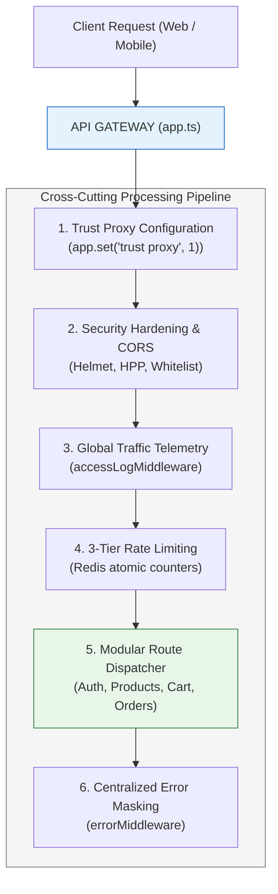

# 06. API Gateway: Pola Arsitektur, Routing, & Centralized Concerns

Dokumen ini membedah arsitektur **API Gateway**, pola *Single Entry Point*, orkestrasi perutean layanan (*Request Routing*), penanganan *Cross-Cutting Concerns* terpusat, serta implementasinya di project **Nexa Streetwear**.

---

## 1. Apa itu API Gateway dalam E-Commerce?

Dalam platform e-commerce modern, sistem terdiri dari berbagai domain modul bisnis yang kompleks: Autentikasi Pengguna, Manajemen Katalog & Varian Produk, Keranjang Belanja, Pemrosesan Pesanan (*Checkout*), Payment Gateway (Midtrans), dan Kalkulasi Ongkir Kurir.

Tanpa API Gateway, aplikasi klien (Website React di browser dan Mobile App di smartphone) harus berkomunikasi langsung ke masing-masing endpoint atau microservices secara terpisah (*Direct Client-to-Service Anti-Pattern*).

```
+---------------------------------------------------------------------------------+
| ARSITEKTUR DENGAN API GATEWAY (SINGLE ENTRY POINT)                              |
|                                                                                 |
| [ Frontend Web (React) ]         [ Mobile App iOS/Android ]                     |
|           \                                   /                                 |
|            \                                 /                                  |
|             v                               v                                   |
|       +-------------------------------------------+                             |
|       |             API GATEWAY NEXA              |                             |
|       | - Centralized JWT & RBAC Auth Check       |                             |
|       | - 3-Tier Traffic Rate Limiting (Redis)    |                             |
|       | - Global Telemetry & Access Logging       |                             |
|       | - Unified Error Masking & CORS Whitelist  |                             |
|       +---------------------+---------------------+                             |
|                             | (Internal Routing)                                |
|        +------------+-------+-------+------------+                              |
|        |            |               |            |                              |
|        v            v               v            v                              |
|    [ /api/auth ] [ /api/products ] [ /api/cart ] [ /api/orders ]                |
+---------------------------------------------------------------------------------+
```

### Mengapa E-Commerce Membutuhkan API Gateway?
1. **Pintu Gerbang Tunggal (*Unified Entrypoint*):** Klien hanya perlu mengetahui satu domain induk (`https://api.nexastreetwear.com`), menyederhanakan konfigurasi frontend dan mempermudah migrasi infrastruktur internal tanpa merusak klien.
2. **Pemusatan *Cross-Cutting Concerns*:** Fitur-fitur universal seperti verifikasi token JWT, pembatasan frekuensi request (*Rate Limiting*), pencatatan jejak audit (*Access Logging*), dan sanitasi header tidak perlu ditulis berulang kali di setiap controller.
3. **Isolasi Keamanan (Security Perimeter):** Database PostgreSQL dan Redis berada di jaringan internal privat (*Private Subnet*) dan tidak pernah memiliki IP publik; hanya API Gateway yang diizinkan meneruskan request yang sah.

---

## 2. Pola Arsitektur Utama API Gateway



### 1. Reverse Proxy Trust (`trust proxy`)
Ketika API Gateway berada di belakang Load Balancer (Nginx atau AWS ALB), header IP client (`req.ip`) akan terbaca sebagai IP lokal Load Balancer. API Gateway wajib mengaktifkan konfigurasi `trust proxy` agar alamat IP asli pembeli tetap dapat diekstrak untuk keperluan audit dan rate limiting.

### 2. Centralized 3-Tier Rate Limiting
Alih-alih mengunci setiap rute satu per satu, API Gateway memberlakukan proteksi bertingkat:
* **Tier 1 (Soft Delay / SpeedLimiter):** Memperlambat respons jika pengunjung melakukan request bertubi-tubi.
* **Tier 2 (Global Gateway Limit):** Membatasi maksimal 150 request per 15 menit per IP untuk seluruh endpoint publik.
* **Tier 3 (Strict Auth Limit):** Membatasi maksimal 15 percobaan login/register per 15 menit untuk membasmi serangan brute-force.

### 3. Unified Error Formatting & Secret Masking
API Gateway menangkap seluruh exception yang dilempar oleh service database atau third-party. Pesan error internal (*database query error*, *stack trace*, *internal credentials*) disensor secara otomatis, menghasilkan format JSON standar bagi frontend:
```json
{
  "status": "error",
  "message": "Stok produk tidak mencukupi untuk item ini"
}
```

---

## 3. Best Practices Rekayasa API Gateway

1. **Gunakan Korelasi Request ID (`X-Request-Id`):**  
   Setiap request yang masuk diberi UUID unik di level gateway. UUID ini dicatat di log akses dan diteruskan ke database, mempermudah pelacakan saat terjadi keluhan transaksi dari pembeli.
2. **Fail-Fast Boundary Validation:**  
   Validasi skema DTO (Zod) dijalankan di gerbang API sebelum request menyentuh controller atau memicu query database yang mahal.
3. **Stateless Gateway Design:**  
   Gateway tidak boleh menyimpan sesi di memori lokal RAM. Gunakan Redis untuk token blacklist dan rate limiting agar Gateway dapat direplikasi ke puluhan instance tanpa konflik data (*Stateless Scalability*).

---

## 4. Implementasi Nyata di Codebase Nexa Streetwear

Sistem API Gateway Nexa Streetwear dibangun secara terpusat dan modular di file utama: [`backend/src/app.ts`](file:///home/allrole/Documents/Learning/Streetwear%20|%20E-commerce%20Project/backend/src/app.ts).

### A. Konfigurasi Trust Proxy & Keamanan Gerbang: [`backend/src/app.ts`](file:///home/allrole/Documents/Learning/Streetwear%20|%20E-commerce%20Project/backend/src/app.ts#L42-L54)
```typescript
const app = express();

// 1. Menerima header X-Forwarded-* dari Nginx / Load Balancer
app.set("trust proxy", 1);

// 2. Security Headers & Parameter Pollution Guard
app.use(helmet());
app.use(hpp());
app.use(cors(corsOptions));
```

### B. Global Telemetry & Rate Limiting: [`backend/src/app.ts`](file:///home/allrole/Documents/Learning/Streetwear%20|%20E-commerce%20Project/backend/src/app.ts#L65-L80)
```typescript
// 3. Telemetri Pencatatan Seluruh Trafik Akses Jaringan (Asinkron)
app.use(accessLogger());

// 4. Rate Limiting Terpusat di Baris Terdepan Gateway
app.use(globalSlowDown);
app.use("/api", globalRateLimiter);
app.use("/api/auth", authRateLimiter);
```

### C. Modular Service Routing (Domain Dispatcher): [`backend/src/app.ts`](file:///home/allrole/Documents/Learning/Streetwear%20|%20E-commerce%20Project/backend/src/app.ts#L160-L175)
Gateway mendistribusikan request ke masing-masing modul secara bersih:
```typescript
// Rute Layanan Bisnis E-Commerce
app.use("/api/auth", authRoutes);
app.use("/api/products", productRoutes);
app.use("/api/categories", categoryRoutes);
app.use("/api/cart", cartRoutes);
app.use("/api/orders", orderRoutes);
app.use("/api/payments", paymentRoutes);
app.use("/api/shipping", shippingRoutes);
app.use("/api/reviews", reviewRoutes);
app.use("/api/health", healthRoutes);
```

### D. Centralized Error Boundary: [`backend/src/middleware/errorMiddleware.ts`](file:///home/allrole/Documents/Learning/Streetwear%20|%20E-commerce%20Project/backend/src/middleware/errorMiddleware.ts)
Semua kegagalan di layer service otomatis bermuara ke middleware error terpusat yang menjamin struktur respons HTTP seragam bagi frontend.

---

## 5. Cheatsheet Verifikasi & Pengujian API Gateway

```bash
# 1. Menguji endpoint kesehatan seluruh dependensi gateway
curl -i http://localhost:5000/api/health

# 2. Menguji Rate Limiter Gateway (Tembak 160 request beruntun)
# Request ke-151 harus menghasilkan status HTTP 429 Too Many Requests
for i in {1..160}; do
  curl -s -o /dev/null -w "%{http_code}\n" http://localhost:5000/api/products
done | sort | uniq -c

# 3. Menguji penanganan rute tidak terdaftar (404 Fallback)
curl -i http://localhost:5000/api/endpoint-palsu
# Menghasilkan respons JSON rapi: {"status":"error","message":"Resource not found"}
```

---

## 6. Kesimpulan

Dengan menerapkan **API Gateway Pattern** terpusat di `app.ts`:
- Frontend Web dan Mobile hanya perlu berinteraksi dengan satu antarmuka yang bersih dan terstandarisasi.
- Seluruh aspek krusial keamanan (*CORS, Helmet, Rate Limiter, Telemetry, Error Masking*) diproses secara konsisten sebelum request menyentuh logika transaksi.
- Arsitektur backend Nexa Streetwear tetap terstruktur, modular, dan siap ditransformasikan ke microservices di masa depan tanpa merombak aplikasi klien.
