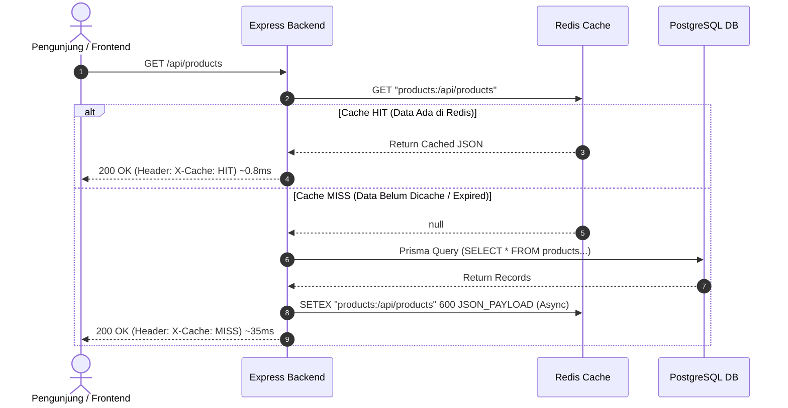

# 01. Caching Strategy & Cache Invalidation

Dokumen ini membedah arsitektur **Caching**, strategi **Cache-Aside**, mitigasi jebakan performa (*Cache Stampede*, *Stale Data*, *Blocking KEYS command*), serta implementasi nyata middleware caching berbasis Redis di project **Nexa Streetwear**.

---

## 1. Mengapa Caching Krusial untuk E-Commerce?

Dalam platform e-commerce, rasio pembacaan (*Read*) terhadap penulisan (*Write*) biasanya mencapai **9:1 bahkan 99:1**. Ratusan pengunjung melihat etalase produk, kategori, dan banner promosi yang sama berulang kali, sementara perubahan harga atau stok oleh admin terjadi jauh lebih jarang.

```
+-----------------------------------------------------------------------------------+
| Rasio Trafik E-Commerce:                                                          |
| [=========================================================================>] Read |
| [=>] Write                                                                        |
+-----------------------------------------------------------------------------------+
```

Jika setiap kunjungan halaman produk harus memicu query database PostgreSQL (melakukan *join table*, parsing JSON, dan serialisasi data), CPU database akan melonjak 100% dan server mengalami *latency spike*.

### Perbandingan Latensi: Database vs In-Memory Cache

| Layer Penyimpanan | Media | Rata-rata Latensi | Throughput (RPS) |
| :--- | :--- | :--- | :--- |
| **PostgreSQL Disk (SSD NVMe)** | Disk I/O + SQL Engine | 15 ms – 80 ms | ~500 – 1.500 req/dtk |
| **PostgreSQL Buffer Pool (RAM)** | OS Memory Page | 2 ms – 5 ms | ~2.000 – 5.000 req/dtk |
| **Redis Cache (In-Memory K-V)** | In-Memory RAM C-Engine | **0.2 ms – 1.0 ms** | **50.000 – 100.000+ req/dtk** |

Dengan menaruh cache di depan database, latensi endpoint katalog berkurang hingga **>90%**, dan database PostgreSQL terlindungi dari kelebihan beban (*overload*).

---

## 2. Pola Arsitektur: Cache-Aside (Lazy Loading)

Nexa Streetwear mengadopsi pola **Cache-Aside**. Pada pola ini, aplikasi Express bertindak sebagai orkestrator yang langsung berkomunikasi dengan Redis dan PostgreSQL.



### Keuntungan Pola Cache-Aside:
1. **Resilience (Tahan Gangguan):** Jika Redis mati atau kehabisan memori, aplikasi tidak *crash*. Express otomatis melakukan *fallback* langsung membaca database PostgreSQL.
2. **Cost-Effective (Hemat Memori):** Data yang masuk ke cache hanya data yang memang diminta oleh pengguna (*demand-driven*), bukan seluruh tabel database.

---

## 3. Mitigasi Jebakan Klasik Caching

Mengimplementasikan caching tanpa perhitungan matang sering menimbulkan bencana performa baru:

### A. Bahaya Perintah `KEYS *` (Redis Event Loop Freeze)
* **Masalah:** Redis berjalan dengan arsitektur *Single-Threaded Event Loop*. Perintah `KEYS products:*` akan memindai seluruh memori Redis secara sinkron. Jika di Redis ada 50.000 key, server Redis akan membeku (*freeze*) selama ratusan milidetik, membuat semua request lain macet.
* **Solusi di Nexa:** Menggunakan **`redis.scanStream`** (perintah `SCAN` non-blocking cursor) yang memproses key per batch (100 key) dan menghapusnya menggunakan Redis Pipeline tanpa menghentikan request lain.

### B. Masalah *Stale Data* (Data Usang / Kedaluwarsa)
* **Masalah:** Admin mengubah harga jaket dari Rp 250.000 menjadi Rp 199.000, namun pembeli masih melihat harga lama karena cache produk masih tersimpan selama 10 menit.
* **Solusi di Nexa:** **Pola Write-Invalidate**. Setiap kali ada aksi mutasi (POST, PATCH, PUT, DELETE) pada rute kategori atau produk, middleware `invalidateCache` otomatis menghapus semua key terkait di Redis.

### C. Masalah *Cache Stampede / Thundering Herd*
* **Masalah:** Ketika key cache yang sangat populer (misalnya katalog homepage) kedaluwarsa tepat saat ada 1.000 request masuk bersamaan, ke-1.000 request tersebut akan bersama-sama melihat `Cache MISS` dan menembak database PostgreSQL sekaligus.
* **Solusi di Nexa:** Penjadwalan TTL adaptif dan pemisahan query ber-variasi tinggi via filter `shouldSkip`.

---

## 4. Implementasi Nyata di Codebase Nexa Streetwear

Sistem caching Nexa Streetwear diatur secara terpusat dan modular di backend:

### A. Middleware Caching Respons: [`backend/src/middleware/cacheMiddleware.ts`](file:///home/allrole/Documents/Learning/Streetwear%20|%20E-commerce%20Project/backend/src/middleware/cacheMiddleware.ts#L19-L65)

```typescript
export const cacheResponse = (
  ttlSeconds: number = 300,
  prefix: string = "cache",
  options?: CacheResponseOptions
) => {
  return async (req: Request, res: Response, next: NextFunction) => {
    // 1. Lewati cache jika bukan method GET atau jika difilter oleh shouldSkip
    if (req.method !== "GET" || (options?.shouldSkip && options.shouldSkip(req))) {
      return next();
    }

    const cacheKey = `${prefix}:${req.originalUrl || req.url}`;

    try {
      // 2. Cek apakah ada di Redis
      const cached = await redis.get(cacheKey);
      if (cached) {
        const parsed: CachePayload = JSON.parse(cached);
        res.setHeader("X-Cache", "HIT");
        if (parsed.contentType) {
          res.setHeader("Content-Type", parsed.contentType);
        }
        return res.send(parsed.body);
      }
    } catch (err) {
      console.warn("Redis cache read warning:", err);
    }

    // 3. Jika MISS, pasang header dan intercept res.send untuk disimpan ke Redis
    res.setHeader("X-Cache", "MISS");

    const originalSend = res.send.bind(res);
    res.send = (body: any) => {
      if (res.statusCode >= 200 && res.statusCode < 300) {
        const contentType = res.getHeader("Content-Type") as string | undefined;
        const payloadToCache = JSON.stringify({ body, contentType });

        redis.set(cacheKey, payloadToCache, "EX", ttlSeconds).catch((err: any) => {
          console.warn("Redis cache write warning:", err);
        });
      }
      return originalSend(body);
    };

    next();
  };
};
```

### B. Penghapusan Aman Non-Blocking: [`backend/src/middleware/cacheMiddleware.ts`](file:///home/allrole/Documents/Learning/Streetwear%20|%20E-commerce%20Project/backend/src/middleware/cacheMiddleware.ts#L120-L146)

Alih-alih memakai `KEYS *`, sistem menggunakan `redis.scanStream` dan `redis.pipeline()`:

```typescript
export const deleteKeysByPattern = async (pattern: string): Promise<void> => {
  try {
    const stream = redis.scanStream({
      match: pattern,
      count: 100, // Ambil 100 key per batch agar tidak membebani event-loop
    });

    stream.on("data", (keys: string[]) => {
      if (keys.length > 0) {
        const pipeline = redis.pipeline();
        keys.forEach((key) => pipeline.del(key));
        pipeline.exec().catch((err: any) => {
          console.warn("Redis pipeline del error:", err);
        });
      }
    });
  } catch (err) {
    console.warn("Error invalidating keys by pattern:", err);
  }
};
```

### C. Invalidation Otomatis saat Mutasi Data: [`backend/src/middleware/cacheMiddleware.ts`](file:///home/allrole/Documents/Learning/Streetwear%20|%20E-commerce%20Project/backend/src/middleware/cacheMiddleware.ts#L151-L162)

```typescript
export const invalidateCache = (prefix: string) => {
  return async (_req: Request, res: Response, next: NextFunction) => {
    const originalSend = res.send.bind(res);
    res.send = (body: any) => {
      // Hanya bersihkan cache jika operasi mutasi database berhasil (2xx)
      if (res.statusCode >= 200 && res.statusCode < 300) {
        deleteKeysByPattern(`${prefix}:*`);
      }
      return originalSend(body);
    };
    next();
  };
};
```

### D. Penerapan di Routing Produk & Kategori

1. **Kategori ([`backend/src/modules/category/category.routes.ts`](file:///home/allrole/Documents/Learning/Streetwear%20|%20E-commerce%20Project/backend/src/modules/category/category.routes.ts#L13-L22)):**
   - `GET /` di-cache selama **600 detik (10 menit)** dengan prefix `categories`.
   - `POST /` & `DELETE /:id` diproteksi oleh `invalidateCache("categories")`.
2. **Produk ([`backend/src/modules/product/product.routes.ts`](file:///home/allrole/Documents/Learning/Streetwear%20|%20E-commerce%20Project/backend/src/modules/product/product.routes.ts#L16-L49)):**
   - `GET /api/products` di-cache selama **600 detik** dengan opsi `shouldSkip` untuk menghindari pemborosan RAM pada query pencarian bertingkat liar.
   - `GET /:id` dan `GET /*slugPath` di-cache dengan prefix `products`.
   - `POST /`, `PUT /:id`, dan `DELETE /:id` diproteksi oleh `invalidateCache("products")`.
3. **Keranjang Belanja ([`backend/src/modules/order/order.service.ts`](file:///home/allrole/Documents/Learning/Streetwear%20|%20E-commerce%20Project/backend/src/modules/order/order.service.ts#L118-L121)):**
   - Saat order berhasil dibuat, cache keranjang dihapus seketika via:
     ```typescript
     redis.del(`cart:user:${userId}`);
     ```

---

## 5. Cheatsheet Verifikasi & Pengujian Performa

### 1. Memeriksa Header Response via cURL
Jalankan request pertama (Cache MISS):
```bash
curl -I http://localhost:5000/api/products
```
*Output:*
```http
HTTP/1.1 200 OK
X-Cache: MISS
Content-Type: application/json; charset=utf-8
```

Jalankan request kedua langsung sesudahnya (Cache HIT):
```bash
curl -I http://localhost:5000/api/products
```
*Output:*
```http
HTTP/1.1 200 OK
X-Cache: HIT
Content-Type: application/json; charset=utf-8
```
*(Waktu response berkurang drastis dari puluhan milidetik menjadi di bawah 1 milidetik!)*

### 2. Memeriksa Memory & Key di Redis CLI
```bash
# Masuk ke Redis CLI
redis-cli

# Cek penggunaan memori Redis
INFO memory

# Cek daftar key produk yang sedang aktif (Gunakan SCAN, BUKAN KEYS!)
SCAN 0 MATCH products:* COUNT 20

# Cek sisa waktu kedaluwarsa (TTL) dari suatu key (dalam detik)
TTL "products:/api/products"
```

---

## 6. Kesimpulan

Dengan menerapkan arsitektur **Cache-Aside** berbasis Redis yang dilengkapi dengan **Non-blocking Key Invalidation (`SCAN` + `pipeline`)**:
- Katalog Nexa Streetwear mampu menahan lonjakan ribuan pengunjung tanpa membebani database PostgreSQL.
- Risiko *stale data* berhasil dicegah 100% karena setiap perubahan inventori langsung memicu penghapusan cache secara instan.
- Sistem tetap aman dan stabil pada server VPS ekonomis kelas freelance (1–2 GB RAM).
