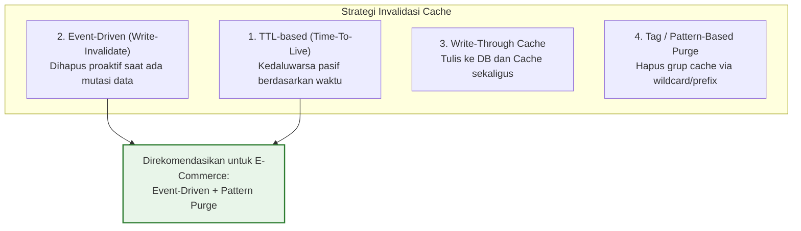

# 02. Stale Cache & Cache Invalidation Strategies

Dokumen ini membedah fenomena **Stale Cache** (data basi/usang), mengapa masalah ini menjadi salah satu momok terbesar dalam rekayasa perangkat lunak (*"There are only two hard things in Computer Science: cache invalidation and naming things"*), serta strategi dan *best practices* implementasi invalidasi cache di **Nexa Streetwear**.

---

## 1. Apa itu Stale Cache? (The Stale Data Problem)

**Stale Cache** adalah kondisi di mana data yang tersimpan di layer *in-memory cache* (Redis) atau di browser pengguna sudah tidak lagi mencerminkan kondisi data sebenarnya (*Single Source of Truth*) di database utama (PostgreSQL).

```
+-------------------+           +-------------------+
|    REDIS CACHE    |           |    POSTGRESQL     |
| (Tersimpan 10m)   |  BERBEDA  |  (Data Terkini)   |
| Harga: Rp 200.000 |  ======>  | Harga: Rp 150.000 |
| Stok: 10          |           | Stok: 0 (HABIS)   |
+-------------------+           +-------------------+
```

### Mengapa Stale Cache Sangat Berbahaya di E-Commerce?
Di aplikasi blog atau berita, membaca artikel yang terlambat diupdate 5 menit bukanlah masalah kritis. Namun di e-commerce streetwear, stale cache dapat menimbulkan kerugian finansial langsung:

1. **Harga Hantu (*Phantom Pricing*):** Admin menurunkan harga jaket dari Rp 450.000 menjadi flash sale Rp 250.000. Jika cache tidak diinvalidasi, pembeli masih melihat harga mahal di etalase dan tidak jadi checkout (*lost sales*).
2. **Stok Palsu (*Ghost Stock & Overselling*):** Produk edisi terbatas (*limited drop*) telah habis diborong pembeli, namun etalase masih menampilkan "Stok: 5" karena data diambil dari cache. Pembeli yang checkout berikutnya akan mengalami kegagalan transaksi dan kecewa (*bad customer experience*).
3. **Status Order Menggantung:** Pembeli sudah menyelesaikan pembayaran QRIS melalui Webhook Midtrans, namun ketika membuka riwayat order, statusnya masih "Pending" karena halaman order di-cache secara statis.

---

## 2. Taksonomi Strategi Cache Invalidation

Untuk menjaga agar cache tetap segar (*fresh*), ada 4 pendekatan utama dalam rekayasa software:



### 1. TTL-Based Invalidation (Time-To-Live / Passive Expiration)
- **Cara Kerja:** Setiap data yang ditulis ke Redis diberi jangka waktu hidup (misal: 600 detik). Setelah 10 menit, Redis secara otomatis menghapus key tersebut dari memori.
- **Kelebihan:** Sangat mudah diimplementasikan, memori Redis tidak akan pernah bocor karena key selalu kedaluwarsa sendiri (*self-cleaning*).
- **Kekurangan:** Ada jeda waktu (*window of staleness*) di mana data basi tetap disajikan kepada pengguna hingga detik terakhir TTL.

### 2. Event-Driven Invalidation (Write-Invalidate / Reactive Purge)
- **Cara Kerja:** Aplikasi tidak menunggu TTL habis. Begitu ada aksi mutasi database (`CREATE`, `UPDATE`, `DELETE`), sistem langsung menghapus (*purge*) key cache yang bersangkutan.
- **Kelebihan:** Konsistensi data tinggi. Pengunjung langsung melihat data terbaru dalam hitungan milidetik setelah admin menekan tombol Simpan.
- **Kekurangan:** Memerlukan tracking keterkaitan data (misal: update 1 produk harus menghapus cache detail produk, cache daftar produk, dan cache kategori terkait).

### 3. Write-Through vs Write-Around
- **Write-Through:** Menulis data ke database dan secara bersamaan memperbarui payload JSON di cache Redis. Pendekatan ini berisiko menimbulkan *race condition* jika ada dua proses write paralel yang menyelesaikan urutan terbalik.
- **Write-Around (Purge on Mutation):** Menulis data ke database lalu **menghapus (`DEL`)** key di cache. Request pembeli berikutnya yang akan mengambil data segar dari database dan menyimpannya kembali ke cache (*Cache-Aside*). **Ini adalah pola yang paling stabil dan diadopsi oleh Nexa**.

---

## 3. Best Practices Rekayasa Cache Invalidation

### A. Prinsip "Purge, Don't Update" (Hapus, Jangan Timpa)
Saat admin mengupdate produk, **jangan mencoba meng-update payload di Redis**. Cukup **hapus (`DEL`)** key tersebut.
- Mengapa? Jika ada request Admin A dan Admin B yang memperbarui produk di milidetik yang hampir bersamaan, urutan penulisan ke Redis bisa tertukar dengan urutan penulisan di PostgreSQL, mengakibatkan cache memuat data yang salah secara permanen. Menghapus key menjamin data berikutnya 100% dibaca dari database yang sah.

### B. Urutan Eksekusi yang Benar: Database Dulu, Invalidate Kemudian
```
❌ SALAH:
1. Invalidate cache Redis
2. Tulis ke database PostgreSQL (Jika langkah ini gagal/rollback, cache sudah terlanjur hilang sia-sia!)

✅ BENAR:
1. Jalankan transaksi database PostgreSQL sampai commit berhasil
2. Baru panggil pembersihan cache di Redis
```

### C. Gunakan Non-Blocking Deletion untuk Pattern Wildcard
Jika menghapus seluruh cache katalog produk (`products:*`), **dilarang keras menggunakan perintah `redis.keys()`**. Perintah tersebut memblokir *single-threaded event loop* Redis. Selalu gunakan `SCAN` kursor non-blocking dengan Redis Pipeline.

---

## 4. Implementasi Nyata di Codebase Nexa Streetwear

Sistem invalidasi cache di Nexa Streetwear dibangun secara terstruktur menggunakan middleware Express dan utility Redis:

### A. Non-Blocking Pattern Invalidation Engine
Di [`backend/src/middleware/cacheMiddleware.ts`](file:///home/allrole/Documents/Learning/Streetwear%20|%20E-commerce%20Project/backend/src/middleware/cacheMiddleware.ts#L120-L146), fungsi `deleteKeysByPattern` menggunakan stream kursor:

```typescript
export const deleteKeysByPattern = async (pattern: string): Promise<void> => {
  try {
    const stream = redis.scanStream({
      match: pattern,
      count: 100, // Membaca 100 kunci per iterasi cursor agar CPU Redis tetap 0%
    });

    stream.on("data", (keys: string[]) => {
      if (keys.length > 0) {
        // Hapus secara batch menggunakan Pipeline
        const pipeline = redis.pipeline();
        keys.forEach((key) => pipeline.del(key));
        pipeline.exec().catch((err: any) => {
          console.warn("Redis pipeline del error:", err);
        });
      }
    });

    stream.on("error", (err: any) => {
      console.warn("Redis scanStream error:", err);
    });
  } catch (err) {
    console.warn("Error invalidating keys by pattern:", err);
  }
};
```

### B. Middleware Invalidation Response Interceptor
Di [`backend/src/middleware/cacheMiddleware.ts`](file:///home/allrole/Documents/Learning/Streetwear%20|%20E-commerce%20Project/backend/src/middleware/cacheMiddleware.ts#L151-L162), invalidasi hanya dieksekusi **jika dan hanya jika response HTTP berstatus 2xx (sukses)**:

```typescript
export const invalidateCache = (prefix: string) => {
  return async (_req: Request, res: Response, next: NextFunction) => {
    const originalSend = res.send.bind(res);
    res.send = (body: any) => {
      // Pastikan transaksi database berhasil sebelum menghapus cache
      if (res.statusCode >= 200 && res.statusCode < 300) {
        deleteKeysByPattern(`${prefix}:*`);
      }
      return originalSend(body);
    };
    next();
  };
};
```

### C. Integrasi pada Rute Mutasi Produk & Kategori
1. **Produk ([`backend/src/modules/product/product.routes.ts`](file:///home/allrole/Documents/Learning/Streetwear%20|%20E-commerce%20Project/backend/src/modules/product/product.routes.ts#L10-L33)):**
   ```typescript
   // Otomatis membersihkan seluruh cache products:* saat admin membuat, mengubah, atau menghapus produk
   router.post("/", verifyAccessToken, verifyAdmin, uploadProductImage, invalidateCache("products"), ProductController.createProduct);
   router.patch("/:id", verifyAccessToken, verifyAdmin, uploadProductImage, invalidateCache("products"), ProductController.updateProduct);
   router.delete("/:id", verifyAccessToken, verifyAdmin, invalidateCache("products"), ProductController.deleteProduct);
   ```

2. **Kategori ([`backend/src/modules/category/category.routes.ts`](file:///home/allrole/Documents/Learning/Streetwear%20|%20E-commerce%20Project/backend/src/modules/category/category.routes.ts#L9-L23)):**
   ```typescript
   router.post("/", verifyAccessToken, verifyAdmin, invalidateCache("categories"), CategoryController.createCategories);
   router.delete("/:id", verifyAccessToken, verifyAdmin, invalidateCache("categories"), CategoryController.deleteCategories);
   ```

### D. Invalidation Otomatis saat Terjadi Transaksi Checkout
Ketika pembeli berhasil checkout di [`backend/src/modules/order/order.service.ts`](file:///home/allrole/Documents/Learning/Streetwear%20|%20E-commerce%20Project/backend/src/modules/order/order.service.ts#L118-L123), dua pembersihan cache dijalankan sekaligus:
```typescript
// 1. Hapus cache keranjang spesifik milik user tersebut
redis.del(`cart:user:${userId}`).catch((err: any) => {
  console.warn("Failed to invalidate cart cache after checkout:", err);
});

// 2. Hapus cache produk agar kuantitas stok produk terkini langsung terlihat oleh pembeli lain
deleteKeysByPattern("products:*");
```

---

## 5. Cheatsheet Verifikasi Siklus Invalidasi Cache

Untuk membuktikan bahwa sistem bebas dari *stale data*, jalankan skenario pengujian siklus hidup berikut:

```bash
# LANGKAH 1: Request pertama (Database Read -> Simpan ke Redis)
curl -i http://localhost:5000/api/products
# Perhatikan Header: X-Cache: MISS

# LANGKAH 2: Request kedua (Langsung dari Redis Memory)
curl -i http://localhost:5000/api/products
# Perhatikan Header: X-Cache: HIT (Response time ~0.8ms)

# LANGKAH 3: Mutasi Data (Admin mengubah data produk via PATCH)
curl -X PATCH http://localhost:5000/api/products/1 \
  -H "Authorization: Bearer <ADMIN_TOKEN>" \
  -H "Content-Type: application/json" \
  -d '{"name": "Nexa Street Hoodie V2"}'
# Status: 200 OK -> Middleware otomatis menghapus key "products:*" di Redis

# LANGKAH 4: Request ketiga setelah mutasi
curl -i http://localhost:5000/api/products
# Perhatikan Header: X-Cache: MISS
# Data yang dikembalikan langsung memuat "Nexa Street Hoodie V2" (Bebas dari Stale Data!)
```

---

## 6. Kesimpulan

Dengan memadukan **Passive Expiration (TTL 10 menit)** sebagai jaring pengaman dan **Event-Driven Write-Invalidation (`SCAN` + Pipeline)** sebagai eksekutor utama:
- Pengunjung toko selalu mendapatkan data paling mutakhir tanpa perlu me-refresh manual.
- Pembeli terhindar dari jebakan *phantom pricing* dan *overselling*.
- Performa server tetap berada pada kecepatan puncak tanpa resiko kebocoran memori atau pembekuan *event-loop* Redis.
