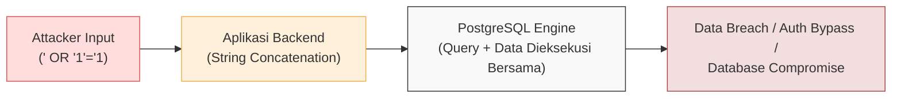
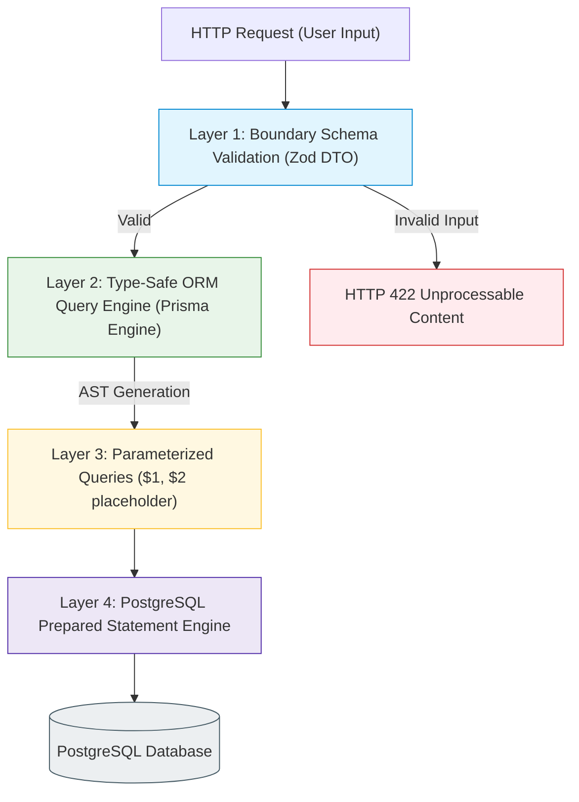

# 01. SQL Injection (SQLi) Prevention & Sanitization

## 1. Masalah yang Terjadi (Vulnerability Anatomy)

**SQL Injection (SQLi)** adalah salah satu celah keamanan paling berbahaya dalam aplikasi web (secara konsisten masuk dalam peringkat teratas *OWASP Top 10* kategori **A03:2021 – Injection**).

Celah ini terjadi saat aplikasi mencampurkan input mentah yang tidak tepercaya (*untrusted user input*) langsung ke dalam sintaks perintah SQL melalui penggabungan string (*string concatenation* atau *template string interpolation*) tanpa melalui proses sanitasi atau *parameterization*.



### Vektor Serangan Nyata pada E-Commerce Streetwear:

1. **Authentication Bypass (Login Tanpa Password):**
   ```sql
   -- Query rentan:
   SELECT * FROM users WHERE email = 'admin@nexa.com' AND password = '' OR '1'='1';
   ```
   *Dampak:* Penyerang berhasil masuk sebagai akun administrator tanpa mengetahui kredensial asli.

2. **Pencurian Data Sensitif via UNION-Based Injection:**
   Pada fitur filter produk berdasarkan kategori atau keyword:
   ```sql
   -- Penyerang menginput: streetwear' UNION SELECT id, password_hash, email, 0, 0, NULL, NULL FROM users --
   SELECT id, name, slug, price FROM products WHERE name ILIKE '%streetwear' 
   UNION SELECT id, password_hash, email, 0 FROM users --%';
   ```
   *Dampak:* Tabel katalog produk membocorkan hash password pelanggan, nomor handphone, atau token API.

3. **Destructive Command / Stored Procedure Hijacking:**
   ```sql
   -- Penyerang menyisipkan pemisah statement:
   SELECT * FROM cart_items WHERE id = 12; DROP TABLE orders CASCADE; --
   ```
   *Dampak:* Kehilangan data transaksi historis e-commerce secara permanen (*data loss*).

---

## 2. Solusi Best Practice (Defense-in-Depth)

Untuk mencegah SQL Injection secara menyeluruh (*100% immune*), project ini mengadopsi prinsip **Pertahanan Berlapis (*Defense-in-Depth*)**:



### Prinsip Utama Penangkalan:
1. **Pemisahan Logika Kode vs Data Literal (*Separation of Code and Data*):**
   * Database engine harus menerima struktur SQL query terlebih dahulu untuk di-kompilasi (*Prepared Statement* / *Parsed Query Plan*), kemudian nilai parameter disuntikkan secara terpisah sebagai nilai literal bertipe data spesifik. Nilai tersebut tidak akan pernah bisa mengubah alur logika parser SQL.
2. **Tagged Template Literal Engine:**
   * Untuk raw SQL yang kompleks, dilarang keras menggunakan *string template biasa* (`` `SELECT * WHERE id = ${id}` ``). Wajib menggunakan *Tagged Template* (seperti `prisma.$queryRaw` atau parameterized tagged templates) di mana compiler membedah string fragment dan parameter value secara terpisah.
3. **Strict Boundary Validation:**
   * Sebelum sebuah request menyentuh database layer, seluruh struktur payload diinspeksi oleh Zod validator. Input yang tidak sesuai tipe data (misal: ID harus integer, email harus format RFC 5322, slug harus alfanumerik) langsung ditolak di gerbang HTTP.
4. **Prinsip Hak Akses Minimal (*Least Privilege Database User*):**
   * User database aplikasi di production hanya diberikan izin `SELECT`, `INSERT`, `UPDATE`, `DELETE` pada skema publik, tanpa izin manipulasi sistem atau superuser commands.

---

## 3. Implementasi Nyata di Codebase Project Ini

Project **Nexa Streetwear** menerapkan 4 pilar benteng penangkalan SQL Injection:

### Pilar 1: Validasi Input Ketat via Zod di Middleware HTTP
Setiap data yang dikirimkan oleh pengguna melewati validasi skema Zod sebelum mencapai *controller* atau *service*:

Berkas Middleware:
[`backend/src/middleware/validateMiddleware.ts`](file:///home/allrole/Documents/Learning/Streetwear%20|%20E-commerce%20Project/backend/src/middleware/validateMiddleware.ts#L4-L27)

Berkas Skema Autentikasi:
[`backend/src/modules/auth/auth.validation.ts`](file:///home/allrole/Documents/Learning/Streetwear%20|%20E-commerce%20Project/backend/src/modules/auth/auth.validation.ts#L5-L42)

```typescript
// backend/src/modules/auth/auth.validation.ts
export const emailSchema = z
  .string()
  .min(1, "Email tidak boleh kosong")
  .max(70, "Email maksimal 70 karakter")
  .email("Format email tidak valid");
```
> [!NOTE]
> Jika penyerang mengirimkan payload `' OR 1=1 --` pada field email, validasi Zod langsung menghentikan request dengan status `HTTP 422 Unprocessable Content` karena karakter kutip dan format tidak sesuai dengan standar email yang sah. Input penyerang bahkan tidak pernah menyentuh layer database.

---

### Pilar 2: Prisma ORM Binary Engine Parameterization
Operasi data sehari-hari (CRUD katalog, keranjang, pesanan, dan manajemen akun) menggunakan Prisma ORM.

Koneksi Singleton:
[`backend/src/config/prisma.ts`](file:///home/allrole/Documents/Learning/Streetwear%20|%20E-commerce%20Project/backend/src/config/prisma.ts)

Contoh Pemanggilan di Service/Model:
```typescript
// backend/src/modules/user/user.service.ts
const user = await prisma.users.findUnique({
  where: { email: cleanEmail },
});
```
*Mekanisme Keamanan:*
Prisma menyusun Abstract Syntax Tree (AST) secara internal dan mengirimkan query ke PostgreSQL dengan parameter `$1`. Nilai `cleanEmail` selalu diperlakukan murni sebagai string konstanta, sehingga payload SQL apapun di dalamnya tidak akan pernah dieksekusi sebagai perintah SQL.

---

### Pilar 3: Tagged Template Literal pada `$queryRaw`
Ketika project membutuhkan performa tinggi atau query PostgreSQL lanjutan (seperti *Full-Text Search Trigram* atau *Recursive CTE* untuk hierarki kategori), project ini menggunakan **Prisma Tagged Template Literal** ``prisma.$queryRaw`...` ``.

Contoh 1 — Hierarki Kategori Rekursif:
[`backend/src/modules/product/product.service.ts`](file:///home/allrole/Documents/Learning/Streetwear%20|%20E-commerce%20Project/backend/src/modules/product/product.service.ts#L146-L158)
```typescript
// AMAN: Ekspresi ${category.id} otomatis ditangkap oleh tagged template 
// dan diteruskan sebagai parameter bind ($1) ke PostgreSQL:
const hierarchyResult = await prisma.$queryRaw<any[]>`
  WITH RECURSIVE category_tree AS (
     SELECT id, name, slug, parent_id FROM categories WHERE id = ${category.id}
     UNION ALL
     SELECT c.id, c.name, c.slug, c.parent_id 
     FROM categories c
     INNER JOIN category_tree ct ON ct.parent_id = c.id
   )
   SELECT id, name, slug, parent_id FROM category_tree;
`;
```

Contoh 2 — Pencarian Typo-Tolerance Trigram Index:
[`backend/src/modules/product/product.model.ts`](file:///home/allrole/Documents/Learning/Streetwear%20|%20E-commerce%20Project/backend/src/modules/product/product.model.ts#L143-L160)
```typescript
// AMAN: Parameter ${cleanQuery} dan ${cursorFilter} di-bind terpisah:
const fuzzyRows = await prisma.$queryRaw<any[]>`
  SELECT 
    p.id, 
    p.category_id, 
    p.name, 
    p.slug, 
    p.price, 
    p.img_url, 
    p.created_at,
    word_similarity(${cleanQuery}, p.name) AS score
  FROM products p
  WHERE p.deleted_at IS NULL
    AND (${cleanQuery} <% p.name OR word_similarity(${cleanQuery}, p.name) > 0.3)
    AND p.id > ${cursorFilter}
  ORDER BY score DESC, p.id ASC
  LIMIT ${limit + 1}
`;
```

> [!WARNING]
> **Larangan Mutlak:** Jangan pernah menggunakan `prisma.$queryRawUnsafe(query)` yang digabungkan dengan string biasa!
> ```typescript
> // SANGAT RENTAN (DILARANG KERAS):
> await prisma.$queryRawUnsafe(`SELECT * FROM products WHERE name = '${userInput}'`);
> ```

---

### Pilar 4: Safe Low-Level Parameter Array pada Native Driver `pg`
Pada layer infrastruktur transaksi database manual yang menggunakan client `pg.PoolClient`:

Berkas Transaksi Helper:
[`backend/src/config/db.ts`](file:///home/allrole/Documents/Learning/Streetwear%20|%20E-commerce%20Project/backend/src/config/db.ts#L26-L41)

```typescript
// backend/src/config/db.ts
export const withTransaction = async <T>(
  callback: (client: pkg.PoolClient) => Promise<T>
): Promise<T> => {
  const client = await pool.connect();
  try {
    await client.query("BEGIN");
    const result = await callback(client);
    await client.query("COMMIT");
    return result;
  } catch (error) {
    await client.query("ROLLBACK");
    throw error;
  } finally {
    client.release();
  }
};
```
Ketika mengeksekusi query melalui `client.query`, selalu sertakan array parameter:
```typescript
// AMAN: Menggunakan array parameter kedua:
await client.query(
  "SELECT id, stock FROM product_variants WHERE id = $1 AND deleted_at IS NULL",
  [variantId]
);
```

---

## 4. Perbandingan Kode: Vulnerable vs Secure Cheatsheet

| Skenario | Pola Rentan (Vulnerable ❌) | Pola Aman di Project Ini (Secure ✅) |
|:---|:---|:---|
| **Query Prisma Standar** | *N/A (Prisma method call otomatis aman).* | `prisma.products.findMany({ where: { slug } })` |
| **Prisma Raw Query** | `prisma.$queryRawUnsafe("SELECT * FROM users WHERE email = '" + email + "'")` | ``prisma.$queryRaw`SELECT * FROM users WHERE email = ${email}` `` |
| **Pencarian ILIKE / Regex** | `` `SELECT * FROM items WHERE name ILIKE '%${keyword}%'` `` | ``prisma.$queryRaw`SELECT * FROM items WHERE name ILIKE ${'%' + keyword + '%'}` `` |
| **Native PG Driver** | `client.query("UPDATE users SET name = '" + name + "' WHERE id = " + id)` | `client.query("UPDATE users SET name = $1 WHERE id = $2", [name, id])` |
| **Input Parsing** | Mengambil langsung `req.body.id` tanpa validasi tipe data | `const { id } = validate(idSchema)` (memastikan integer via Zod) |

---

## 5. Simulasi Pengujian Keamanan (Security Verification)

Berikut adalah hasil pengujian skenario serangan injeksi terhadap endpoint project:

### Skenario A: Injeksi pada Endpoint Autentikasi (`POST /api/auth/login`)
* **Payload Input:**
  ```json
  {
    "email": "' OR '1'='1' --",
    "password": "randompassword"
  }
  ```
* **Hasil Pengujian:**
  1. Middleware [`validateMiddleware.ts`](file:///home/allrole/Documents/Learning/Streetwear%20|%20E-commerce%20Project/backend/src/middleware/validateMiddleware.ts) mengaktifkan skema Zod.
  2. Zod menolak string karena tidak memenuhi validasi regex RFC 5322 email.
  3. Respons HTTP: `422 Unprocessable Content` dengan pesan `"Format email tidak valid"`.
  4. Database **tidak tersentuh sama sekali**.

### Skenario B: Injeksi pada Keyword Pencarian Katalog (`GET /api/products/search?q=...`)
* **Payload Input:**
  ```
  GET /api/products/search?q=hoodie%27%20UNION%20SELECT%20id,%20password,%20email%20FROM%20users--
  ```
* **Hasil Pengujian:**
  1. Query dialirkan ke method `searchProductsFuzzy` di [`product.model.ts`](file:///home/allrole/Documents/Learning/Streetwear%20|%20E-commerce%20Project/backend/src/modules/product/product.model.ts#L143).
  2. Input dimasukkan ke tagged template ``word_similarity(${cleanQuery}, p.name)``.
  3. PostgreSQL mengompilasi fungsi `word_similarity($1, p.name)` di mana `$1 = "hoodie' UNION SELECT id, password, email FROM users--"`.
  4. Mesin PostgreSQL mencari produk yang memiliki nama harfiah mirip dengan kalimat tersebut.
  5. Respons: Produk tidak ditemukan (`[]`), data kredensial users **tetap 100% aman dan terlindungi**.

---

## 6. Checklist Keamanan Pengembang (Developer Security Checklist)

Sebelum melakukan merge / commit fitur baru yang berinteraksi dengan database:

- [x] **Hindari String Concatenation:** Tidak ada penggabungan string (`+`) atau template string standar (`` `${val}` ``) saat menyusun query SQL.
- [x] **Gunakan Prisma Tagged Template:** Jika menggunakan `$queryRaw`, selalu gunakan tagged template literal tanpa memanggil `$queryRawUnsafe`.
- [x] **Validasi Boundary dengan Zod:** Semua endpoint menerima payload yang telah divalidasi skema Zod (tipe data, panjang minimal/maksimal, pola karakter).
- [x] **Array Parameter pada Native Driver:** Jika menggunakan `pg.Pool` atau `pg.PoolClient`, parameter selalu dikirimkan dalam array terpisah `$1, $2, ...`.
- [x] **Sanitasi Identifier Dinamis (Whitelist):** Jika nama kolom atau arah urutan (`ASC`/`DESC`) bersifat dinamis dari input pengguna, gunakan daftar putih (*whitelist* enum) ketat, bukan string bebas.

---

## Review Senior Backend: Analisis Gap & Batasan Mentok Implementasi

### Status Saat Ini:
* Bebas dari celah SQL Injection di seluruh layer ORM Prisma, `$queryRaw` tagged templates, low-level pg driver arrays, serta validasi skema Zod.

### Hal yang Belum Diimplementasikan (Menuju Standar Tertinggi / Batasan Mentok):
1. **Database Least-Privilege Role Hardening:**  
   Aplikasi Express saat ini terkoneksi ke PostgreSQL menggunakan user dengan hak kepemilikan penuh. Batasan mentoknya adalah membuat user database khusus aplikasi (`nexa_runtime`) yang dicabut hak akses DDL-nya (`REVOKE CREATE, DROP, ALTER ON SCHEMA public FROM nexa_runtime`), sehingga seandainya ada celah injeksi baru di masa depan, penyerang mustahil menghapus atau mengubah struktur tabel.
2. **Web Application Firewall (WAF) SQLi Signature Inspection:**  
   Pemeriksaan saat ini masih berada di level Node.js. Batasan mentoknya adalah memasang modul WAF di Nginx/Cloudflare (seperti ModSecurity dengan OWASP Core Rule Set v3) yang menolak pola SQLi berbahaya pada layer jaringan sebelum mencapai server Express.
