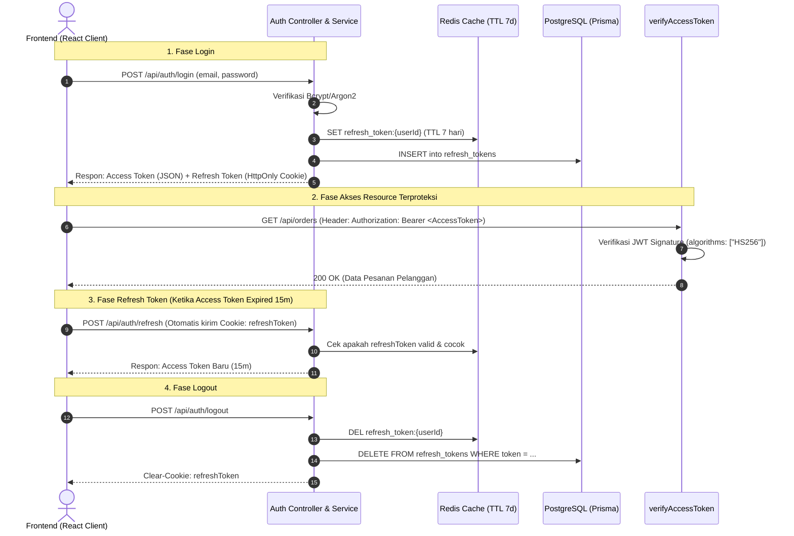

# 03. JSON Web Token (JWT) Lifecycle & Security Guide

## 1. Arsitektur & Cara Kerja JWT di Project Ini

Project **Nexa Streetwear** menerapkan arsitektur **Dual-Token Authentication** (*Access Token* + *Refresh Token*) untuk menyeimbangkan performa tinggi (*stateless*) dengan kontrol keamanan mutlak (*revocable session*).



---

## 2. Bedah Dua Jenis Token

| Parameter | Access Token | Refresh Token |
|:---|:---|:---|
| **Masa Berlaku (*Lifespan*)** | **15 Menit** (*Short-lived*) | **7 Hari** (*Long-lived*) |
| **Sifat (*State*)** | **Stateless:** Diverifikasi secara kriptografis tanpa query database. | **Stateful:** Disimpan di Redis (<1ms) dan tabel PostgreSQL untuk revokasi. |
| **Tempat Penyimpanan Klien** | In-Memory (React state / Axios memory) | **HttpOnly Cookie** (Kebal dari pencurian skrip XSS browser). |
| **Media Pengiriman HTTP** | Request Header: `Authorization: Bearer <token>` | Cookie: `refreshToken` (`SameSite=Strict/Lax`, `Secure`). |
| **Kunci Enkripsi (Secret)** | `env.JWT_ACCESS_SECRET` (256-bit) | `env.JWT_REFRESH_SECRET` (256-bit terpisah) |
| **Payload Data** | `{ id: user.id, role: user.role }` | `{ id: user.id, role: user.role }` |

---

## 3. Evaluasi: Apakah Sudah Best Practice?

Berikut adalah audit kepatuhan implementasi JWT project ini terhadap standar **OWASP JWT Cheat Sheet** dan **RFC 7519**:

### ✅ Aspek yang SUDAH Sesuai Best Practice:

1. **Short-Lived Access Token (15 Menit):**
   * *Alasan Keamanan:* Access token bersifat stateless sehingga tidak bisa di-revoke seketika tanpa whitelist. Dengan membatasi umurnya hanya 15 menit, risiko jika token disadap melalui jaringan publik sangat minim karena akan kedaluwarsa secara otomatis.
2. **Penyimpanan Refresh Token di `HttpOnly Cookie`:**
   * Berkas: [`backend/src/modules/auth/auth.controller.ts`](file:///home/allrole/Documents/Learning/Streetwear%20|%20E-commerce%20Project/backend/src/modules/auth/auth.controller.ts#L5-L10)
   * *Alasan Keamanan:* Menolak akses pembacaan cookie oleh JavaScript (`document.cookie`), sehingga kebal dari serangan pencurian token via **Cross-Site Scripting (XSS)**.
3. **Pemisahan Kunci Enkripsi (*Dual Secret Segregation*):**
   * Berkas: [`backend/src/utils/token.ts`](file:///home/allrole/Documents/Learning/Streetwear%20|%20E-commerce%20Project/backend/src/utils/token.ts#L10-L24)
   * *Alasan Keamanan:* `JWT_ACCESS_SECRET` dan `JWT_REFRESH_SECRET` menggunakan kunci rahasia yang terpisah total. Jika salah satu kunci disusupi, jenis token yang lain tetap terlindungi.
4. **Pencegahan Eksploitasi Algoritma (*Algorithm Confusion Attack / `alg: none`*):**
   * Berkas: [`backend/src/middleware/authMiddleware.ts`](file:///home/allrole/Documents/Learning/Streetwear%20|%20E-commerce%20Project/backend/src/middleware/authMiddleware.ts#L18-L20)
   * *Alasan Keamanan:* Library dipaksa secara eksplisit menggunakan `{ algorithms: ["HS256"] }`. Server menolak token yang dipalsukan dengan header `alg: none` atau `RS256` kunci publik.
5. **Entropi Kunci Tinggi (Minimal 256-Bit):**
   * Berkas: [`backend/src/config/env.ts`](file:///home/allrole/Documents/Learning/Streetwear%20|%20E-commerce%20Project/backend/src/config/env.ts#L31-L36)
   * *Alasan Keamanan:* Skema Zod mewajibkan secret minimal 32 karakter dan menolak nilai placeholder, kebal dari serangan *offline dictionary attack* menggunakan kartu grafis (GPU cracking).
6. **Kemampuan Logout Seketika (*Instant Revocation via Redis + DB*):**
   * Berkas: [`backend/src/modules/auth/auth.model.ts`](file:///home/allrole/Documents/Learning/Streetwear%20|%20E-commerce%20Project/backend/src/modules/auth/auth.model.ts#L98-L114)
   * *Alasan Keamanan:* Saat user menekan logout, session key di Redis dan record di PostgreSQL dihapus seketika. Refresh token yang sama tidak akan bisa digunakan lagi meskipun masa 7 hari belum habis.
7. **Payload Ramping & Bersih dari Data Sensitif:**
   * Payload JWT hanya menyimpan `id` dan `role`. Dilarang keras menaruh password hash, alamat email lengkap, atau nomor telepon di dalam payload JWT karena payload bersifat base64 yang dapat didekode oleh siapa saja.

8. **Refresh Token Rotation (RTR) dengan Grace Period & Reuse Detection:**
   * Berkas: [`backend/src/modules/auth/auth.service.ts`](file:///home/allrole/Documents/Learning/Streetwear%20|%20E-commerce%20Project/backend/src/modules/auth/auth.service.ts#L62-L105) & [`backend/src/modules/auth/auth.model.ts`](file:///home/allrole/Documents/Learning/Streetwear%20|%20E-commerce%20Project/backend/src/modules/auth/auth.model.ts#L60-L100)
   * *Mekanisme:* Setiap kali endpoint `/api/auth/refresh` dipanggil, server membakar refresh token lama dan menerbitkan **Refresh Token BARU**.
   * *Deteksi Pencurian (Token Theft Detection):* Jika ada pihak penyerang mencoba menggunakan refresh token lama yang sudah pernah dirotasi, sistem langsung mendeteksi anomali ini dan **membatalkan seluruh sesi pengguna seketika (revoke family)**.
   * *Grace Period (15 Detik):* Disediakan jendela 15 detik di Redis untuk menampung request konkuren dari browser client agar sesi tidak terputus saat beberapa API dipanggil bersamaan.

---

### ⚠️ Aspek Tambahan untuk Roadmap Masa Depan:

1. **Device Fingerprinting / Family Tracking:**
   * Menyimpan `User-Agent` atau IP hash bersama refresh token di Redis untuk memastikan token tidak digunakan dari lokasi geospasial atau browser yang berbeda secara tiba-tiba.

---

## 4. Implementasi Nyata di Codebase Project

### A. Generator & Verifikator Token di [`backend/src/utils/token.ts`](file:///home/allrole/Documents/Learning/Streetwear%20|%20E-commerce%20Project/backend/src/utils/token.ts)

```typescript
// backend/src/utils/token.ts
export const generateAccessToken = (user: UserPayload): string => {
  return jwt.sign(
    { id: user.id, role: user.role },
    env.JWT_ACCESS_SECRET,
    { expiresIn: "15m", algorithm: "HS256" }
  );
};

export const generateRefreshToken = (user: UserPayload): string => {
  return jwt.sign(
    { id: user.id, role: user.role },
    env.JWT_REFRESH_SECRET,
    { expiresIn: "7d", algorithm: "HS256" }
  );
};
```

---

### B. Proteksi Route via Middleware di [`backend/src/middleware/authMiddleware.ts`](file:///home/allrole/Documents/Learning/Streetwear%20|%20E-commerce%20Project/backend/src/middleware/authMiddleware.ts)

```typescript
// backend/src/middleware/authMiddleware.ts
export const verifyAccessToken = (req: Request, res: Response, next: NextFunction) => {
  const authHeader = req.headers.authorization;

  if (!authHeader || !authHeader.startsWith("Bearer ")) {
    return res.status(401).json({ message: "Not authorized, no access token" });
  }

  const token = authHeader.split(" ")[1];

  // Verifikasi algoritma HS256 secara ketat:
  const decoded = jwt.verify(token, env.JWT_ACCESS_SECRET, {
    algorithms: ["HS256"],
  }) as UserPayload;

  req.user = decoded;
  next();
};
```

---

### C. Mekanisme Verifikasi Multi-Tier (Redis & PostgreSQL) di [`backend/src/modules/auth/auth.model.ts`](file:///home/allrole/Documents/Learning/Streetwear%20|%20E-commerce%20Project/backend/src/modules/auth/auth.model.ts)

```typescript
// backend/src/modules/auth/auth.model.ts
static async findRefreshToken(userId: number, token: string): Promise<any> {
  try {
    // 1. Cek cache memori Redis kecepatan tinggi (<1ms)
    const cachedToken = await redis.get(`refresh_token:${userId}`);
    if (cachedToken) {
      return cachedToken === token ? { user_id: userId, token } : null;
    }
  } catch (err) {
    console.warn("Redis findRefreshToken error, fallback to PostgreSQL:", err);
  }

  // 2. Fallback cek PostgreSQL jika Redis restart atau cold cache
  return await prisma.refresh_tokens.findFirst({
    where: { user_id: userId, token },
  });
}
```

---

## 5. Ringkasan & Checklist Keamanan JWT

- [x] **Dual Token Architecture:** Pemisahan Access Token (15 menit) dan Refresh Token (7 hari).
- [x] **HttpOnly & Secure Cookies:** Refresh token disimpan di cookie dengan flag `httpOnly: true`, `sameSite: strict/lax`, dan `secure: true` di production.
- [x] **Dedicated Cryptographic Secrets:** Kunci rahasia terpisah dan di-enforce minimal 32 karakter berentropi tinggi.
- [x] **Strict Algorithm Whitelisting:** Opsi `{ algorithms: ["HS256"] }` mencegah serangan pemalsuan header `alg: none`.
- [x] **Revocation Storage:** Refresh token dicatat di Redis & PostgreSQL untuk mendukung force logout.
- [x] **No Sensitive Data in Payload:** Payload hanya berisi metadata non-sensitif (`id`, `role`).
- [x] **Refresh Token Rotation (RTR):** Setiap penukaran token menghasilkan Refresh Token baru, token lama dibakar, dilengkapi 15 detik Grace Period & Automatic Reuse Revocation.
- [ ] **Next Step (Roadmap):** Device Fingerprinting (User-Agent / IP subnet bind).

---

## Review Senior Backend: Analisis Gap & Batasan Mentok Implementasi

### Status Saat Ini:
* Arsitektur Dual-Token JWT (15 menit Access Token + 7 hari Refresh Token di cookie HttpOnly/Strict) dengan *Refresh Token Rotation (RTR)* dan deteksi pencurian token via Redis/PostgreSQL telah aktif penuh.

### Hal yang Belum Diimplementasikan (Menuju Standar Tertinggi / Batasan Mentok):
1. **Asymmetric Key Pairs with JWKS (RS256 / EdDSA):**  
   Saat ini sistem menggunakan algoritma simetris `HS256`, di mana backend menandatangani dan memverifikasi token dengan secret string yang sama. Batasan mentok enterprise adalah menggunakan pasangan kunci asimetris (**RS256** atau **Ed25519**) dengan endpoint publik `/.well-known/jwks.json`. Layanan lain hanya memegang *Public Key* untuk memverifikasi token tanpa risiko kebocoran *Private Key*.
2. **Device Fingerprinting & IP Subnet Binding:**  
   Refresh token saat ini belum terikat pada sidik jari perangkat pengguna. Batasan mentoknya adalah menyimpan hash `SHA256(UserAgent + AcceptLanguage + ClientIPSubnet)` di dalam metadata sesi. Jika token dicuri dan digunakan dari negara atau browser berbeda, sistem secara proaktif langsung memutus sesi tersebut.
