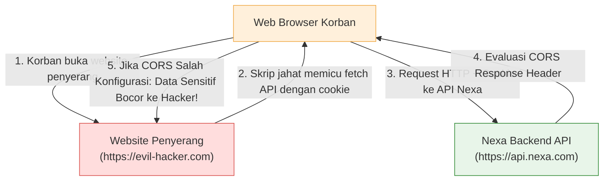

# 04. Cross-Origin Resource Sharing (CORS) Policy & Origin Defense

## 1. Masalah yang Terjadi (Vulnerability Anatomy & Real-World Risks)

Secara bawaan (*default*), browser web menerapkan mekanisme keamanan fundamental yang disebut **Same-Origin Policy (SOP)**. 

Berdasarkan SOP, sebuah skrip JavaScript yang berjalan di website **A** (`https://evil-attacker.com`) dilarang keras oleh browser untuk membaca data hasil request dari website **B** (`https://api.nexa.com`).



### Vektor Serangan & Dampak Kesalahan Konfigurasi CORS:

1. **Eksploitasi Wildcard dengan Kredensial (`origin: *` + `credentials: true`):**
   * Jika server sembarangan mengizinkan semua origin (`*`) sambil mengaktifkan pertukaran cookie, penyerang dapat membuat situs phising yang memicu `fetch('/api/user/profile')` dan browser korban akan otomatis menyertakan cookie autentikasi. Data profil, alamat, dan keranjang belanja korban bisa dibaca oleh skrip penyerang.
2. **Kebocoran Origin `localhost` di Lingkungan Produksi:**
   * Jika server production masih mengizinkan `http://localhost:5173` atau `http://localhost:3000` di daftar `allowedOrigins`, script lokal di komputer penyerang atau malware di laptop korban dapat mengeksekusi request ke backend production dengan kredensial aktif.
3. **Badai Request Preflight Tanpa Caching (Preflight Flood):**
   * Setiap request non-simple (seperti request dengan header `Authorization`, `Content-Type: application/json`, atau method `PUT`/`DELETE`) mewajibkan browser mengirim request `OPTIONS` terlebih dahulu. Tanpa konfigurasi `maxAge`, lalu lintas request ke server membengkak 2x lipat hanya untuk negosiasi preflight.
4. **CORS Crash yang Menghasilkan HTTP 500 (Bukan 403):**
   * Melempar objek `new Error("CORS...")` standar tanpa status code menyebabkan Express menanggapinya sebagai *Internal Server Error (500)*. Ini mengotori log sistem dan membingungkan monitoring server seolah-olah terjadi kegagalan sistem fatal.

---

## 2. Solusi Best Practice (W3C & OWASP Standards)

Project ini menerapkan 6 pilar pertahanan CORS:

1. **Environment-Aware Whitelisting (Isolasi Total Localhost):**
   * Di mode development, origin lokal (`localhost:5173`, `localhost:3000`, `127.0.0.1:5173`) diizinkan untuk mempermudah pengerjaan frontend.
   * Di mode production, seluruh origin `localhost` **dihapus total**. Hanya domain produksi resmi (`env.CLIENT_URL`) dan subdomain terverifikasi yang boleh mengakses API.
2. **Dukungan Multi-Subdomain & Dynamic Whitelist:**
   * Menggunakan pola Regex dan variabel `ALLOWED_ORIGINS` (berbasis koma) agar storefront (`nexa.com`), dashboard admin (`admin.nexa.com`), dan staging preview (`staging.nexa.com`) dapat berkomunikasi tanpa perlu menulis hardcoded domain berulang kali.
3. **Pengendalian Kredensial Ketat (`credentials: true`):**
   * Pertukaran cookie `refreshToken` lintas domain hanya diizinkan untuk origin yang lolos seleksi ketat.
4. **Whitelist Explicit HTTP Methods & Headers:**
   * Membatasi method hanya pada `GET, POST, PUT, PATCH, DELETE, OPTIONS`.
   * Mendaftarkan custom headers aplikasi: `Authorization`, `Idempotency-Key`, `X-Idempotency-Key`, `x-csrf-token`.
5. **Preflight Caching Optimal (`maxAge: 86400` / 24 Jam):**
   * Menginstruksikan browser untuk menyimpan hasil preflight selama 24 jam sehingga penjelajahan katalog dan checkout menjadi jauh lebih instan.
6. **Error Handling 403 Forbidden yang Bersih:**
   * Origin yang tidak dikenal ditolak dengan status HTTP **`403 Forbidden`** via `AppError`, bukan memicu crash 500.

---

## 3. Implementasi Nyata di Codebase Project

Penerapan CORS terpusat di [`backend/src/app.ts`](file:///home/allrole/Documents/Learning/Streetwear%20|%20E-commerce%20Project/backend/src/app.ts#L67-L115) dan didukung oleh validasi konfigurasi di [`backend/src/config/env.ts`](file:///home/allrole/Documents/Learning/Streetwear%20|%20E-commerce%20Project/backend/src/config/env.ts#L39-L40):

### Kode Implementasi di [`backend/src/app.ts`](file:///home/allrole/Documents/Learning/Streetwear%20|%20E-commerce%20Project/backend/src/app.ts):

```typescript
// backend/src/app.ts

// 1. Parsing Origin Tambahan dari Environment Variable
const parseExtraOrigins = (originsStr?: string): string[] => {
  if (!originsStr) return [];
  return originsStr.split(",").map((o) => o.trim()).filter(Boolean);
};

const extraOrigins = parseExtraOrigins(env.ALLOWED_ORIGINS);

// 2. Pemisahan Ketat Daftar Whitelist Berdasarkan Lingkungan
const allowedOrigins: (string | RegExp)[] =
  env.NODE_ENV === "production"
    ? [
        env.CLIENT_URL, // Domain storefront produksi
        ...extraOrigins, // Domain admin / staging dari env
        /^https:\/\/([a-z0-9-]+\.)?nexa\.com$/, // Regex subdomain resmi nexa.com
      ].filter(Boolean)
    : [
        env.CLIENT_URL,
        ...extraOrigins,
        "http://localhost:5173",
        "http://localhost:3000",
        "http://localhost:4173",
        "http://127.0.0.1:5173",
      ].filter(Boolean);

// 3. Pemasangan Middleware CORS dengan Status 403 Forbidden
app.use(
  cors({
    origin: (origin, callback) => {
      // Izinkan request tanpa origin (mobile app native, curl terminal, webhook Midtrans server-to-server)
      if (!origin) {
        return callback(null, true);
      }

      // Evaluasi apakah origin cocok dengan string exact atau regex pattern
      const isAllowed = allowedOrigins.some((allowed) => {
        if (allowed instanceof RegExp) {
          return allowed.test(origin);
        }
        return allowed === origin;
      });

      if (isAllowed) {
        callback(null, true);
      } else {
        // Tolak dengan 403 Forbidden terstandar (AppError), bukan 500 error
        callback(new AppError(`CORS policy violation: Origin '${origin}' is not allowed`, 403));
      }
    },
    credentials: true,
    methods: ["GET", "POST", "PUT", "PATCH", "DELETE", "OPTIONS"],
    allowedHeaders: [
      "Content-Type",
      "Authorization",
      "Idempotency-Key",
      "X-Idempotency-Key",
      "x-csrf-token",
      "csrf-token",
    ],
    exposedHeaders: ["X-Idempotent-Replay", "X-Cache", "X-RateLimit-Limit", "X-RateLimit-Remaining"],
    maxAge: 86400, // Preflight cache 24 jam
  })
);
```

---

## 4. Bedah Perbandingan: Sebelum vs Sesudah Hardening

| Parameter | Sebelum Perbaikan ❌ | Sesudah Hardening (Sekarang) ✅ |
|:---|:---|:---|
| **Isolasi Localhost** | `localhost:5173` tetap diizinkan di production | `localhost` **dihapus 100%** di production |
| **Status Penolakan** | Melempar status HTTP `500 Internal Error` | Melempar status HTTP **`403 Forbidden`** via `AppError` |
| **Dukungan Subdomain** | Harus hardcode satu per satu string URL | Mendukung pola **Regex** (`/^https:\/\/.*\.nexa\.com$/`) |
| **Multi-Origin Config** | Hanya 1 URL dari `env.CLIENT_URL` | Mendukung daftar koma via `env.ALLOWED_ORIGINS` |
| **Preflight Cache** | 24 Jam (`maxAge: 86400`) | 24 Jam (`maxAge: 86400`) |
| **Request Non-Browser** | Diizinkan (`!origin`) | Diizinkan (`!origin` untuk cURL/Midtrans Webhook) |

---

## 5. Simulasi Pengujian Keamanan (Security Verification)

### Skenario A: Request dari Origin Sah (Frontend Toko Sendiri)
* **Request:**
  ```http
  GET /api/products HTTP/1.1
  Host: localhost:5000
  Origin: http://localhost:5173
  ```
* **Hasil Evaluasi:**
  * Origin `http://localhost:5173` ada di dalam whitelist development.
  * Server mengembalikan header respons:
    ```http
    Access-Control-Allow-Origin: http://localhost:5173
    Access-Control-Allow-Credentials: true
    ```
  * Browser berhasil membaca data produk katalog.

### Skenario B: Request dari Origin Ilegal / Penyerang
* **Request:**
  ```http
  GET /api/cart HTTP/1.1
  Host: localhost:5000
  Origin: https://evil-malicious-site.com
  ```
* **Hasil Evaluasi:**
  * Origin tidak cocok dengan `allowedOrigins`.
  * Server langsung menolak request dengan status **`HTTP 403 Forbidden`**:
    ```json
    {
      "status": "fail",
      "message": "CORS policy violation: Origin 'https://evil-malicious-site.com' is not allowed",
      "errors": null
    }
    ```
  * Browser memblokir payload dan data keranjang belanja pelanggan **100% aman terlindungi**.

---

## 6. Developer CORS Checklist

Sebelum mendeploy aplikasi ke server staging atau production:

- [x] **Zero Localhost in Production:** Tidak ada URL `localhost` atau port lokal yang lolos ke environment production.
- [x] **Proper Error Code:** Pelanggaran origin ditolak dengan `403 Forbidden`, bukan crash 500.
- [x] **Credentials Protection:** `credentials: true` hanya disandingkan dengan domain terverifikasi, bukan `*`.
- [x] **Preflight Caching:** Parameter `maxAge` aktif minimal 12–24 jam untuk mereduksi beban server.
- [x] **Headers Whitelist:** Seluruh custom headers aplikasi (`Authorization`, `Idempotency-Key`, `x-csrf-token`) terdaftar di `allowedHeaders`.
- [x] **Exposed Headers:** Header custom yang dibutuhkan frontend terdaftar di `exposedHeaders`.

---

## Review Senior Backend: Analisis Gap & Batasan Mentok Implementasi

### Status Saat Ini:
* CORS policy environment-aware telah aktif, melarang wildcard `*` dengan credentials, menolak origin asing dengan status terstruktur `403 Forbidden`, dan mengoptimalkan request OPTIONS dengan preflight caching 24 jam.

### Hal yang Belum Diimplementasikan (Menuju Standar Tertinggi / Batasan Mentok):
1. **Sec-Fetch Metadata Headers Guard (W3C Fetch Metadata):**  
   CORS hanya dievaluasi jika browser mengirimkan header `Origin`. Batasan mentok pertahanan lintas domain adalah membaca header metadata browser modern:
   ```typescript
   if (req.headers["sec-fetch-site"] === "cross-site" && req.method !== "GET") {
     throw new AppError("Cross-site request blocked by Fetch Metadata policy", 403);
   }
   ```
2. **Subdomain Hijack Defense (Origin Pinning on Sensitive Mutations):**  
   Regex subdomain `/^https:\/\/([a-z0-9-]+\.)?nexa\.com$/` mengizinkan seluruh subdomain resmi. Jika suatu saat ada subdomain marketing WordPress pihak ketiga (`blog.nexa.com`) yang dibobol, subdomain tersebut bisa memanggil API admin. Batasan mentoknya adalah mengunci endpoint sensitif (`/api/orders`, `/api/payments`) hanya untuk origin tertentu (`admin.nexa.com` dan `nexa.com`).
