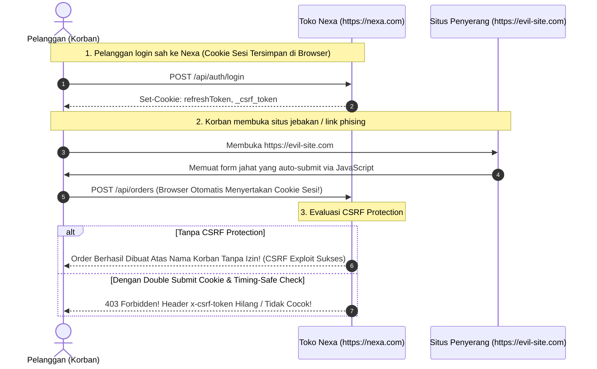
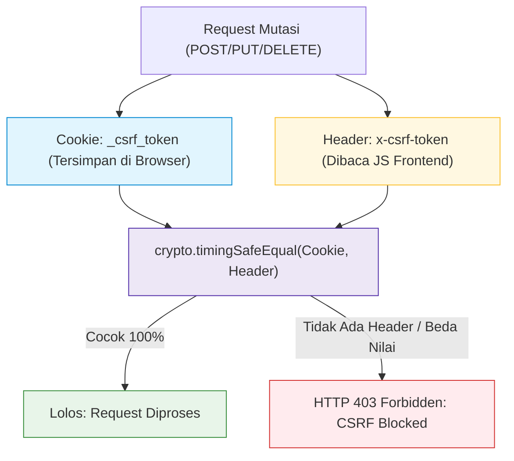

# 09. Cross-Site Request Forgery (CSRF) Protection & Cookie Defense

## 1. Masalah yang Terjadi (Vulnerability Anatomy & Real-World Risks)

**Cross-Site Request Forgery (CSRF)** adalah serangan yang memaksa browser korban yang telah terotentikasi untuk mengeksekusi perintah yang tidak diinginkan pada aplikasi web target.

Serangan ini mengeksploitasi perilaku alami browser: **browser akan secara otomatis menyertakan seluruh cookie yang tersimpan untuk sebuah domain setiap kali melakukan request ke domain tersebut**, terlepas dari mana request itu berasal.



### Vektor Serangan Nyata pada E-Commerce:

1. **Manipulasi Alamat Pengiriman (*Shipping Hijacking*):**
   * Penyerang membuat form tersembunyi yang melakukan `POST /api/addresses` dengan alamat rumah penyerang. Ketika korban membuka situs penyerang, alamat baru ditambahkan ke akun korban.
2. **Pembelian / Pembuatan Pesanan Palsu:**
   * Memaksa browser korban mengirim request checkout produk tanpa persetujuan sadar dari korban.
3. **Penggantian Password / Email Akun:**
   * Memicu permintaan pergantian kredensial akun korban untuk mengambil alih akun secara permanen.

---

## 2. Solusi Best Practice (The Double-Submit Cookie Pattern)

Untuk mematikan serangan CSRF secara total, project **Nexa Streetwear** menerapkan strategi **Pertahanan Ganda (*Dual Defense*)**:

### Pilar 1: Atribut Cookie `SameSite` Modern
Seluruh cookie kredensial dikonfigurasi dengan atribut:
* `SameSite=Strict`: Untuk cookie autentikasi utama (`refreshToken`), cookie **tidak akan pernah dikirimkan** jika request berasal dari situs eksternal.
* `SameSite=Lax`: Untuk cookie pengenal sesi browsing, cookie hanya dikirimkan pada navigasi aman tingkat atas (seperti klik tautan GET dari hasil pencarian Google), tetapi diblokir pada request mutasi (POST/PUT/DELETE) lintas domain.

### Pilar 2: The Double Submit Cookie Pattern
Mekanisme ini bekerja dengan memisahkan dua saluran pengiriman token:



1. Server menyetel cookie acak `_csrf_token` (non-HttpOnly agar bisa dibaca oleh JavaScript frontend).
2. Ketika frontend melakukan request mutasi, interceptor Axios membaca nilai cookie tersebut dan menyalinnya ke dalam header HTTP `x-csrf-token`.
3. Server memvalidasi apakah nilai di dalam **Header** identik dengan nilai di dalam **Cookie**.
4. **Mengapa Pola Ini Aman?**
   * Berdasarkan aturan *Same-Origin Policy (SOP)* browser, situs penyerang (`https://evil-site.com`) **DILARANG KERAS** membaca cookie milik `https://nexa.com`.
   * Akibatnya, penyerang tidak akan pernah tahu isi token CSRF tersebut dan tidak bisa menyertakan header `x-csrf-token` yang valid!

---

## 3. Implementasi Nyata di Codebase Project

### A. Middleware Anti-CSRF di [`backend/src/middleware/csrfMiddleware.ts`](file:///home/allrole/Documents/Learning/Streetwear%20|%20E-commerce%20Project/backend/src/middleware/csrfMiddleware.ts)

```typescript
// backend/src/middleware/csrfMiddleware.ts
export const csrfProtection = (req: Request, res: Response, next: NextFunction) => {
  // 1. Inisialisasi Cookie CSRF jika belum ada
  let token = req.cookies[CSRF_COOKIE_NAME];
  if (!token) {
    token = crypto.randomBytes(32).toString("hex");
    res.cookie(CSRF_COOKIE_NAME, token, {
      httpOnly: false, // Dibuat false agar Axios frontend bisa membaca token
      secure: env.NODE_ENV === "production",
      sameSite: "lax",
    });
  }

  // 2. Request GET, HEAD, OPTIONS aman secara alami (Idempotent)
  if (["GET", "HEAD", "OPTIONS"].includes(req.method)) {
    return next();
  }

  // 3. Endpoint autentikasi awal (login/register) dikecualikan
  const isAuthRoute =
    req.path.includes("/auth/login") ||
    req.path.includes("/auth/register") ||
    req.path.includes("/auth/refresh") ||
    req.path.includes("/auth/google");

  if (isAuthRoute) {
    return next();
  }

  // 4. Request dengan Authorization: Bearer <token> murni kebal dari CSRF
  // (karena browser tidak pernah otomatis mengirim Bearer token)
  if (req.headers.authorization && req.headers.authorization.startsWith("Bearer ")) {
    return next();
  }

  // 5. Validasi Header vs Cookie secara Timing-Safe
  const headerToken = (req.headers[CSRF_HEADER_NAME] || req.headers["csrf-token"]) as string | undefined;

  const isMatch = Boolean(
    headerToken &&
    token &&
    headerToken.length === token.length &&
    crypto.timingSafeEqual(Buffer.from(headerToken), Buffer.from(token))
  );

  if (!isMatch) {
    return res.status(403).json({
      status: "fail",
      message: "CSRF token validation failed. Invalid or missing CSRF token.",
    });
  }

  next();
};
```

---

### B. Otomatisasi Header di Frontend Axios ([`frontend/src/shared/services/api.ts`](file:///home/allrole/Documents/Learning/Streetwear%20|%20E-commerce%20Project/frontend/src/shared/services/api.ts#L38-L47))

Frontend secara transparan membaca cookie `_csrf_token` dan menyematkannya pada setiap request API:

```typescript
// frontend/src/shared/services/api.ts
API.interceptors.request.use((config: InternalAxiosRequestConfig) => {
  // Otomatis sertakan token CSRF jika ada di cookie browser
  if (typeof document !== "undefined" && config.headers) {
    const csrfCookie = document.cookie
      .split("; ")
      .find((row) => row.startsWith("_csrf_token="));
    if (csrfCookie) {
      config.headers["x-csrf-token"] = decodeURIComponent(csrfCookie.split("=")[1]);
    }
  }
  return config;
});
```

---

## 4. Simulasi Pengujian Keamanan (Security Verification)

### Skenario A: Transaksi Sah dari Web Nexa Sendiri
* **Request:** `POST /api/cart/items`
* **Header:** `x-csrf-token: e3b0c44298fc1c149afbf4c8996fb92427ae41e4649b934ca495991b7852b855`
* **Cookie:** `_csrf_token=e3b0c44298fc1c149afbf4c8996fb92427ae41e4649b934ca495991b7852b855`
* **Hasil:** Nilai header identik dengan cookie via `crypto.timingSafeEqual`. Request diproses sukses (`HTTP 201 Created`).

### Skenario B: Serangan CSRF dari Situs Jahat (`https://evil-site.com`)
* **Request:** `POST /api/orders` (Browser otomatis melampirkan cookie `_csrf_token` milik Nexa).
* **Header:** *Kosong (karena skrip jahat tidak bisa membaca cookie domain nexa.com)*.
* **Hasil:** Middleware mendeteksi header `x-csrf-token` tidak ada.
* **Respon:** Server menolak dengan **`HTTP 403 Forbidden`**:
  ```json
  {
    "status": "fail",
    "message": "CSRF token validation failed. Invalid or missing CSRF token."
  }
```
* **Dampak:** Serangan CSRF gagal total, uang dan akun pelanggan terlindungi 100%.

---

## 5. Developer CSRF Checklist

- [x] **Double-Submit Pattern:** Cookie `_csrf_token` dicocokkan dengan header `x-csrf-token`.
- [x] **Timing-Safe Comparison:** Verifikasi token menggunakan `crypto.timingSafeEqual` untuk mencegah kebocoran side-channel.
- [x] **SameSite Attributes:** Cookie sensitif di-set dengan `SameSite=Strict` atau `SameSite=Lax`.
- [x] **Exempt Safe Methods:** Method baca yang aman (GET, HEAD, OPTIONS) dikecualikan dari pengecekan CSRF.
- [x] **Exempt Pure Bearer:** Request berbasis `Authorization: Bearer` dilewatkan secara aman.
- [x] **CORS Integration:** Header `x-csrf-token` terdaftar dalam `allowedHeaders` di konfigurasi CORS backend.

---

## 6. Evaluasi & Gap Analysis Standar Industri (Batasan Mentok)

Sebagai Senior Backend Engineer, berikut adalah hasil audit komparatif antara benteng pertahanan CSRF dan cookie saat ini dengan standar industri perbankan dan enterprise e-commerce:

### A. Komponen yang Sudah Teruji & Solid (Production-Ready)
1. **Double Submit Cookie Pattern:** Implementasi pencocokan header `x-csrf-token` dengan cookie browser telah menutup celah eksploitasi form cross-origin secara efektif.
2. **Timing-Safe Protection:** Verifikasi token menggunakan `crypto.timingSafeEqual` kebal dari serangan *timing attack* side-channel.
3. **Pengecualian Cerdas (Smart Exemption):** Request stateless dengan header `Authorization: Bearer` serta method idempotent (GET/HEAD) dilewatkan secara terukur tanpa merusak developer experience.

### B. Gap Analysis: Hal yang Belum Diterapkan Menuju "Batasan Mentok"

| Mekanisme Pertahanan CSRF & Cookie | Kondisi Saat Ini di Codebase | Standar Batasan Mentok (Enterprise Grade) | Dampak & Urgensi |
| :--- | :--- | :--- | :--- |
| **Origin & Referer Header Verification** | Mengandalkan token matching tanpa memvalidasi header `Origin` / `Referer`. | Memvalidasi header `req.headers.origin` pada setiap request mutasi (POST/PUT/DELETE) harus identik dengan domain resmi server. | **Tinggi (P1):** Pertahanan lapis pertama yang sangat cepat (*Zero-CPU check*) direkomendasikan resmi oleh OWASP CSRF Prevention Cheat Sheet. |
| **Signed / Encrypted CSRF Tokens (HMAC Binding)** | Token CSRF berupa random string polos 32-byte yang tidak terikat ke user session. | Token ditandatangani menggunakan HMAC (`HMAC_SHA256(sessionId + timestamp, secret)`). | **Tinggi (P1):** Mencegah serangan *Subdomain Cookie Tossing*, di mana penyerang yang menguasai subdomain (misal blog.nexa.com) menimpa cookie `_csrf_token` milik root domain nexa.com. |
| **Cookie Prefixes (`__Host-` dan `__Secure-`)** | Nama cookie masih polos (`refreshToken`, `_csrf_token`). | Menggunakan prefix standar browser: `__Host-refreshToken` dan `__Secure-_csrf_token`. | **Sedang (P2):** Prefix `__Host-` memaksa browser menolak cookie jika tidak dikirim via HTTPS, menolak jika dikirim dari subdomain lain, dan mengunci path ke `/`. |
| **Sec-Fetch-Site Metadata Headers** | Belum membaca header proteksi browser modern `Sec-Fetch-*`. | Middleware mengecek `req.headers['sec-fetch-site'] === 'cross-site'` untuk langsung menolak request mutasi state tanpa membebani komputasi token. | **Sedang (P2):** Proteksi bawaan browser Chromium/Firefox generasi baru yang mematikan eksploitasi cross-site sebelum menyentuh logika aplikasi. |

### C. Rekomendasi Roadmap Implementasi
1. **Prioritas Terdekat (Origin Verification Guard):** Tambahkan pengecekan `req.headers.origin` pada [`backend/src/middleware/csrfMiddleware.ts`](file:///home/allrole/Documents/Learning/Streetwear%20|%20E-commerce%20Project/backend/src/middleware/csrfMiddleware.ts) untuk memastikan origin request mutasi berasal dari frontend terdaftar.
2. **Prioritas Menengah (Adopsi `__Host-` Prefix):** Perbarui penamaan cookie sesi di auth controller menjadi `__Host-refreshToken` pada environment production.
