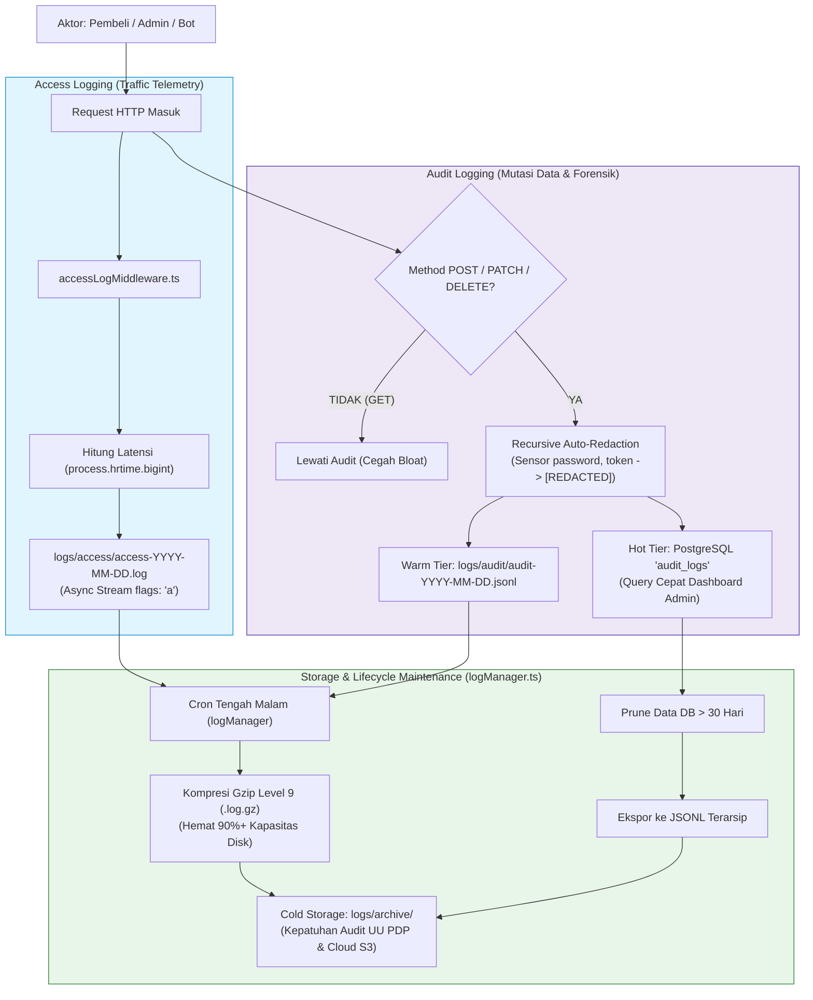

# 11. Log Aggregation, Access Logging & Security Audit Monitoring

Dokumen ini membedah arsitektur terpadu sistem pencatatan log di project **Nexa Streetwear**, menggabungkan **Access Logging** (telemetri lalu lintas HTTP dan performa latensi), **Security Audit Logging** (akuntabilitas mutasi data dan forensik keamanan), serta strategi **Log Aggregation, Storage Management, dan Pemantauan Terpusat**.

---

## 1. Anatomi Sistem Logging: Access Log vs Audit Log

Dalam sistem e-commerce bernilai tinggi, ada dua kebutuhan pencatatan log yang memiliki tujuan dan karakteristik yang sangat berbeda:

```
+---------------------------------------------------------------------------------+
|                       DUAL LOGGING PIPELINE DI NEXA STREETWEAR                  |
|                                                                                 |
| 1. ACCESS LOG (Network Traffic Telemetry)                                       |
|    - Target: SEMUA request HTTP (GET, POST, static images, error 404/500).     |
|    - Tujuan: Visibilitas performa jaringan, latensi endpoint, & anomali traffic.|
|    - Media: Asynchronous Append-Only File Stream (.jsonl) + Kompresi Gzip.     |
|                                                                                 |
| 2. AUDIT LOG (Security & Data Accountability)                                    |
|    - Target: HANYA request mutasi data bisnis (POST, PUT, PATCH, DELETE).       |
|    - Tujuan: Jejak forensik (siapa mengubah apa, kapan, dan nilai sebelumnya).  |
|    - Proteksi: Recursive Auto-Redaction (sensor password, token, cvv, OTP).     |
|    - Media: Dual-Tier (Hot PostgreSQL 'audit_logs' + Warm JSONL Stream).        |
+---------------------------------------------------------------------------------+
```

### Jebakan Fatal Arsitektur: "The Database Bloat Trap"
Kesalahan umum adalah **mencatat seluruh request HTTP (Access Log) langsung ke dalam tabel database PostgreSQL**.
* Jika ada 2.000 hit per detik pada katalog dan foto produk, database dipaksa melakukan 2.000 `INSERT` per detik hanya untuk log.
* Akibatnya: Ukuran database membengkak puluhan Gigabyte (*table bloat*), connection pool habis, dan proses checkout pembeli menjadi lambat (*I/O starvation*).

**Solusi di Nexa:** Memisahkan media penyimpanan. Access log dialirkan secara asinkron ke berkas disk lokal dengan kompresi Gzip harian, sementara Audit log mutasi penting disimpan di database dengan retensi terkontrol (30 hari).

---

## 2. Alur Arsitektur Log Aggregation & Telemetri



---

## 3. Fitur Keamanan Kritis: Zero Secret Exposure (Auto-Redaction)

Ketika sistem mencatat payload body pengguna, data sensitif tidak boleh dibiarkan lolos dalam bentuk teks polos (*plaintext*).

Di [`backend/src/middleware/auditLogMiddleware.ts`](file:///home/allrole/Documents/Learning/Streetwear%20|%20E-commerce%20Project/backend/src/middleware/auditLogMiddleware.ts#L46-L73), sistem menjalankan fungsi penyensoran rekursif:
```typescript
const SENSITIVE_KEYS = [
  "password",
  "token",
  "access_token",
  "refresh_token",
  "secret",
  "two_factor_secret",
  "otp",
  "cvv",
  "card_number"
];
```
Setiap kunci di atas—bahkan jika berada di dalam objek bersarang (*nested JSON*) atau array—secara otomatis diubah nilainya menjadi string **`"[REDACTED]"`**. Hasilnya, file log dan database audit aman 100% dari kebocoran data rahasia (*zero credential leak*).

---

## 4. Implementasi Nyata di Codebase Nexa Streetwear

Sistem logging Nexa Streetwear diatur oleh 3 modul utama:

### A. Access Logging Telemetri Asinkron: [`backend/src/middleware/accessLogMiddleware.ts`](file:///home/allrole/Documents/Learning/Streetwear%20|%20E-commerce%20Project/backend/src/middleware/accessLogMiddleware.ts)
Merekam setiap request HTTP dengan presisi nanodetik tanpa memblokir CPU aplikasi:

```typescript
export const accessLogger = () => {
  return (req: Request, res: Response, next: NextFunction) => {
    const startTime = process.hrtime.bigint();

    res.on("finish", () => {
      const endTime = process.hrtime.bigint();
      const latencyMs = Number(endTime - startTime) / 1_000_000;

      const logEntry = JSON.stringify({
        timestamp: new Date().toISOString(),
        ip: req.ip || req.socket.remoteAddress,
        method: req.method,
        url: req.originalUrl || req.url,
        statusCode: res.statusCode,
        latencyMs: Math.round(latencyMs * 100) / 100,
        userAgent: req.headers["user-agent"],
      }) + "\n";

      // Ditulis via WriteStream non-blocking sequential append
      const stream = getLogStream();
      stream.write(logEntry);
    });

    next();
  };
};
```

### B. Security Audit Logging Middleware: [`backend/src/middleware/auditLogMiddleware.ts`](file:///home/allrole/Documents/Learning/Streetwear%20|%20E-commerce%20Project/backend/src/middleware/auditLogMiddleware.ts)
Merekam mutasi data ke PostgreSQL dan file JSONL dengan auto-redaction:

```typescript
export const auditLogger = () => {
  return async (req: Request, res: Response, next: NextFunction) => {
    // Lewati jika request bertipe GET (hanya rekam mutasi data)
    if (req.method === "GET") {
      return next();
    }

    res.on("finish", async () => {
      if (res.statusCode >= 200 && res.statusCode < 400) {
        const sanitizedBody = redactSensitiveData(req.body);
        const userId = (req as any).user?.id || null;

        // 1. Tulis ke PostgreSQL audit_logs (Hot Storage)
        await prisma.audit_logs.create({
          data: {
            user_id: userId,
            action: `${req.method} ${req.baseUrl}${req.path}`,
            payload: sanitizedBody,
            ip_address: req.ip || "unknown",
            created_at: new Date(),
          },
        }).catch((err) => console.warn("Audit DB write error:", err));

        // 2. Tulis ke file JSONL lokal (Warm Storage)
        writeAuditStream(sanitizedBody);
      }
    });

    next();
  };
};
```

### C. Skrip Pengelolaan Siklus Hidup Log: [`backend/scripts/logManager.ts`](file:///home/allrole/Documents/Learning/Streetwear%20|%20E-commerce%20Project/backend/scripts/logManager.ts)
Menangani rotasi berkas, kompresi Gzip harian, dan *database pruning* otomatis:

```bash
# Periksa status seluruh direktori log
npm run logs:status

# Jalankan rotasi dan kompresi log harian ke format .gz
npm run logs:rotate

# Bersihkan data log PostgreSQL yang berusia lebih dari 30 hari
npm run logs:prune

# Jalankan seluruh rantai pemeliharaan log sekaligus
npm run logs:maintenance
```

---

## 5. Integrasi ke Centralized Log Aggregation (Loki / ELK / Promtail)

Untuk sistem produksi multi-server, file `.log` dan `.jsonl` yang dihasilkan oleh Nexa Streetwear dirancang menggunakan format **JSON Lines** standar, sehingga dapat langsung dikumpulkan (*scraped*) oleh agen pengumpul log:

```yaml
# Contoh konfigurasi Promtail (Grafana Loki Scraper):
clients:
  - url: http://loki.internal:3100/loki/api/v1/push

scrape_configs:
  - job_name: nexa-access-logs
    static_configs:
      - targets: [localhost]
        labels:
          job: nexa-access
          env: production
          __path__: /opt/nexa-streetwear/backend/logs/access/*.log

  - job_name: nexa-audit-logs
    static_configs:
      - targets: [localhost]
        labels:
          job: nexa-audit
          env: production
          __path__: /opt/nexa-streetwear/backend/logs/audit/*.jsonl
```

---

## 6. Cheatsheet CLI & Investigasi Forensik

```bash
# 1. Menampilkan 10 request paling lambat (Slow Requests) dari log hari ini
cat logs/access/access-$(date +%Y-%m-%d).log | jq -s 'sort_by(.latencyMs) | reverse | .[0:10]'

# 2. Mencari riwayat perubahan harga produk oleh admin di log audit
grep "PATCH /api/products" logs/audit/audit-$(date +%Y-%m-%d).jsonl | jq .

# 3. Memantau aliran log akses secara live
tail -f logs/access/access-$(date +%Y-%m-%d).log | jq .

# 4. Membaca log lawas yang telah terkompresi Gzip tanpa mengekstraknya
zcat logs/archive/access-2026-11-01.log.gz | grep "500"
```

---

## 7. Kesimpulan

Dengan mengintegrasikan **Access Logging Asinkron**, **Security Audit Logging Dual-Tier**, dan **Skrip Pemeliharaan `logManager.ts`**:
- Sistem memiliki visibilitas telemetri jaringan lengkap dan jejak forensik keamanan tanpa membebani database transaksional.
- Data sensitif pelanggan terlindungi dari kebocoran log berkat penyensoran otomatis *Recursive Auto-Redaction*.
- Kapasitas disk server terlindungi dari kepenuhan berkat kompresi otomatis Gzip harian (efisiensi storage >90%).
