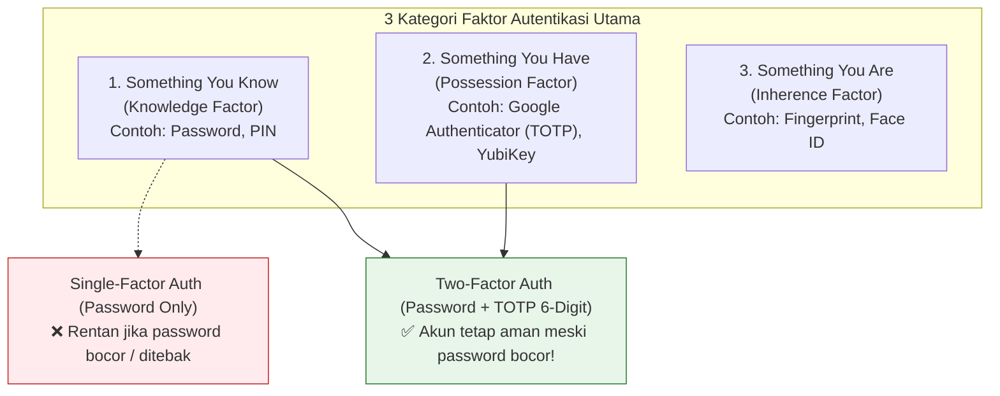
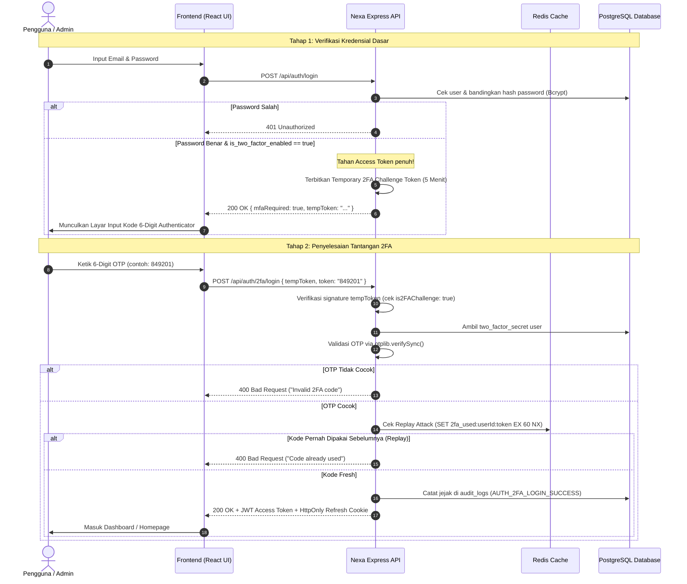

# 13. Multi-Factor Authentication (MFA / 2FA) & TOTP Architecture

## 1. Apa itu MFA dan 2FA? (The Anatomy of Authentication Factors)

**MFA (Multi-Factor Authentication)** adalah metode pengamanan akun yang mengharuskan pengguna menyajikan dua atau lebih bukti verifikasi (*faktor*) dari kategori yang berbeda sebelum diberikan akses ke dalam sistem.

**2FA (Two-Factor Authentication)** adalah bentuk MFA yang menggunakan tepat **dua faktor**.



### Mengapa Single-Factor (Hanya Password) Tidak Cukup?
1. **Kebocoran Data Pihak Ketiga (*Credential Stuffing*):** Banyak pengguna memakai password yang sama di berbagai situs. Jika situs lain bocor, akun toko Nexa mereka ikut terancam.
2. **Serangan Phishing:** Korban tanpa sadar mengetikkan password di situs tiruan.
3. **Keylogger & Malware:** Password bisa dicuri langsung dari perangkat korban.

Dengan 2FA aktif, meskipun penyerang mengetahui password korban, penyerang **tetap tidak bisa masuk** tanpa kode fisik 6-digit yang berganti setiap 30 detik di smartphone korban.

---

## 2. Cara Kerja TOTP (Time-based One-Time Password - RFC 6238)

Standar industri yang digunakan di Nexa Streetwear adalah **TOTP berbasis RFC 6238** (didukung aplikasi seperti *Google Authenticator*, *Microsoft Authenticator*, *Authy*, *1Password*):

1. **Shared Secret Generation:**  
   Saat pengguna mengaktifkan 2FA, server membuat kunci acak berbasis Base32 (misal: `JBSWY3DPEHPK3PXP`).
2. **QR Code Pairing (otpauth URI):**  
   Server mengemas secret ini ke dalam URI standar:  
   `otpauth://totp/Streetwear%20Store:user@email.com?secret=JBSWY3DPEHPK3PXP&issuer=Streetwear%20Store`  
   Smartphone pengguna memindai QR code ini.
3. **Perhitungan Matematis Offline (Sinkronisasi Waktu):**  
   Baik smartphone maupun server menghitung kode yang sama menggunakan waktu sistem saat ini tanpa memerlukan koneksi internet:
   $$\text{Counter } T = \left\lfloor \frac{\text{Current Timestamp} - T_0}{30 \text{ detik}} \right\rfloor$$
   $$\text{OTP} = \text{Truncate}(\text{HMAC-SHA1}(\text{Secret}, T)) \pmod{10^6}$$
4. **Jendela Waktu 30 Detik:**  
   Kode 6-digit berganti otomatis setiap 30 detik.

---

## 3. Alur Autentikasi 2FA Nexa (2-Step Login Handshake)



---

## 4. Best Practice Keamanan 2FA (Hardening Guard)

Project **Nexa Streetwear** menerapkan 5 pilar perlindungan 2FA tingkat perbankan:

### 1. Two-Step Login Handshake (No Partial Session Leak)
Jika user mengaktifkan 2FA, endpoint `/api/auth/login` **tidak akan pernah** membocorkan access token atau refresh token. Sistem hanya memberikan *temporary challenge token* bertanda khusus `{ is2FAChallenge: true }` yang kedaluwarsa dalam 5 menit.

### 2. Anti-Brute-Force Rate Limiting
Kode OTP 6-digit hanya memiliki $1.000.000$ kemungkinan kombinasi. Seluruh endpoint `/api/auth/*` (termasuk `/2fa/verify` dan `/2fa/login`) dikunci oleh [`authLimiter`](file:///home/allrole/Documents/Learning/Streetwear%20|%20E-commerce%20Project/backend/src/app.ts#L60-L65) dengan batas maksimal **15 request per 15 menit per IP** untuk mencegah serangan tebakan otomatis.

### 3. Anti-Replay Protection via Redis
Penyerang yang menyadap lalu lintas jaringan (*Man-in-the-Middle*) mungkin mencoba mengirimkan kembali kode OTP yang baru saja digunakan. Di endpoint `/2fa/login`, sistem menandai kode yang sukses di Redis:
```typescript
const replayKey = `2fa_used:${userId}:${token}`;
const wasAlreadyUsed = await redis.set(replayKey, "1", "EX", 60, "NX");
if (!wasAlreadyUsed) {
  throw new AppError("This 2FA code has already been used.", 400);
}
```
Jika kode yang sama dikirimkan lagi dalam jendela 60 detik, request langsung ditolak!

### 4. Zero Secret Exposure & Recursive Redaction
Di [`backend/src/middleware/auditLogMiddleware.ts`](file:///home/allrole/Documents/Learning/Streetwear%20|%20E-commerce%20Project/backend/src/middleware/auditLogMiddleware.ts#L46-L73), kata kunci `token`, `secret`, `two_factor_secret`, dan `otp` otomatis disensor menjadi `[REDACTED]` agar tidak pernah bocor ke file log atau database audit.

### 5. Audit Logging Trail
Setiap event krusial 2FA dicatat ke database audit:
* `AUTH_2FA_SETUP`: Saat pengguna membuat QR Code baru.
* `AUTH_2FA_ENABLED`: Saat pengguna berhasil memverifikasi OTP pertama kali.
* `AUTH_2FA_LOGIN_SUCCESS`: Saat pengguna berhasil menyelesaikan login 2FA.
* `AUTH_2FA_DISABLED`: Saat pengguna menonaktifkan 2FA.

---

## 5. Implementasi Nyata di Codebase Project

### A. Dual-Channel Endpoint 2FA di [`backend/src/modules/auth/advancedAuth.routes.ts`](file:///home/allrole/Documents/Learning/Streetwear%20|%20E-commerce%20Project/backend/src/modules/auth/advancedAuth.routes.ts)

Sistem mendukung **2 Channel Verifikasi** sekaligus:

#### Channel 1: Google Authenticator (TOTP Offline)
1. **`POST /api/auth/2fa/setup` (Harus Login):** Menghasilkan Secret Base32 baru dan mengembalikan Data URL QR Code untuk dipindai Google Authenticator.
2. **`POST /api/auth/2fa/verify` (Harus Login):** Meminta kode 6-digit pertama dari ponsel untuk memverifikasi setup sebelum mengaktifkan 2FA.
3. **`POST /api/auth/2fa/login` (Publik / 2FA Handshake):** Menerima `tempToken` dan `token` 6-digit dari aplikasi authenticator.
4. **`POST /api/auth/2fa/disable` (Harus Login):** Membutuhkan kode OTP sah untuk menonaktifkan 2FA.

#### Channel 2: Email OTP (Fallback Tanpa Aplikasi)
5. **`POST /api/auth/2fa/email/request` (Publik):** Menghasilkan OTP 6-digit acak (`crypto.randomInt`), menyimpannya di Redis (TTL 5 menit), dan mengirimkannya ke email user via [`backend/src/services/emailService.ts`](file:///home/allrole/Documents/Learning/Streetwear%20|%20E-commerce%20Project/backend/src/services/emailService.ts). Memiliki proteksi cooldown 60 detik anti-spam.
6. **`POST /api/auth/2fa/email/verify` (Publik):** Memvalidasi kode OTP yang dikirim ke email, menghapus OTP dari Redis (anti-replay), dan menerbitkan JWT Access Token + HttpOnly Refresh Cookie.

### B. Two-Step Handshake di [`backend/src/modules/auth/auth.service.ts`](file:///home/allrole/Documents/Learning/Streetwear%20|%20E-commerce%20Project/backend/src/modules/auth/auth.service.ts#L48-L60)

```typescript
// backend/src/modules/auth/auth.service.ts
if (userData.is_two_factor_enabled) {
  // Akun mengaktifkan 2FA: Tahan sesi penuh dan berikan challenge token sementara (5 menit)
  const tempToken = generate2FATempToken(userData.id);
  return {
    mfaRequired: true,
    tempToken,
    user: { id: userData.id, email: userData.email },
  };
}
```

### C. Helper Token di [`backend/src/utils/token.ts`](file:///home/allrole/Documents/Learning/Streetwear%20|%20E-commerce%20Project/backend/src/utils/token.ts#L36-L63)

```typescript
// backend/src/utils/token.ts
export const generate2FATempToken = (userId: number): string => {
  return jwt.sign(
    { id: userId, is2FAChallenge: true },
    env.JWT_ACCESS_SECRET,
    { expiresIn: "5m", algorithm: "HS256" }
  );
};
```

---

## 6. Developer 2FA Security Checklist

- [x] **Time-based OTP Standard:** Menggunakan spesifikasi RFC 6238 dengan algoritma SHA1 dan jendela 30 detik via library `otplib`.
- [x] **Two-Step Login Handshake:** Tidak ada access token atau refresh token yang diterbitkan sebelum tantangan 2FA diselesaikan.
- [x] **Anti-Brute-Force Rate Limiting:** Seluruh endpoint verifikasi 2FA dilindungi `authLimiter`.
- [x] **Anti-Replay Lock:** Mencegah pemakaian berulang kode 6-digit yang sama via Redis `SET ... NX`.
- [x] **Scoped Temporary Token:** Token tantangan login hanya berlaku 5 menit dan tidak bisa disalahgunakan sebagai access token API.
- [x] **Audit Trail Coverage:** Seluruh siklus hidup 2FA (Setup, Verify, Login, Disable) tercatat rapi di tabel `audit_logs`.
- [x] **Backward Compatible:** Pengguna lama yang belum mengaktifkan 2FA tetap bisa login seperti biasa secara mulus.

---

## 7. Evaluasi & Gap Analysis Standar Industri (Batasan Mentok)

Sebagai Senior Backend Engineer, berikut adalah hasil audit mendalam terhadap implementasi MFA/2FA Nexa dibanding standar keamanan autentikasi NIST SP 800-63B (Authenticator Assurance Level 2 & 3):

### A. Komponen yang Sudah Teruji & Solid (Production-Ready)
1. **Two-Step Login Handshake:** Penahanan sesi token secara penuh menggunakan temporary challenge token (`is2FAChallenge: true`, 5m TTL) memastikan tidak ada celah *partial authentication leak*.
2. **Dual-Channel Flexibility:** Tersedianya dua kanal independen (Google Authenticator RFC 6238 dan Email OTP via Redis) memberikan kemudahan akses tanpa mengorbankan keamanan.
3. **Redis Anti-Replay Guard:** Penguncian atomik `SET 2fa_used:userId:token EX 60 NX` efektif mematikan upaya penggunaan ulang kode OTP yang disadap di jaringan.

### B. Gap Analysis: Hal yang Belum Diterapkan Menuju "Batasan Mentok"

| Fitur / Arsitektur Autentikasi MFA | Kondisi Saat Ini di Codebase | Standar Batasan Mentok (Enterprise Grade / NIST AAL3) | Dampak & Urgensi |
| :--- | :--- | :--- | :--- |
| **Emergency Backup Recovery Codes** | Belum ada mekanisme pemulihan jika smartphone pelanggan hilang, rusak, atau ter-reset. | Saat aktivasi 2FA, sistem menerbitkan **8–10 kode pemulihan darurat 8-karakter** (*single-use*). Kode disimpan di database dalam bentuk hash Bcrypt dan langsung hangus setelah dipakai sekali. | **Tinggi (P1):** Jika pelanggan kehilangan ponselnya, mereka akan terkunci dari akun toko selamanya kecuali menghubungi tim support secara manual (beban operasional CS tinggi). |
| **Step-Up Authentication (In-Session MFA Challenge)** | 2FA hanya ditanyakan di gerbang login awal. Setelah login, seluruh aksi diizinkan tanpa tantangan ulang. | Mewajibkan verifikasi ulang 2FA (*Step-Up MFA*) untuk aksi sensitif: ganti email, ganti password, perubahan alamat kirim utama, atau checkout transaksi bernilai fantastis (> Rp 5.000.000). | **Tinggi (P1):** Jika penyerang berhasil mencuri laptop pelanggan yang sedang dalam posisi login aktif (*session hijacking*), penyerang tetap tidak bisa mengubah password atau membajak dana. |
| **WebAuthn / Passkeys (FIDO2 Hardware Keys)** | Bertumpu pada TOTP 6-digit dan Email OTP. | Mendukung standar **FIDO2 / WebAuthn** (Face ID, Touch ID, Windows Hello, YubiKey fisik). | **Sedang (P2):** TOTP 6-digit masih rentan terhadap *Adversary-in-the-Middle (AitM) Phishing Proxy* (seperti tools Evilginx). FIDO2 Passkeys kebal 100% dari phising karena kunci privat terikat langsung pada origin domain browser (*origin-bound*). |
| **Trusted Device Remembering ("Ingat Perangkat Ini Selama 30 Hari")** | Pengguna wajib mengetik 6-digit OTP pada setiap kali sesi login habis. | Opsi *Remember This Device* yang menerbitkan token perangkat terenkripsi di cookie (*Device Fingerprint Token*) untuk melewati 2FA hanya pada perangkat yang sama selama 30 hari. | **Sedang (P2):** Meningkatkan kenyamanan pengguna (*user experience*) tanpa mengurangi keamanan secara signifikan. |
| **SMS OTP Defense (SIM-Swap & Anti-Pumping Protection)** | Kanal SMS sengaja tidak diaktifkan karena risiko SIM Swapping dan biaya tinggi. | Jika di masa depan SMS OTP diaktifkan, wajib dilengkapi deteksi *SIM-Swap API* (bekerja sama dengan operator seluler) dan proteksi *SMS Pumping Toll-Fraud* di rate limiter. | **Rendah (P3):** Mencegah pembengkakan tagihan SMS gateway akibat bot penipu nomor telepon luar negeri. |

### C. Rekomendasi Roadmap Implementasi
1. **Prioritas Terdekat (Backup Recovery Codes):** Buat tabel `user_backup_codes` di Prisma schema untuk menyimpan 8 kode recovery ber-hash Bcrypt yang bisa diunduh pelanggan sebagai PDF/TXT saat aktivasi 2FA.
2. **Prioritas Menengah (Step-Up Guard):** Pasang middleware `requireFresh2FA` pada endpoint mutasi kredensial pengguna (`PATCH /api/users/profile`).
