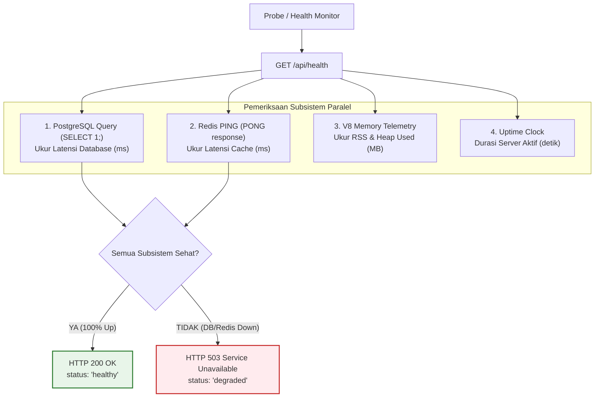

# 14. Health Checks & Deep System Probing

Dokumen ini membedah arsitektur **Health Checks & Deep Dependency Probing**, perbedaan mendasar antara *Shallow Ping* dan *Deep Probing*, perannya dalam proteksi ketersediaan sistem (*Availability & Fault Tolerance*), serta implementasi nyatanya di project **Nexa Streetwear**.

---

## 1. Mengapa Health Check Termasuk Bagian dari Sistem Security & Availability?

Dalam pilar keamanan informasi **CIA Triad** (*Confidentiality, Integrity, Availability*), pilar **Availability (Ketersediaan)** adalah syarat mutlak agar sistem e-commerce dianggap aman dan andal.

Penyerang dapat melumpuhkan sistem bukan hanya dengan membobol data, melainkan dengan memicu *denial-of-service* atau *connection pool starvation* yang membuat database berhenti merespons.

```
+---------------------------------------------------------------------------------+
| KASUS: DATABASE CRASH, TAPI PROSES NODE.JS MASIH HIDUP                          |
|                                                                                 |
| 1. Shallow Check (/ping):                                                       |
|    Klien: "Apakah port 5000 aktif?" -> Node.js: "200 OK!" (Menyesatkan!)        |
|    HASIL: Pembeli mengklik Bayar -> Error 500 Internal Server Error (Transaksi  |
|    Gagal & Uang Menggantung).                                                   |
|                                                                                 |
| 2. Deep Health Check (/api/health):                                             |
|    Node.js menguji: PostgreSQL (SELECT 1) + Redis (PING) + RAM.                 |
|    HASIL: Mengetahui PostgreSQL down -> Mengembalikan 503 Service Unavailable.  |
|    Load Balancer seketika mengisolasi server ini dan mengalihkan pembeli ke     |
|    server lain yang sehat!                                                      |
+---------------------------------------------------------------------------------+
```

### 3 Konsumen Utama Endpoint Health Check:
1. **Load Balancer (Nginx / AWS ALB):** Mengirim probe setiap 5–10 detik. Jika endpoint gagal merespons, Load Balancer tidak akan meneruskan trafik pembeli ke server tersebut (*Traffic Draining*).
2. **Container Orchestrator (Docker & Kubernetes):**
   * **Readiness Probe:** Memastikan Pod baru tidak menerima trafik sebelum database dan Redis terhubung.
   * **Liveness Probe:** Otomatis merestart kontainer jika proses membeku (*deadlock* atau *unhandled freeze*).
3. **Eksternal Uptime Monitor (UptimeRobot, BetterUptime, Datadog):** Memberikan peringatan instan (*Instant Alert*) ke Slack, Telegram, atau WhatsApp tim engineer saat terjadi gangguan sistem.

---

## 2. Anatomi Deep Health Check di Nexa Streetwear

Endpoint kesehatan Nexa diakses melalui **`GET /api/health`** dan memverifikasi seluruh subsistem vital secara asinkron:



### Semantik Status HTTP:
* **HTTP `200 OK` (Healthy):** Semua dependensi aktif. Layanan siap menerima transaksi pembeli.
* **HTTP `503 Service Unavailable` (Degraded):** Salah satu dependensi vital (PostgreSQL atau Redis) tidak dapat dihubungi. Load Balancer wajib menghentikan routing ke instance ini.

---

## 3. Best Practices Rekayasa Health Check

1. **Gunakan Query yang Paling Ringan:**  
   Gunakan query `SELECT 1;` untuk menguji database. Jangan pernah menjalankan `SELECT COUNT(*) FROM products` atau query tabel besar yang justru membebani CPU database saat probe berjalan setiap 5 detik.
2. **Kompensasi Batas Waktu Ketat (Strict Probe Timeout):**  
   Beri batas waktu kueri maksimal 2–3 detik. Jika database tidak merespons dalam 3 detik, anggap statusnya `down`.
3. **Bebas dari Autentikasi & Rate Limiting:**  
   Endpoint `/api/health` harus dapat diakses secara publik tanpa token JWT dan tidak boleh dibatasi oleh middleware rate limit agar probe otomatis tidak terblokir dengan status `429 Too Many Requests`.
4. **Zero Secret Leakage:**  
   Tampilkan status komponen (`up` / `down`) dan latensi milidetik, namun **dilarang menampilkan connection string, host IP internal, atau password database** di respons JSON.

---

## 4. Implementasi Nyata di Codebase Nexa Streetwear

### A. Endpoint Health Check Terstruktur: [`backend/src/modules/health/health.routes.ts`](file:///home/allrole/Documents/Learning/Streetwear%20|%20E-commerce%20Project/backend/src/modules/health/health.routes.ts)

```typescript
router.get("/health", async (_req: Request, res: Response) => {
  const startTime = Date.now();
  const checks: {
    database: { status: "up" | "down"; latencyMs?: number; error?: string };
    redis: { status: "up" | "down"; latencyMs?: number; error?: string };
  } = {
    database: { status: "down" },
    redis: { status: "down" },
  };

  let isHealthy = true;

  // 1. Uji Database PostgreSQL via Prisma
  const dbStart = Date.now();
  try {
    await prisma.$queryRaw`SELECT 1;`;
    checks.database = {
      status: "up",
      latencyMs: Date.now() - dbStart,
    };
  } catch (err: any) {
    isHealthy = false;
    checks.database = {
      status: "down",
      error: err.message || "Failed to query database",
    };
  }

  // 2. Uji Cache & Semaphore via Redis
  const redisStart = Date.now();
  try {
    const pong = await redis.ping();
    if (pong === "PONG") {
      checks.redis = {
        status: "up",
        latencyMs: Date.now() - redisStart,
      };
    } else {
      isHealthy = false;
      checks.redis = { status: "down", error: "Unexpected ping response" };
    }
  } catch (err: any) {
    isHealthy = false;
    checks.redis = {
      status: "down",
      error: err.message || "Failed to connect to Redis",
    };
  }

  // 3. Telemetri Memori Node.js & Durasi Aktif (Uptime)
  const memoryUsage = process.memoryUsage();
  const payload = {
    status: isHealthy ? "healthy" : "degraded",
    uptimeSeconds: Math.floor(process.uptime()),
    timestamp: new Date().toISOString(),
    totalResponseTimeMs: Date.now() - startTime,
    checks,
    system: {
      memory: {
        rssMB: Math.round(memoryUsage.rss / 1024 / 1024),
        heapUsedMB: Math.round(memoryUsage.heapUsed / 1024 / 1024),
        heapTotalMB: Math.round(memoryUsage.heapTotal / 1024 / 1024),
      },
      nodeVersion: process.version,
    },
  };

  return res.status(isHealthy ? 200 : 503).json(payload);
});
```

### B. Pengecualian dari Rate Limiting di Gateway: [`backend/src/app.ts`](file:///home/allrole/Documents/Learning/Streetwear%20|%20E-commerce%20Project/backend/src/app.ts#L155)
Rute `/api/health` ditempatkan sebelum rute bisnis dan tidak dibebani rate limit, sehingga Docker dan Kubernetes dapat melakukan pengecekan ribuan kali sehari tanpa hambatan.

---

## 5. Cheatsheet CLI & Pengujian Diagnostik

```bash
# 1. Menguji status kesehatan sistem via cURL
curl -i http://localhost:5000/api/health

# 2. Simulasi kegagalan subsistem (matikan Redis)
docker compose stop redis
curl -i http://localhost:5000/api/health
# Menghasilkan HTTP 503 Service Unavailable (status: "degraded")
```

---

## 6. Kesimpulan

Dengan menempatkan **Health Check & Deep Dependency Probing** sebagai bagian dari arsitektur pertahanan sistem:
- Load Balancer dan K8s dapat mengambil tindakan preventif otomatis sebelum pembeli terdampak gangguan transaksi.
- Degradasi performa database atau cache terdeteksi dalam hitungan detik.
- Menjamin pilar **Availability** toko online Nexa Streetwear tetap berada pada standar 99.9% uptime.
