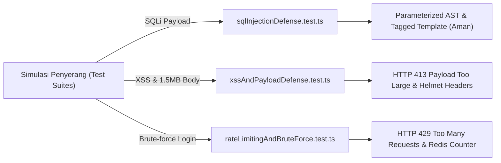

# Non-Functional Testing: Security Testing Architecture

Dokumen ini membedah arsitektur dan skenario pengujian keamanan siber (*Automated Security Testing*) pada backend **Nexa Streetwear**.

---

## 1. Filosofi & Pendekatan Security Testing

Security Testing di Nexa memastikan bahwa seluruh benteng keamanan aplikasi yang telah didokumentasikan di `docs/security/` tidak hanya ada di atas kertas, melainkan **terbukti secara otomatis menangkis serangan siber nyata** pada saat proses build & integrasi:



---

## 2. Cakupan Berkas Security Testing di Codebase

Pengujian keamanan mencakup 3 berkas dengan 8 skenario pengujian:

### 1. [sqlInjectionDefense.test.ts](file:///home/allrole/Documents/Learning/Streetwear%20|%20E-commerce%20Project/backend/test/non-functional/security/sqlInjectionDefense.test.ts)
* **Classic SQLi Bypass:** Menembakkan `' OR '1'='1` ke parameter query pencarian fuzzy produk `/api/products?search=...`. Memverifikasi bahwa server tidak crash (500) dan tidak membocorkan seluruh data tabel.
* **Destructive SQLi Injection:** Menembakkan payload perusak `'; DROP TABLE "users"; --`. Memverifikasi bahwa tabel `users` tetap 100% utuh di PostgreSQL karena string ditafsirkan sebagai nilai literil berkat *parameterized queries*.
* **Union-Based Leakage Defense:** Menembakkan payload `' UNION SELECT password, email FROM users --` ke filter kategori dan memverifikasi data sensitif tidak pernah bocor.

### 2. [xssAndPayloadDefense.test.ts](file:///home/allrole/Documents/Learning/Streetwear%20|%20E-commerce%20Project/backend/test/non-functional/security/xssAndPayloadDefense.test.ts)
* **HTTP Security Headers Verification:** Memverifikasi keberadaan header keamanan bawaan Helmet:
  - `X-Content-Type-Options: nosniff` (mencegah browser melakukan eksekusi file non-executable).
  - `X-Frame-Options: SAMEORIGIN / DENY` (mencegah serangan Clickjacking).
* **Payload Size Ceiling Defense (Anti-OOM DoS):** Mengirimkan request body JSON berukuran **1.5 Megabytes** ke endpoint autentikasi. Memverifikasi bahwa parser Express langsung memutus koneksi dengan status **`413 Payload Too Large`** sebelum memori V8 membengkak.
* **Cross-Site Scripting (XSS) Rejection:** Mengirimkan tag `<script>alert('XSS')</script>` pada input field dan memastikan schema Zod DTO menolak payload dengan format tidak valid (status 400/422).

### 3. [rateLimitingAndBruteForce.test.ts](file:///home/allrole/Documents/Learning/Streetwear%20|%20E-commerce%20Project/backend/test/non-functional/security/rateLimitingAndBruteForce.test.ts)
* **RateLimit Headers Compliance:** Memverifikasi kehadiran header standar RFC 6585 (`RateLimit-Limit` dan `RateLimit-Remaining`) pada setiap respon API.
* **Brute-Force Authentication Defense:** Memverifikasi bahwa endpoint login `/api/auth/login` memiliki limit traffic terpisah yang ketat (15 request per 15 menit per IP) untuk mematahkan serangan kamus password.

---

## 3. Cara Menjalankan

```bash
# Menjalankan seluruh Security Test Suite
npm run test:security
```
